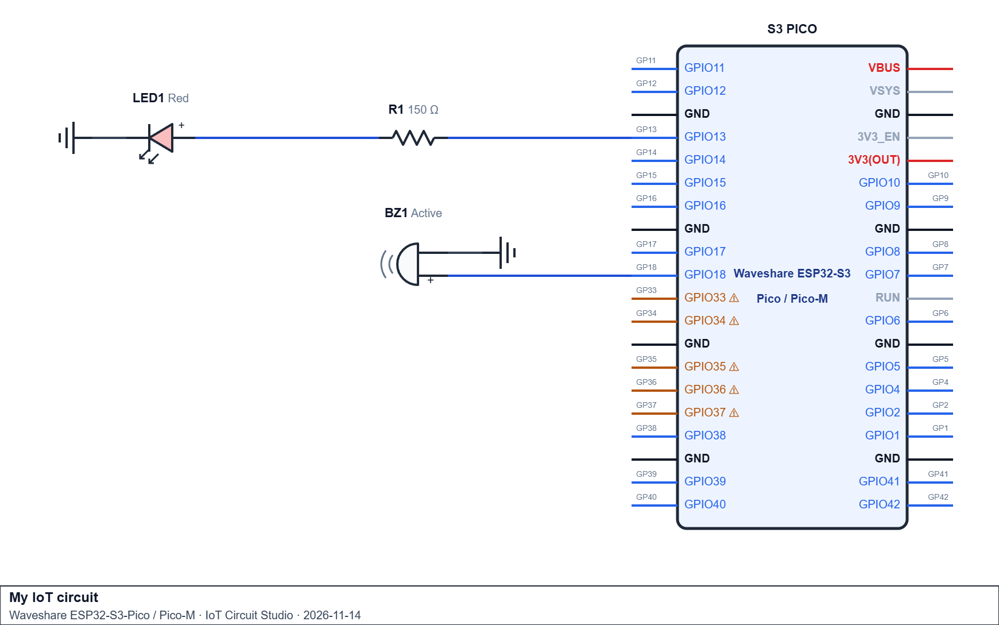
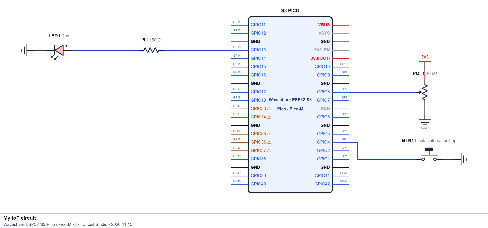
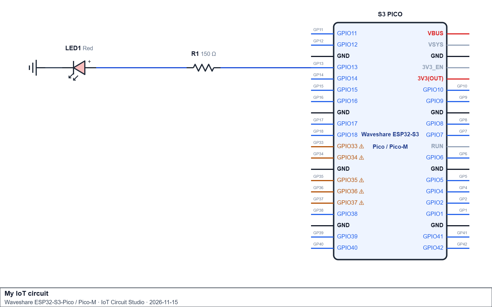
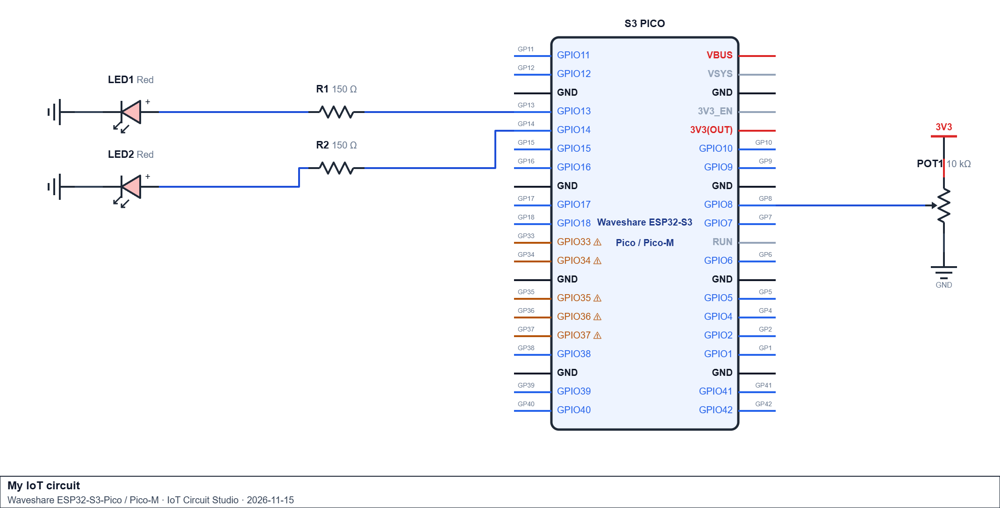

# Activity 10 (Access Point Mode) - Wi-Fi Access Point Mode in Depth

Work through these tasks after reading [Wi-Fi Modes - Access Point Mode (AP) in Depth](../Resource/Week-10-WiFi-Access-Point-Mode.md). Every task runs the ESP32-PICO in **Access Point mode**: it creates its own network, and you join it from your phone or laptop. No router or internet is needed.

> **Testing tip:** when your phone joins the ESP32-PICO's network it may warn "No internet connection". Choose **Stay connected** / **Use without internet**. Turning off mobile data while testing stops the phone quietly switching away.

> **Schematics:** for every task that has a circuit (Tasks 2-6), draw the schematic **before** you build it on the breadboard, using [Circuit Studio](https://circuit-studio.pages.dev/).
> - Include **every component** in that task's Components list.
> - **You choose the GPIO pins.** Fill in the task's **Your pin choices** table, draw those pins on your schematic, and use the same numbers as named constants in your code (e.g. `const int LAMP_LED = 27;`). All three must match.
> - Show the resistors, and connect every ground to GND.
> - When it's finished, use **Export → Schematic image** to save a picture and **Export → Share link** to get a link, and paste both into the Schematic box near the top of each task.

> **Pin rules for the ESP32-PICO** (a pin that breaks one of these rules can stop the sketch working, or stop the board booting):
> - **Analog inputs** (potentiometer) must use an **ADC1** pin: GPIO 32, 33, 34, 35, 36 or 39. ADC2 pins return nothing useful while the Wi-Fi radio is on, and that includes Access Point mode.
> - **Outputs** (LEDs, buzzer) can't use GPIO 34, 35, 36 or 39, because those are input-only.
> - **Never use** GPIO 6-11, 16 or 17 (wired to the ESP32-PICO's internal flash) or GPIO 1 and 3 (Serial TX/RX, which the Serial Monitor needs).
> - **Avoid the boot-mode (strapping) pins** GPIO 0, 2, 5, 12 and 15. Something connected to them can stop the board from booting or uploading.
> - **Safe choices** for digital parts (LEDs, buzzer, button): GPIO 4, 13, 14, 18, 19, 21, 22, 23, 25, 26, 27, 32, 33.
> - **Buttons** are wired between the GPIO and GND and use `INPUT_PULLUP`, so a press reads `LOW`.
> - **Check your board's pinout.** Not every GPIO is broken out to a header pin on every ESP32-PICO board.
> - **Within one task, every connection needs its own pin.**

> **Passwords:** every access point password must be **8-63 characters**. Use your own password while testing, but replace it with `"YOUR_AP_PASSWORD"` in the code you submit.

## Task 1 - A Configured, Uniquely Named Access Point

**Scenario:**

Twenty students are about to run access points in the same room. Every network needs a name nobody else will have, a limit on how many devices can join, and its own address range so nobody's phone ends up on the wrong board.

**Components:**

- ESP32-PICO development board (no circuit)

Write `String makeUniqueName()` that returns `"AP-<your initials>-"` followed by the last 4 characters of `WiFi.softAPmacAddress()` with the colon removed (e.g. `AP-JS-CDED`). In `setup()`:
- set `WiFi.mode(WIFI_AP)`, then start the access point with `WiFi.softAP(name, password, channel, hidden, maxClients)` using named constants `AP_CHANNEL = 11`, `AP_HIDDEN = 0` and `AP_MAX_CLIENTS = 2`
- check `softAP()`'s return value and print an error and stop if it's `false`
- move the access point to `192.168.20.1` with `WiFi.softAPConfig()`, checking its return value too
- print the SSID (`WiFi.softAPSSID()`), channel, client limit, IP address and MAC address

In `loop()`, every `REPORT_INTERVAL = 2000` ms (`millis()`, no `delay()`), check `WiFi.softAPgetStationNum()` and print `Devices connected: <n>` **only when the number has changed** since the last check.

Test it: join from two devices, then try a third. Finally, change the password to 7 characters, upload, and screenshot the error.

>
> Evidence: _(Serial Monitor screenshots of: the access point details, the device count going up to 2, and the 7-character password error; plus a phone screenshot showing your network in its Wi-Fi list and the third device being refused)_
>
>A copy of my code Activity 1: https://wokwi.com/projects/480650947608373249

**Check yourself:**
- [ ] Network name is `AP-<initials>-XXXX`, built from the MAC address in `makeUniqueName()`
- [ ] `softAP()` gets all five settings, in the right order, from named constants
- [ ] Both `softAP()` and `softAPConfig()` return values are checked
- [ ] The phone gets an address starting `192.168.20.`
- [ ] Device count printed only when it changes; `loop()` has no `delay()`
- [ ] A third device can't join
- [ ] A 7-character password produces your error message instead of a silent failure

---

## Task 2 - Join and Leave Monitor

**Scenario:**

A field technician wants to know who is connected to a remote pump controller. When a device joins, an LED should light and the buzzer should chirp; when the last device leaves, the LED goes out. Every join and leave is logged with the device's MAC address and the IP it was given.

**Components:**

- ESP32-PICO development board
- 1x LED
- 1x 220 Ω resistor
- 1x passive buzzer
- Jumper wires

> **Schematic:**
>
>[Finished Schematic](https://circuit-studio.pages.dev/#p=zfZRdb5swFIb_SvRemwoDy4fvtm6qom1ttHU3naKID4c6Bcxsk5RE-e-VWVogCrnE5_h9znvOMQespcpDAwYhjRMLFVfCONpUiZAg2HKlhSzAKEER5hwMP-vRXD6OTqkgiBUPDU_A4Lne2KHUocGjO2VuwILZDQ2mTyCoyuRy0oQF9GZCxzYpkqFK5jaJ69L3HO07pYhtHbHMS1nwwmiwvwcIm_OHgsDUpS2quQmCVzDqugQ12NglUNKAuQRZGPEMDL_90WJ--wCCUslSgx2Ow9QjOYHilZ7VkVqnLS_jJ5rjB_9x1Hvn0WmH-OPbV9rBIZaZVGBQPMGRYJ2JEmwdZpp3cK9Um3XiduxV-z1XJ2JDqsG8D6I36RC_PPWAL6KwomFsxJYPI6soGUevVYtMiw-HV3F39z2DgwDjPgs3iluA4lpoI89dUf9iH3_1TMnnXIPRT-4gzp9MEhnGl_wE9Hxis74fb9jPkmAnFO9s4W5VG67T2QYEYTPhsxGWYLi3jY_aaNttG13Y6Du_XbvdKq72-5SP-8ptI-1d70y53VQb_Tyk_K_Y-kW26yv3734_U247erVmtQ1l6m6u1Ux7ys0ztsd3i_kD9Yd0BZ_MXuT-WpcXV3Snfd0lQVxpI_NbmXCwosoyGy5S-1RUUonC_nUyEalQiWbcS4Ko0S5DZU6bsanykqvm43h8Aw)
>
>Activity 2: Join and Leave Monitor Schematic:
>
>
> <details><summary>Schematic link</summary>
>
> [Open the example schematic in Circuit Studio]()
>
> </details>
>
> **Your pin choices** (choose any suitable GPIO, following the pin rules, and use the same numbers in your schematic and your code):
>
> | Connection | Pin type needed | Your GPIO |
> |---|---|---|
> | Client LED (through the 220 Ω resistor; LED cathode → GND) | Digital output | GPIO 13 |
> | Passive buzzer + (buzzer − → GND) | Digital output (`tone()`) | GPIO 18 |

Write `onWiFiEvent(WiFiEvent_t event, WiFiEventInfo_t info)` that handles `ARDUINO_EVENT_WIFI_AP_STACONNECTED`, `ARDUINO_EVENT_WIFI_AP_STAIPASSIGNED` and `ARDUINO_EVENT_WIFI_AP_STADISCONNECTED` by **only** copying the MAC address or IP into `volatile` variables and setting `volatile` flags. Register it with `WiFi.onEvent()` before `WiFi.softAP()`. Write `String macToText(const volatile uint8_t* mac)`. In `loop()`, with no `delay()`:
- on a join: print `[JOIN] <mac> (total joins: <n>)` and start a **1000 Hz** chirp
- on an IP being assigned: print `[IP] <address>`
- on a leave: print `[LEAVE] <mac>` and start a **400 Hz** chirp
- every chirp lasts `CHIRP_DURATION = 100` ms, started with `tone()` and stopped by a separate function using `millis()` and `noTone()`
- the LED is on whenever `WiFi.softAPgetStationNum()` is more than 0

Test it by joining and leaving from two devices (switching a phone's Wi-Fi off counts as leaving).

>
> Evidence: _(video of the LED and chirps as two devices join and leave, plus a Serial Monitor screenshot of the log)_
>
>A copy of my code Activity 2: https://wokwi.com/projects/480655635057231873

**Check yourself:**
- [ ] Pin table filled in with pins that follow the pin rules, and the same pins used in both the schematic and the code constants
- [ ] Schematic drawn in Circuit Studio using every component listed above, pasted into the Schematic box with its share link
- [ ] Event function only copies data and sets `volatile` flags; all printing and sound happens in `loop()`
- [ ] `WiFi.onEvent()` registered before `WiFi.softAP()`
- [ ] MAC addresses printed as `XX:XX:XX:XX:XX:XX`, and each join shows the IP that was given out
- [ ] Join and leave chirps are different pitches and last 100 ms, with no `delay()`
- [ ] LED stays on until the **last** device leaves

---

## Task 3 - Web Form Control: Classroom Fan Speed

**Scenario:**

A teacher wants to set a classroom fan's speed from their phone as a percentage. The LED stands in for the fan: its brightness shows the speed. Students will try typing silly values into the address bar, so every value must be checked.

**Components:**

- ESP32-PICO development board
- 1x LED
- 1x 220 Ω resistor
- Jumper wires

> **Schematic:**
>
>[Finished Schematic](https://circuit-studio.pages.dev/#p=zjdJdb5swFAbgvxK916aygaSJ76Z2qqJ9NNqym01RZMClrgAz2yRLI_77ZEIGidZptz6H8_Ae-4gnbUrhwKG0C1Jl0ka5wLomUxoEO2ms0hU4I6hEKcHx6TBZ6vWkbwVBaqRwMgNHSMNZwFjA4jWdcxrzeHHD4vl3EDR1dt00XdOIx3M-DW-ieeybEi1MtvRN0tZRGNgoqFXq_yPVZa0rWTkL_uMI5Xu-MRC4Q-1_qvsSBL_AGaUEB_AZJTDagVOCQiSyAMfXaLJa3j2CoDa6tuDH9m21JT2Ubu3ikJinfPAK2WtBFJ84Fp49Nh-JH9_fsxGHVBfagMPIDO1IcPRZ0SQdBCOtsk6bnunGeyb6K_PlAtHPpQVnUzoWotvbTIuRkFfnDDG7zrAYzX74fB-ON9ZuCPbKyNFV7Ldp8_qayxkIRBfzKlTtLx5-2UN1WKqvvvPVMwmC0g-umqL4E2G__VntoqrYXyKXYz5cIUNqX139B2J2Quf05V9J2AXSvUN__LBaPrLoTWJDkDbW6fJOZ_J05jurHBzCZI2q_EsvVGKEUd12NwRJx9TCuP61vjRlLc3pItrf)
>
>Activity 3: Classroom Fan Speed Schematic:
>
>
> <details><summary>Schematic link</summary>
>
> [Open the example schematic in Circuit Studio]()
>
> </details>
>
> **Your pin choices** (choose any suitable GPIO, following the pin rules, and use the same numbers in your schematic and your code):
>
> | Connection | Pin type needed | Your GPIO |
> |---|---|---|
> | Fan LED (through the 220 Ω resistor; LED cathode → GND) | Digital output (PWM) | GPIO 13 |

Start an access point called `"Fan-<your initials>"` and a `WebServer` on port 80 with these routes:
- `/` shows the current speed as a percentage, a `<form action='/speed' method='get'>` with a number input `name='percent'` (0-100), and quick links for **Off** (0 %), **Half** (50 %) and **Full** (100 %)
- `/speed?percent=N` validates `N` using your own `bool isWholeNumber(const String& text)`: reply `400` with a message if it's missing, not a whole number or above 100. For a good value, set the LED with `analogWrite(pin, map(percent, 0, 100, 0, 255))`, print the new speed to Serial, and redirect to `/` with `303`
- anything else replies `404`

`loop()` calls `server.handleClient()` every pass and contains no `delay()`.

Test these addresses and screenshot each reply: `/speed?percent=75`, `/speed`, `/speed?percent=fast`, `/speed?percent=150`, `/speed?percent=-10`, `/fan`.

>
> Evidence: _(video of the LED changing brightness from the phone, plus phone screenshots of the six test replies)_
>
>A copy of my code Activity 3: https://wokwi.com/projects/480739681811993601

**Check yourself:**
- [ ] Pin table filled in with pins that follow the pin rules, and the same pins used in both the schematic and the code constants
- [ ] Schematic drawn in Circuit Studio using every component listed above, pasted into the Schematic box with its share link
- [ ] The form sends `percent` to `/speed`, and the quick links work
- [ ] Missing, non-numeric, negative and over-100 values each get a `400` with a clear message
- [ ] `map()` converts 0-100 % to 0-255 for `analogWrite()`
- [ ] After a good change, the browser is redirected to `/`
- [ ] Unknown paths get `404`; `loop()` has no `delay()`

---

## Task 4 - Live Dashboard With a JSON API

**Scenario:**

A workbench test rig needs a phone dashboard that updates by itself every second, without the flicker of a page reload, and a way to switch an indicator LED on and off from the same page.

**Components:**

- ESP32-PICO development board
- Potentiometer
- 1x push button
- 1x LED
- 1x 220 Ω resistor
- Jumper wires

> **Schematic:**
>
>[Finished Schematic](https://circuit-studio.pages.dev/#p=zjZVhb5swEIb_SnWfTWVjEoK_be1URdvaass2aVNVgXFSpwYTY5ImVf77ZJoIyCDrR7jjfe5e35lXmGuTxRYYSG09Lg2vpPVKW6VSA4K1MKXUOTCCII8zAQy-bi-menZxSAUE3IjYihQY-Ngfe4R4JJjhCcMBC6JLEkx-A4KqSE-TRjMcssBnOLyMcOiSEh2bdOqSRFlQ3yupV0ju6uA6K3QuclsC-_MK0uX8IIDAbgtXVP0lIHgBRjBGsAU2xgiMtsAwAhUnQgGD7_Tifnp1BwgKo4sS2Ot-mLpHBxB_LKNtYuaLhqfEgebR4A1H_COPTFrEL5-uSQsHXCttgIERKewRzJUsgM1jVYoWzuIniRPe4IwoZWm1OTBrlmPSXua3DlE_ZSUwMsKDOBqGqY5buEV-7C4gp91FLdDN7bXf9bIfsKDLFVdZ67gqa3X-xhgdDKRhz4F9nN322peomD-7QKVcmsytVxXDhsZiu8xK0xRQaCtyK3UmrDi4OqJvdfi9rd7fzfpcxRgP-7oOVuEu3jXUNed0Tbttk1FP2_QnJe8xFgcrFZV9J3eU96Me-Zvb63fJvxA6CTdpj_z4YBadHOX9sAugw4AHBBtpRGuVN4-82u0WYgwI4vqcT_agcBeHO9-kiTZL6aIfXPTIb3Z387jK1zRXm65y99vPJ8rNQrjo_ZCyWcd6gZfnaiYd5frGcq9v7qd3hA7prlX-zOsLpqXbjPC_uu1RO1txsJwUPIvOKdMT5WbEziqPIt8YUnSVm73_jxfBkKwNdi_SPyt7OhbN0J4teDEaj7FS56z4NVzwpCv7gIBXpdXZlU4FsLxSyoXzBTCITVrJ3P3ElExMbGQ9-A8Iklq6iI097Miyygph6of9_i8)
>
>Activity 4: Workbench Test Rig Dashboard Schematic:
>
>
> <details><summary>Schematic link</summary>
>
> [Open the example schematic in Circuit Studio]()
>
> </details>
>
> **Your pin choices** (choose any suitable GPIO, following the pin rules, and use the same numbers in your schematic and your code):
>
> | Connection | Pin type needed | Your GPIO |
> |---|---|---|
> | Potentiometer wiper (outer legs → 3.3V and GND) | Analog input, **ADC1 only** | GPIO 8 |
> | Push button (other leg → GND, `INPUT_PULLUP`) | Digital input | GPIO 4 |
> | LED (through the 220 Ω resistor; LED cathode → GND) | Digital output | GPIO 13 |

Build these routes:
- `/` sends a page stored in a **raw string literal** (`R"rawliteral(...)rawliteral"`). Its JavaScript calls `fetch('/api/status')` every 1000 ms and shows: the potentiometer reading, the same reading as a percentage, whether the button is pressed, whether the LED is on, seconds since start-up, and the number of connected devices. If a fetch fails, the page shows `no connection`.
- `/api/status` replies with **valid JSON** containing the fields `pot`, `percent`, `pressed`, `led`, `uptime` and `clients`, with content type `application/json`.
- `/api/led` accepts **POST only** (`HTTP_POST`) with `state=on` or `state=off`, sets the LED and replies `{"led":true}` or `{"led":false}`. Any other `state`, or none, gets a `400`. The page has **LED On** and **LED Off** buttons that call it with `fetch('/api/led?state=on', { method: 'POST' })` and similar.

Read the potentiometer and button on their own `READ_INTERVAL = 200` ms timer; handlers must not call `analogRead()` or `digitalRead()`. `loop()` contains no `delay()`.

>
> Evidence: _(video of the dashboard updating as you turn the potentiometer and press the button, and the LED buttons working; screenshots of the raw JSON at `/api/status`, and of `/api/led?state=on` typed into the address bar returning `404` because it's a GET)_
>
>A copy of my code Activity 4: https://wokwi.com/projects/480746088999612417

**Check yourself:**
- [ ] Pin table filled in with pins that follow the pin rules, and the same pins used in both the schematic and the code constants
- [ ] Schematic drawn in Circuit Studio using every component listed above, pasted into the Schematic box with its share link
- [ ] Page stored in a raw string literal and sent once; the values update every second without the page reloading
- [ ] `/api/status` returns valid JSON with all six fields (open it directly to check)
- [ ] `/api/led` only works with POST, and rejects bad `state` values with `400`
- [ ] Inputs read on their own 200 ms timer, not inside handlers
- [ ] The page shows `no connection` if you walk out of range or switch the board off
- [ ] `loop()` has no `delay()`

---

## Task 5 - Captive Portal With Saved Settings

**Scenario:**

A warning beacon for a building site is set up on-site from a phone. When the installer joins its network, the settings page must open by itself. They name the beacon and choose how fast it flashes, and the settings must still be there after the power is cut.

**Components:**

- ESP32-PICO development board
- 1x LED (the beacon)
- 1x 220 Ω resistor
- Jumper wires

> **Schematic:**
>
>[Finished Schematic](https://circuit-studio.pages.dev/#p=zjdJdb5swFAbgvxK916aygebDd1M7VdE-Gm3ZzaYoMuBSV4CZbZKlEf99MiGDROu0W5_DeXiPfcSTNqVw4FDaBakyaaNcYF2TKQ2CnTRW6QqcEVSilOD4dJgs9XrSt4IgNVI4mYEjpOE0YCxg8ZrOOY15vLhh8fw7CJo6u266XdMFZzNOo5sp7ZoSLUy29E3S1lEY2CioVer_I9VlrStZOQv-4wjle74xELhD7X-q-xIEv8AZpQQH8CklMNqBU4JCJLIAx9doslrePYKgNrq24Mf2bbUlPZRu7eKQmKd88ArZa0EUnzgWnj02H4kf39-zEYdUF9qAw8gM7Uhw9FnRJB0EI62yTpue6cZ7Jvor8-UC0c-lBWe3dCxEs1mmxUjIq3OGmF1nWIxmP3y-D8cbazcEe2Xk6Cr227R5fc3lFASii3kVqvYXD7_soTos1Vff-eqZBEHpB1dNUfyJsN_-rHZRVewvkcsxH66QIbWvrv4DMTuhc_ryryTsAuneoT9-WC0fWfQmsSFIG-t0eaczeTrznVUODmGyRlX-pRcqMcKobrsbgqRjamFc_1pfmrKW5nQR7W8)
>
>Activity 5: Captive Portal Beacon Schematic:
>
>
> <details><summary>Schematic link</summary>
>
> [Open the example schematic in Circuit Studio]()
>
> </details>
>
> **Your pin choices** (choose any suitable GPIO, following the pin rules, and use the same numbers in your schematic and your code):
>
> | Connection | Pin type needed | Your GPIO |
> |---|---|---|
> | Beacon LED (through the 220 Ω resistor; LED cathode → GND) | Digital output | GPIO 13 |

Start an access point called `"Beacon-Setup-<your initials>"` with a `DNSServer` on port 53 answering every name (`"*"`) with `WiFi.softAPIP()`. Routes:
- `/` shows the beacon's name as a heading, and a form (sent to `/save`) with the name and the flash interval in milliseconds, pre-filled with the current values
- `/save?name=...&interval=...` checks the name with your own `isValidName()` (1-20 letters, digits, spaces or hyphens) and the interval is a whole number from **100 to 2000**. Bad input gets the form back with an error message and code `400`. Good input is saved with `Preferences` (`putString`, `putInt`) and the page is shown with "Settings saved."
- every other path is **redirected** (`302`) to `http://<softAPIP>/`, so phones open the page by themselves

In `setup()`, load the saved values with defaults of `"Site Beacon"` and `500` ms, and print them. The LED flashes at the saved interval using `millis()`. `loop()` calls `dnsServer.processNextRequest()` and `server.handleClient()` every pass and contains no `delay()`. Flash is written **only** in the save handler.

>
> Evidence: _(video showing the setup page popping up by itself when your phone joins, saving a new interval and the LED changing speed; Serial Monitor screenshot after a power cycle showing the saved values loaded; phone screenshot of an invalid interval being rejected)_
>
>A copy of my code Activity 5: https://wokwi.com/projects/480824662753940481

**Check yourself:**
- [ ] Pin table filled in with pins that follow the pin rules, and the same pins used in both the schematic and the code constants
- [ ] Schematic drawn in Circuit Studio using every component listed above, pasted into the Schematic box with its share link
- [ ] The setup page opens automatically when a phone joins (or when any `http://` address is opened)
- [ ] Name and interval are both validated; bad values show the form again with an error and code `400`
- [ ] Settings are saved with `Preferences` only when **Save** is pressed, and are loaded after a power cycle
- [ ] The LED flashes at the saved interval without `delay()`
- [ ] `loop()` calls both `dnsServer.processNextRequest()` and `server.handleClient()`

---

## Task 6 - Capstone: Paddock Irrigation Controller

**Scenario:**

A farmer has a water pump in a paddock with no Wi-Fi and no mobile coverage. They want to walk up, join the controller's network, have the control page open by itself, see the soil moisture live, run the pump for a set number of seconds (it must switch itself off), stop it early if needed, and set the moisture level below which a "dry" warning LED comes on. The dry level must be kept after a power cut.

**Components:**

- ESP32-PICO development board
- Potentiometer (stands in for a soil-moisture sensor)
- 2x LED (pump, dry warning)
- 2x 220 Ω resistor
- Jumper wires

> **Schematic:**
>
>[Finished Schematic](https://circuit-studio.pages.dev/#p=zlZVvb5swEMa_SnWvncp_oAl-N7VTFW1roy3bpE1VZcCkzgBTY0iTKN99giYCMmDty-Dz87u7x3fZQ6RNIixwUNpOAmWCQtlJbotQaUBQSpMrnQInCFKRSODwZXsx18uLYyggCIwUVobAgWJ6NSFkQpwlnnHscMe7JM7sFyAosvA8yF1ij1PC6eySTWkV5GthwnkVJPOM0UnOJpkKqjwCnWQ6lanNgf_eg6pivhNAYLdZlVR9ExC8ACcYI9gCv8IIjLbAMYJY-DIGDt_YxWJ-fQ8IMqOzHPj-MEw9oCMoeMy9rW-iVcOL5ZE2Yc4rjtATj8xaxM8fb0gLB4GOtQEORoZwQBDFKgMeiTiXLZzFTwr7QYMzMle51ebIrFkVk_Uyv3aI-inJgRMXD-LYdBpq0cKt0lN1DjmvzmuBbu9uaLeX_YCNUVFB8waQaStTq3QirTwW5bJXEu0lLe6XfUVhjIfLKtcKp-WoaRQPmUbfbVrk2rDw8P9N8_pNo-8zzRUvL2uhxkxrqjszjbzFtCflPmfTVvvKIGAlO7p1evVuz5SxH-xNhLDQkfRZTwkneer1yN_e3bBh-QcEG2Vka09sHoNit1vJK0AgajvPhiyrtlJlrN-cNhNfnX6oTk_8ZjFsHp_TkqXxpqvcvfvpTLmZtup0MaRsSqFXeD2WM-ko1-uw-ny7mN8TNqRblitvHe-6us3b7etFM0ijvXBx6hsadZW7d8970Tzi0V64SRRhLMdyHuuFM-jen6kWwuvqNsvqX932VIxmvPLWgRPbMWV2ptxMw6jyJmQ7l4Zjyj-HezHryj4gCIrc6uRahxJ4WsRxdZyugIMwYaHS6s83Vr4RRtUz9YDAr6UzYexx_NZFkklT_zgc_gI)
>
>Activity 6: Paddock Irrigation Controller Schematic:
>
>
> <details><summary>Schematic link</summary>
>
> [Open the example schematic in Circuit Studio]()
>
> </details>
>
> **Your pin choices** (choose any suitable GPIO, following the pin rules, and use the same numbers in your schematic and your code):
>
> | Connection | Pin type needed | Your GPIO |
> |---|---|---|
> | Potentiometer wiper (outer legs → 3.3V and GND) | Analog input, **ADC1 only** | GPIO 8 |
> | Pump LED (through a 220 Ω resistor; LED cathode → GND) | Digital output | GPIO 13 |
> | Dry-warning LED (through a 220 Ω resistor; LED cathode → GND) | Digital output | GPIO 14 |

Requirements:
- **Access point:** `"Irrigation-<your initials>"`, 8+ character password, at most **3** devices, return value checked.
- **Captive portal:** `DNSServer` answering every name, plus a `302` redirect for unknown paths.
- **Moisture:** read every 500 ms and converted to a percentage with `map(reading, 0, 4095, 0, 100)`. The dry LED is on while the moisture is **below** the saved dry level.
- **Dashboard (`/`):** a raw-string page whose JavaScript fetches `/api/status` every second and shows moisture %, pump ON/OFF, seconds of pumping left, the dry level and the number of connected devices. It has a number box (seconds) with a **Run pump** button, a **Stop** button, and a link to `/settings`.
- **`/api/status`:** valid JSON with `moisture`, `pump`, `secondsLeft`, `dryLevel` and `clients`.
- **`/api/pump?seconds=N` (POST only):** `N` must be a whole number from **5 to 300**, otherwise `400`. Turns the pump on and switches it off automatically after `N` seconds, timed with `millis()`. Replies with JSON.
- **`/api/stop` (POST only):** turns the pump off straight away.
- **`/settings` and `/save?dry=N`:** a form to set the dry level (whole number 0-100, otherwise `400`), saved with `Preferences` only when submitted, and loaded in `setup()` (default `30`).
- `loop()` calls short functions only and contains no `delay()`.

>
> Evidence: _(video showing: the page popping up when the phone joins, moisture updating live, a 10-second pump run switching itself off, a pump run stopped early, and the dry LED reacting after you change the dry level; Serial Monitor screenshot after a power cycle showing the saved dry level; screenshot of `seconds=2` being rejected)_
>
>A copy of my code Activity 6: https://wokwi.com/projects/480831666065293313

**Check yourself:**
- [ ] Pin table filled in with pins that follow the pin rules, and the same pins used in both the schematic and the code constants
- [ ] Schematic drawn in Circuit Studio using every component listed above, pasted into the Schematic box with its share link
- [ ] Captive portal opens the dashboard by itself; at most 3 devices can join
- [ ] Dashboard updates every second from valid JSON, without reloading
- [ ] Pump runs for exactly the requested time and switches itself off (no `delay()`); Stop works at any time
- [ ] `seconds` outside 5-300 and `dry` outside 0-100 (or not numbers) are rejected with `400`
- [ ] `/api/pump` and `/api/stop` only accept POST
- [ ] Dry level saved with `Preferences` only on submit, and loaded after a power cycle
- [ ] `loop()` has no `delay()`

---

## Task 7 - Spot-the-Bug Worksheet

**Format:** For each round, read the snippet and write down what's wrong **before** revealing the answer.

**Round 1:**
```cpp
void setup() {
  WiFi.mode(WIFI_AP);
  WiFi.softAP("Workshop-AP", "iot12345", 2);   // allow 2 devices
}
```
<details><summary>Answer</summary>The third parameter of `softAP()` is the **channel**, not the client limit. This puts the access point on channel 2 and leaves the limit at the default of 4, so up to 4 devices can still join. Parameters are matched by position, so to set the limit you must give the channel and hidden setting first: `WiFi.softAP("Workshop-AP", "iot12345", 1, 0, 2);`.</details>

**Round 2:**
```cpp
void loop() {
  lastTemp = dht.readTemperature();
  delay(2000);
  server.handleClient();
}
```
<details><summary>Answer</summary>`delay(2000)` means `server.handleClient()` only runs once every 2 seconds. Each browser request waits up to 2 seconds before it's even looked at, so pages load slowly and a dashboard fetching every second falls behind or times out. Read the sensor on a `millis()` timer and call `server.handleClient()` on every pass, with no `delay()`.</details>

**Round 3:**
```cpp
void handle_set() {
  int level = server.arg("brightness").toInt();
  analogWrite(LAMP_LED, level);
  server.sendHeader("Location", "/");
  server.send(303);
}
```
<details><summary>Answer</summary>The value is used with no checking at all. `/set` with no value, or `/set?brightness=abc`, gives `toInt()` = `0`, which quietly switches the lamp off. `/set?brightness=999` sends an out-of-range value to `analogWrite()`. The handler must check `hasArg()`, check the text is a whole number, check the range (0-255), and reply `400` with a message if any check fails.</details>

**Round 4:**
```cpp
IPAddress apIP(10, 0, 0, 1);
IPAddress subnet(255, 255, 255, 0);

void setup() {
  WiFi.mode(WIFI_AP);
  WiFi.softAP("Kiosk", "kiosk2024");
  WiFi.softAPConfig(apIP, apIP, subnet);
  dnsServer.start(53, "*", IPAddress(192, 168, 4, 1));
  server.onNotFound(handle_redirect);
  server.begin();
}
```
<details><summary>Answer</summary>The access point was moved to `10.0.0.1`, but the DNS server still answers every name with the old default `192.168.4.1`. Phones send their internet check to an address that doesn't exist on this network, so the captive portal never pops up. Start the DNS server with `WiFi.softAPIP()` (after `softAPConfig()`) so it always matches.</details>

**Round 5:**
```cpp
void handle_status() {
  String json = "{pot:" + String(lastPot) + ", led:" + String(ledOn) + "}";
  server.send(200, "application/json", json);
}
```
<details><summary>Answer</summary>This isn't valid JSON. In JSON every key must be in double quotes (`"pot"`), and `true`/`false` must be written as words, but `String(ledOn)` gives `1` or `0`. The browser's `response.json()` fails on it, so the dashboard goes to its `.catch()` and shows "no connection" even though the ESP32-PICO is replying. Fix: `"{\"pot\":" + String(lastPot) + ",\"led\":" + (ledOn ? "true" : "false") + "}"`.</details>

**Round 6:**
```cpp
void loop() {
  dnsServer.processNextRequest();
  server.handleClient();
  prefs.putInt("interval", flashInterval);   // keep the setting saved
  updateBeacon();
}
```
<details><summary>Answer</summary>`prefs.putInt()` runs on every pass of `loop()`, thousands of times a second. Writing flash this often wears it out (flash has a limited number of write cycles) and slows `loop()` down. Settings should be saved once, inside the save handler, only when the user changes them.</details>

---

## Questions

Answer these in your own words before moving on:

1. List the three jobs the ESP32-PICO does when it runs as an access point. Why can't a phone joined to it reach the internet, and what does the phone usually do about that?
   ```
   The ESP32-PICO performs three jobs when running as an Access Point: the Access Point creates a Wi-Fi network that phones can connect to, the DNS Server redirects domain requests to the ESP32's IP address, and the Web Server hosts the captive portal webpage and handles user requests. The phone cannot reach the internet because the ESP32 is not connected to an internet router. The phone usually detects this and displays a notification asking the user to sign in to the Wi-Fi network.

   ```

2. A classmate sets their access point password to `"lab"` and says "the code runs fine, but my network doesn't show up". Explain what happened, and the two changes that would have made the problem obvious or avoided it.
   ```
   The issue is that the password is only 3 characters long, which causes a problem because the ESP32 requires at least 8 characters for an access point password. The two ways to avoid this are to use a password with at least 8 characters and check the return value of WiFi.softAP() and display an error message in Serial Monitor if the access point fails to start.

   ```

3. Why must every value from `server.arg()` be validated, even on a network only you know the password to? Give an example of what could go wrong in the irrigation controller without validation.
   ```
   Even if the Wi-Fi has a password, it is always crucial to validate every value for security because someone could connect and send faulty data. For example, in the irrigation controller, someone could enter an invalid pump duration or a value outside the allowed range, causing the pump to run for an unintended amount of time.

   ```

4. Compare a page that reloads itself every 5 seconds with a page that fetches `/api/status` every second. Give two advantages of the `fetch()` design, and explain why the pump controls use POST instead of GET.
   ```
   The advantages of fetch() are that it retrieves the latest data in JSON without needing to reload the entire page to update the readings. It also updates the data every second, making it faster and smoother while the user can continue using the dashboard. POST is used for the pump controls because it performs actions that change the pump's state, while GET is used to retrieve information without changing anything.

   ```

5. Explain, step by step, how a captive portal makes the setup page open by itself when a phone joins. Why is `Preferences` needed for a setup page to be useful, and why must settings only be saved when the user presses Save?
   ```
   First, the phone connects to the ESP32's Wi-Fi network. Then, the ESP32's DNS Server redirects domain requests to its own IP address. After that, the ESP32's Web Server responds with the captive portal page, and finally, the phone displays the setup page, often automatically through its WiFi sign-in notification. Preferences is used to save settings permanently in the ESP32's storage, just like how it saved the dry level of 60% in Activity 6. Settings are saved only when the user presses Save to avoid accidental changes without the user's permission.

   ```
