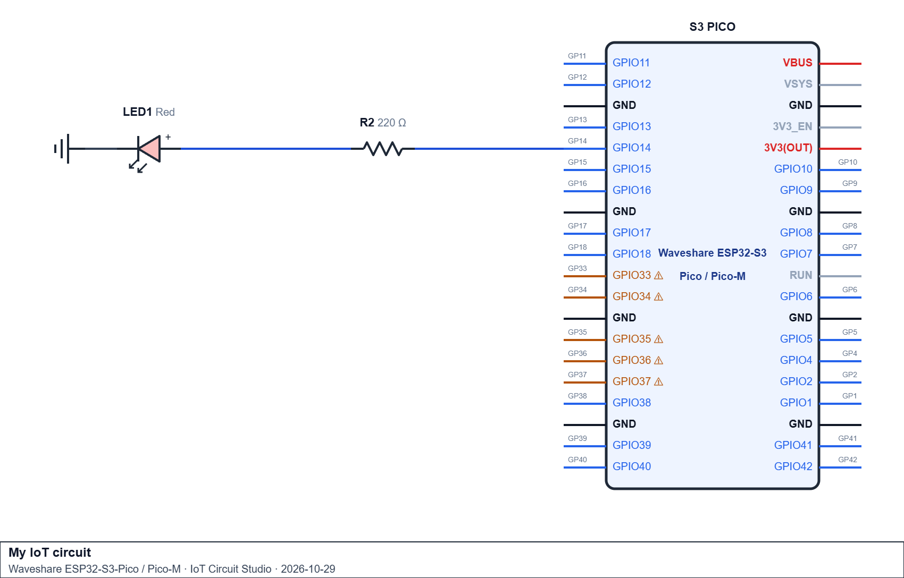
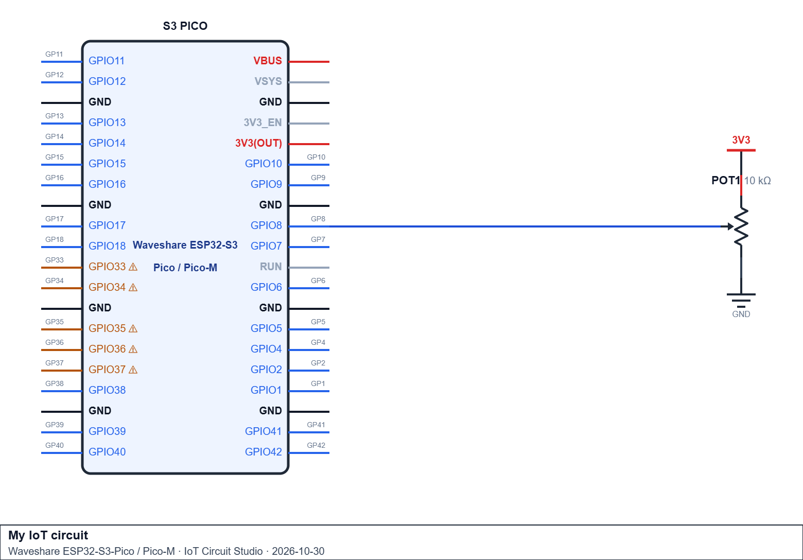
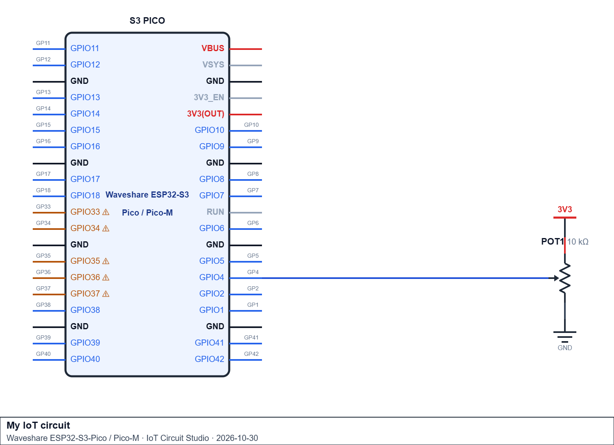
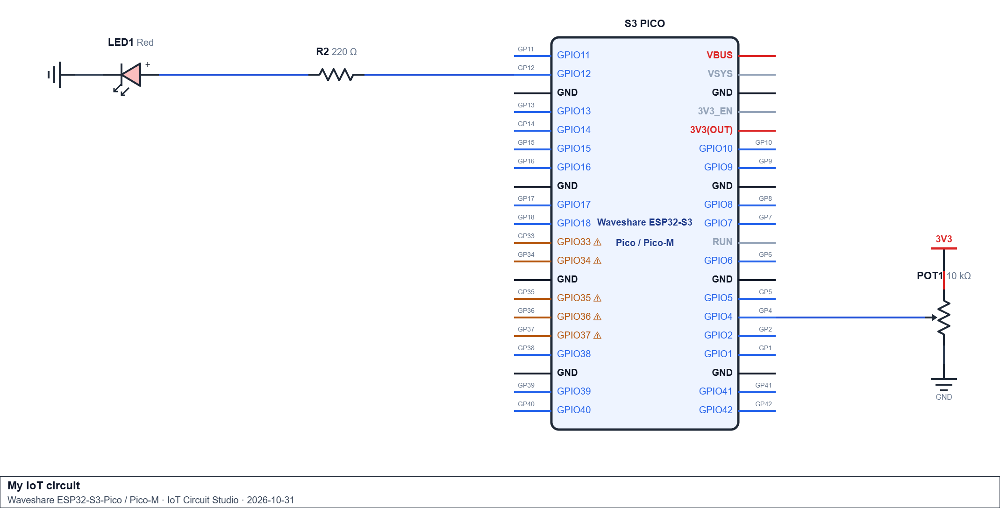
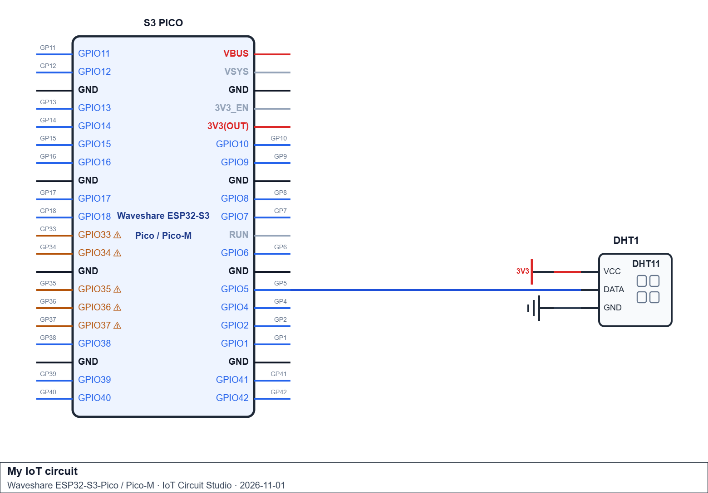
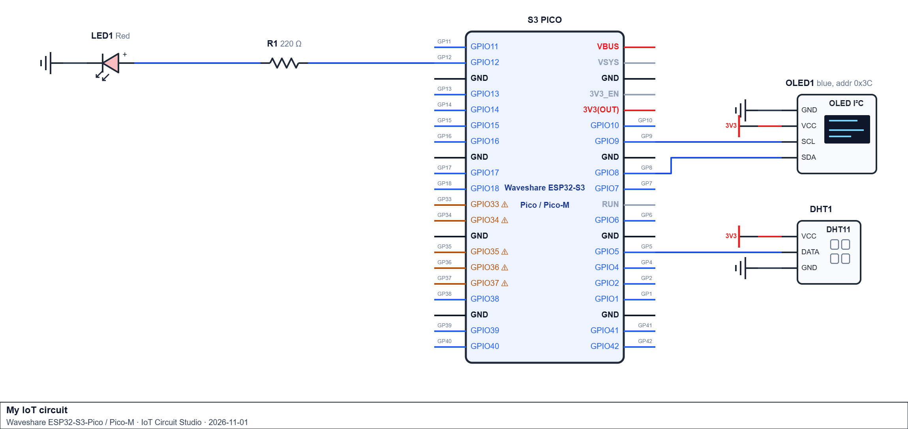
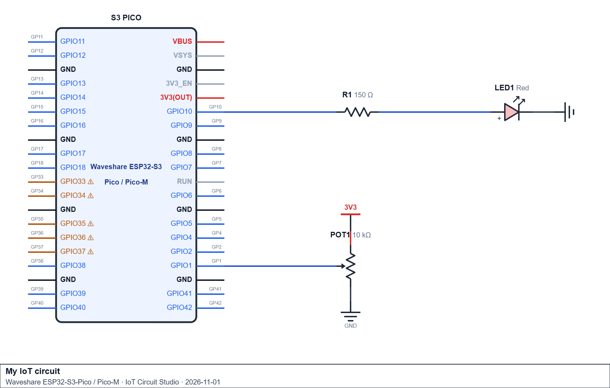

# Activity 8 - Networking and Database Connection

> **Schematics:** for every task that has a circuit (Tasks 1-8), draw the schematic **before** you build it on the breadboard, using [Circuit Studio](https://circuit-studio.pages.dev/).
> - Include **every component** in that task's Components list.
> - **You choose the GPIO pins.** Fill in the task's **Your pin choices** table, draw those pins on your schematic, and use the same numbers as named constants in your code (e.g. `const int STATUS_LED = 27;`). All three must match.
> - Show the resistors, and connect every ground to GND.
> - When it's finished, use **Export → Schematic image** to save a picture and **Export → Share link** to get a link, and paste both into the Schematic box near the top of each task.
>
> Checking your schematic against your pin table before you build catches wiring mistakes before anything is plugged in.

> **Pin rules for the ESP32-PICO** (a pin that breaks one of these rules can stop the sketch working, or stop the board booting):
> - **Analog inputs** (potentiometer) must use an **ADC1** pin: GPIO 32, 33, 34, 35, 36 or 39. ADC2 pins return nothing useful while Wi-Fi is on, and every task here uses Wi-Fi.
> - **Outputs** (LEDs, buzzer) can't use GPIO 34, 35, 36 or 39, because those are input-only.
> - **Never use** GPIO 6-11, 16 or 17 (wired to the ESP32-PICO's internal flash) or GPIO 1 and 3 (Serial TX/RX, which the Serial Monitor needs).
> - **Avoid the boot-mode (strapping) pins** GPIO 0, 2, 5, 12 and 15. Something connected to them can stop the board from booting or uploading.
> - **Safe choices** for digital parts (LED, buzzer, DHT11): GPIO 4, 13, 14, 18, 19, 21, 22, 23, 25, 26, 27, 32, 33.
> - **I²C (OLED)** normally uses GPIO 21 (SDA) and 22 (SCL), but any two safe digital pins work if you pass them to `Wire.begin(SDA_PIN, SCL_PIN)`.
> - **Check your board's pinout.** Not every GPIO is broken out to a header pin on every ESP32-PICO board.
> - **Within one task, every connection needs its own pin.**

> **Supabase setup (do this once, before Task 3):** Tasks 3, 6 and 7 save readings to a cloud database on [Supabase](https://supabase.com).
> 1. Sign up and create a new project on the free plan. Wait for it to finish setting up.
> 2. Open **SQL Editor**, paste this SQL and click **Run**. It creates a `sensor_log` table and allows your device to **insert** rows (nothing else):
>    ```sql
>    create table sensor_log (
>      id          bigint generated always as identity primary key,
>      created_at  timestamptz not null default now(),
>      pot_value   integer,
>      temperature real,
>      humidity    real
>    );
>
>    alter table sensor_log enable row level security;
>
>    create policy "ESP32 can insert rows"
>      on sensor_log for insert
>      to anon
>      with check (true);
>    ```
> 3. Open **Project Settings → API Keys** (or the **Connect** button) and copy the **Project URL** and the **publishable** key (called the **anon** key on older projects) into `SUPABASE_URL` and `SUPABASE_KEY` in your sketch.
> 4. Never use the **secret** (`service_role`) key on the device. Replace your real URL and key with `"YOUR_PROJECT_ID"` / `"YOUR_SUPABASE_PUBLISHABLE_KEY"` placeholders before you submit code.
> 5. To check your data, open **Table Editor → sensor_log**. Each successful send adds one row, with `created_at` filled in by Supabase.

## Task 1 - Non-Blocking Wi-Fi Connection With a Status LED

**Scenario:**

Before any sensor data can be sent anywhere, the device needs to reliably connect to Wi-Fi and show, at a glance, whether it's actually online.

**Components:**

- ESP32-PICO development board
- 1x LED
- 1x 220 Ω resistor
- Jumper wires

> **Schematic:**
>
>
> [Finished Schematic](https://circuit-studio.pages.dev/#p=zfZLLbtswEEV_JbhrKhAlxQ_uirQIjD5stOmmhWFQEm0zoUSWpOI4hv-9oCpDshF3OZyZe-bO8IC1thX3YJDaR4W0RSN95HxTSg2CF2Gd1DUYJah5JcDwdX8z0483XSkICiu4FyUYkjgZRTSOkuljPGHZiKXj25SOf4GgMeX7RVNG09skyUJRrrktZ6FIOJMmkUsjI4swR6Ero2tRewf2-wAZan5SEPi9CUO1nSB4BZvEBHuwUUxgtQeLCRTPhQLDj_RmMbufg8BYbRzY4XgdeiQdp1ht3oqJGic9TokOFqXZPxzNTjw6GRC_fPpIBzgUWmkLBitKHAnWShqwNVdODHDP2zSTWdHjrHDSeW07Jk065t27zO_JkKi3lQNLQgtvvJ63YUe8wlfZjsYvA_6mPtnN6KXd6YD88O3M7QVgSbCTVgwuuFu9be5U4hoQ8HY9F_5N-C9hUXmf7Y8Rsh9C9sTvb7Zb_RlvX_mTPlc-7_18odz7DtnFNeVnXZsyH_9vZnqm3H7U8PywmM1pdq67JCga53V1r0sBVjdKhXS9AQO3ZSPr4EHJ3HIr2-UtCfJW23Druz0_NZURtg2Ox78)
>
> Activity 1 - Schematic for Non-Blocking Wi-Fi Connection With a Status LED 
>
>
> <details><summary>Schematic link</summary>
>
> [Open the example schematic in Circuit Studio](https://circuit-studio.pages.dev/#p=zdZDBSsQwFEV_pdyVQjok7TijbyfjwlkpTN0os0jbKJG2CS-JOpT-u2TQjeDywbn3XN6MV8ejjiBYF8vOcpdsLENMvXUQ-DAcrJtASmDSowGhMaM3rGNiU9wOhmNxOIVoxuLi7r5R6hICHRsdTQ9CJatNqWSp1o2sSCqqtqtrtXmGQPL9H6jaNlKSvKH11apSdYZap7nfZ8gEX1dlqEtvu7ysc6N3k5liAL3MsJl5UhCIJ59nnpMQ-AJtt1LgBCqVkgLsIkgKDLo1AwiHunjc7x4g4Nn5AJqX_73LUeDTssnSo0CXQnTjzvUGNKVhyK3TGwia-2SnvHOwLWu2v4m2Bc3wmuOP6T3ld56PZfkG)
>
> </details>
>
> **Your pin choices** (choose any suitable GPIO, following the pin rules, and use the same numbers in your schematic and your code):
>
> | Connection | Pin type needed | Your GPIO |
> |---|---|---|
> | LED (through the 220 Ω resistor; LED cathode → GND) | Digital output | GPIO 14 |

Write `connectWiFi()` using `SSID`/`PASSWORD` constants set to **your own 2.4 GHz Wi-Fi network** (a phone hotspot works well; the ESP32 cannot join 5 GHz networks), called once from `setup()` with a bounded blocking retry (`WiFi.status() != WL_CONNECTED`, max 20 attempts, `delay(500)` between attempts; this is acceptable here because it runs once, in `setup()`, exactly like this course's other one-shot initialisation calls). If it connects, print `"Connected! IP: "` followed by `WiFi.localIP()`; if it runs out of attempts, print `"Connection failed - continuing offline."`. In `loop()`, check `WiFi.status()` on every pass and drive the status LED `HIGH` when connected, `LOW` when not. `loop()` itself must contain no `delay()` at all.

>
> Evidence: _(attach a photo or short video of your working circuit on the ESP32-PICO, plus a screenshot of the Serial Monitor output)_
>
>A copy of my code activity 1: https://wokwi.com/projects/479213974528275457

**Check yourself:**
- [ ] Pin table filled in with pins that follow the pin rules, and the same pins used in both the schematic and the code constants
- [ ] Schematic drawn in Circuit Studio using every component listed above, pasted into the Schematic box with its share link
- [ ] `SSID`/`PASSWORD` match your 2.4 GHz network exactly (case-sensitive), and the Serial Monitor shows "Connected!" with an IP address
- [ ] Before submitting, the real password is replaced with `"YOUR_WIFI_PASSWORD"` so it isn't shared
- [ ] `connectWiFi()`'s blocking retry runs only once, from `setup()`, never from `loop()`
- [ ] The status LED correctly reflects `WiFi.status()` on every single pass of `loop()`
- [ ] `loop()` contains no `delay()`

---

## Task 2 - HTTP POST of a Sensor Reading, on a Non-Blocking Interval

**Scenario:**

With Wi-Fi connected, the device now needs to send a reading somewhere: a POST request carrying a small JSON body, on a steady interval that never blocks anything else.

**Components:**

- ESP32-PICO development board
- Potentiometer
- Jumper wires

> **Schematic:**
>
> [Finished Schematic](https://circuit-studio.pages.dev/#p=zfZJBj9owEIX_CnpnZ-XESUp83UorDi1Ipa3UCiGTOKxXSWzZDixC_PfKgVVgRTna8_y-eTM-ota2FR4cSvuoVLbslY-c7yulQbCT1indgccEnWglOL4dJjO9nFykICitFF5W4EhokkcxjRhd0pSnKafsKY-__AFBb6q7ooxyGj8lRRJEGy1sNQsi6QxLIscio8rQR6lbozvZeQf-9wgVND9jEPiDCU0NL0HwDh5TSnAAzymB1R6cEjRiIxtw_GCTxex5DgJjtXHgx9P_qSdyAZXrqp_SLK1HntFedl7pVnppz9yMnblJ8gEursiL-TK-wkK_tm7oldITQd0oA16Lxskrqnb7rDDZSN2VJduxCy494-LsTk72i8W3Ie8TVFO3U5WPhG1X3donxR37l-9fH9ivCPbKyqtN7dd5XjGT9iAQIX35aaoGHDHCLsbqmD5UF6H6wR9Xs18XeVkX2_dHzuyT85j6oXMmnTio4pHz7xvn4UOG65fFbD69tV0RlL3zun3WlQTv-qYJ5W4LDmGrXnXhmzdqY4VVw-xWBJvB2gjrL2N-61sj7XA4nf4B)
>
> Activity 2: Potentiometer HTTP POST Schematic 
>
>
> <details><summary>Schematic link</summary>
>
> [Open the example schematic in Circuit Studio]()
>
> </details>
>
> **Your pin choices** (choose any suitable GPIO, following the pin rules, and use the same numbers in your schematic and your code):
>
> | Connection | Pin type needed | Your GPIO |
> |---|---|---|
> | Potentiometer wiper (outer legs → 3.3V and GND) | Analog input, **ADC1 only** | GPIO 8 |

Write `bool sendReading(float value)` that checks `WiFi.status() == WL_CONNECTED` before doing anything else, then uses `HTTPClient` to `POST` a JSON body (`{"sensor":"potentiometer","value":<value>}`) to `SERVER_URL = "http://httpbin.org/post"` (a free public test server: no account needed, and it replies `200` to any POST, so a `200` in your Serial Monitor means the reading arrived), calling `http.end()` unconditionally afterward. Connect in `setup()` by reusing your `connectWiFi()` from Task 1. In `loop()`, read the potentiometer and call `sendReading()` on a non-blocking `SEND_INTERVAL = 5000` ms interval using `millis()`.

>
> Evidence: _(attach a photo or short video of your working circuit on the ESP32-PICO, plus a screenshot of the Serial Monitor output)_
>
>A copy of my code Activity 2: https://wokwi.com/projects/479292251350067201

**Check yourself:**
- [ ] Pin table filled in with pins that follow the pin rules, and the same pins used in both the schematic and the code constants
- [ ] Schematic drawn in Circuit Studio using every component listed above, pasted into the Schematic box with its share link
- [ ] `sendReading()` checks `WiFi.status()` itself, not just relying on `setup()` having connected once
- [ ] The JSON body is correctly quoted and comma-separated
- [ ] `http.end()` is called every time, regardless of the response code
- [ ] The send interval is `millis()`-gated, not `delay()`-gated

---

## Task 3 - Sending Data to a Cloud Database (Supabase)

**Scenario:**

A workshop wants every reading of a sensor stored in a cloud database it can view and export later. Supabase gives each table a REST address, so one HTTPS POST with a JSON body inserts one row, no server of your own required. Complete the **Supabase setup** at the top of this Activity first.

**Components:**

- ESP32-PICO development board
- Potentiometer
- Jumper wires

> **Schematic:**
>
>
>[Finished Schematic](https://circuit-studio.pages.dev/#p=zfZJRb9owFIX_CjrPTuXEAYpfO6nioQVpbJM2IWQSA6aJbdkODCH---RAFagYj_Y9Pt899_qIlXG1COBQJiSFckWjQuJDUyoDgp10XhkNnhJoUUtwvB16YzPrXaQgKJwUQZbgyGg2SFKaMDqjz7yf8yx_GmT0NwgaW94XDTntP_UzFkVLI1w5jiLpLcsSzxKrithHYWprtNTBg_85QkXNjxQE4WBjU-1LEPwFTyklOIAPKIEzAZwSVGIpK3B8Z73p-GUCAuuM9eDH0_-pJ3IBFYtmoOXGi45nTZA6KFPLIN2ZO8zOXJZ_gkdX5Olkll5hYTa1b3ul9ESwqpQFX4nKyytqRT-2aWk76q4o2I5dcOyMy4Z3crKfLL0NeZ8gBHXP3nWEtS5v7fP0jv3r-7cH9nOCvXLyalP7xXLrcrYegEDE9MWXqVpwpIi76Kpd-lidxuonv1vNfjHSWR3s6JEz--LcpX7ovB2GzU58PHL-dePcfsh4_TodT_Jb2zlB0fhg6hdTSnDdVFUs6zU4hCsbpeM3r9TSCafa2c0Jlq21FS5cxrxtaitdezid_gE)
>
> Activity 3: Supabase Potentiometer Schematic
>
>
>
> <details><summary>Schematic link</summary>
>
> [Open the example schematic in Circuit Studio]()
>
> </details>
>
> **Your pin choices** (choose any suitable GPIO, following the pin rules, and use the same numbers in your schematic and your code):
>
> | Connection | Pin type needed | Your GPIO |
> |---|---|---|
> | Potentiometer wiper (outer legs → 3.3V and GND) | Analog input, **ADC1 only** | GPIO 4 |

Write `bool sendToSupabase(int potValue)` that POSTs the JSON body `{"pot_value":<reading>}` to `SUPABASE_URL + "/rest/v1/sensor_log"` over HTTPS (`WiFiClientSecure` with `setInsecure()`, then `http.begin(client, url)`), with the headers `Content-Type: application/json`, `apikey: <key>`, `Authorization: Bearer <key>` and `Prefer: return=minimal`. Return `true` only if the response code is exactly `201` (Created). In `loop()`, read the potentiometer and call it on a non-blocking `SEND_INTERVAL = 15000` ms interval. Supabase doesn't force a minimum gap, but one row every 15 seconds is plenty for a slowly changing reading and keeps the free database small. Print `[OK] Row saved` or `[FAIL] Response: <code>` to Serial after each send, then open **Table Editor → sensor_log** and confirm new rows are appearing.

>
> Evidence: _(attach a photo or short video of your working circuit on the ESP32-PICO, plus a screenshot of the Serial Monitor output)_
>
>A copy of my code Activity 3: https://wokwi.com/projects/479299974323212289

**Check yourself:**
- [ ] Pin table filled in with pins that follow the pin rules, and the same pins used in both the schematic and the code constants
- [ ] Schematic drawn in Circuit Studio using every component listed above, pasted into the Schematic box with its share link
- [ ] `SEND_INTERVAL` is `15000`, a non-blocking `millis()` timer
- [ ] `sendToSupabase()` checks `WiFi.status()` before building/sending the request
- [ ] The JSON key `pot_value` matches the column name exactly, and both key headers are sent
- [ ] Success is judged by response code `== 201`, not just "response code > 0"
- [ ] `http.end()` is called after every `http.POST()`
- [ ] New rows appear in **Table Editor → sensor_log**, and no real URL or key is left in the submitted code

---

## Task 4 - NTP Time Sync and Timestamped Serial Log

**Scenario:**

Every logged reading so far in this course has used `millis()`, which is time since power-on, not an actual date. This task attaches a real timestamp fetched from an internet time server instead.

**Components:**

- ESP32-PICO development board
- DHT11 sensor
- 10 kΩ resistor (not needed if your DHT11 is on a 3-pin board, which has one built in)
- Jumper wires

> **Schematic:**
>
>
>[Finished Schematic](https://circuit-studio.pages.dev/#p=zjZLBbuIwFEV_Bd21UyUxExrvKpBaFtMiDdPFjBAyjkMdJbFxHChC_PvIKVUAdVCX0bs55_naB-TaVtyBQWkXCGVFq1zQuDZTGgRbaRula7CIoOaVBMPP_WCq54NTFATCSu5kBoY4jJMgCgMazcOERfeMju7o_egPCFqTfR1KWTy8S5PUh1aa22zqQ7IxNA4aGhgl_B5CV0bXsnYN2N8DlM_8jkDg9sYv1f0JgnewKAwJ9mBJSGC1AwsJSr6SJRh-0cFsOn4BgbHaNGCH4_-tR3ISiSWnIW_ei96Xvbko-vCNTj4afiGcPM2jS1teKgOW87KRZwK1Wad7V_aCrRB0Sz8MCb02xKMzB32l33IMd8WwFFnvWNfZlWD4KUjP-I_Pkxv8BcFOWXl2L7slT8Nc5ykIONgB4qpDA4bX8Ri--37eV-DnMz_93KC_it3ybZPxDW1vsR-fJ1fs_ug32YUr6m3Bb7EnD_OHC3j3CjvrbPry45K8IBBt43Q11pkEq9uy9ON6DQZus1bV_m2XamW5VV2FC4JVhzbculPbRVsZabuP4_Ef)
>
>Activity 4: DHT11 NTPS chematic
>
>
> <details><summary>Schematic link</summary>
>
> [Open the example schematic in Circuit Studio]()
>
> </details>
>
> **Your pin choices** (choose any suitable GPIO, following the pin rules, and use the same numbers in your schematic and your code):
>
> | Connection | Pin type needed | Your GPIO |
> |---|---|---|
> | DHT11 DATA (10 kΩ pull-up from DATA to 3.3V, unless your 3-pin DHT11 board already has one; VCC → 3.3V, GND → GND) | Digital input/output | GPIO 5 |

Write `syncTime()` (`configTime(0, 0, "pool.ntp.org", "time.nist.gov")` to start the sync, then `setenv("TZ", "AEST-10", 1);` and `tzset();` to set Australian Eastern time, then a bounded loop waiting for `time(nullptr)` to exceed `1000000`, since a synced clock is never that small) and `getTimestamp()` (formats `localtime()` into `"YYYY-MM-DD HH:MM:SS"`). Call `connectWiFi()` then `syncTime()` once from `setup()`, **only if** Wi-Fi actually connected. In `loop()`, read the DHT11 no more than once every 2000 ms (non-blocking, `isnan()`-guarded) and print `getTimestamp()` alongside each valid reading to Serial.

>
> Evidence: _(attach a photo or short video of your working circuit on the ESP32-PICO, plus a screenshot of the Serial Monitor output)_
>
>A copy of my code Activity 4: https://wokwi.com/projects/479387569283480577

**Check yourself:**
- [ ] Pin table filled in with pins that follow the pin rules, and the same pins used in both the schematic and the code constants
- [ ] Schematic drawn in Circuit Studio using every component listed above, pasted into the Schematic box with its share link
- [ ] `syncTime()` is only called if `WiFi.status() == WL_CONNECTED` after `connectWiFi()` returns
- [ ] `getTimestamp()` produces a real calendar date, not a 1970-01-01 placeholder
- [ ] The DHT11 is polled no faster than once every 2000 ms, non-blocking
- [ ] Every printed line uses `getTimestamp()`, not `millis()`

---

## Task 5 - Non-Blocking Reconnect Handling

**Scenario:**

A device that only ever connects once in `setup()` never recovers if Wi-Fi drops later. This task adds a reconnect check that runs entirely independently of everything else `loop()` is doing.

**Components:**

- ESP32-PICO development board
- Potentiometer
- 1x LED (status indicator)
- 1x 220 Ω resistor
- Jumper wires

> **Schematic:**
>
>
> [Finished Schematic](https://circuit-studio.pages.dev/#p=zjZNtb5swEID_SnWfTQV2mgR_m9qpirY10dZu0qaqMuC2bgF7fgkhVf77ZEoEpCHaR7jz89z5zm_wKHXBLFAQ0gap0KkTNjDWZUICgjXXRsgSaISgZAUHCt_qs4W8PWtTAUGqObM8Awo4xNMgCgMS3YYxxXMahefhfPIbEDiVHU0iISXTczyLfVIimc4WPokbRXBgSKBE6utIZaFkyUtrgP55A-Fz7iJAYGvli2pOAoIN0CgMEdRApyECLS3QEEHOEp4DhR_kbLW4XAICpaUyQN9249YdakXpw4TUunoqOp-SlpdWyIJbrt-9F-TdSyZ7cdwzr5a3UU8L8rkwTa1huEPwmAsF9JHlhves-bzcJBd5Z81522PQSGqg870rmvdkXz9fDWSpzKUGCppnMGqr1srUuu5smhthrGzbCyL8royPKr_jj91hf4I5K5fNZysc0RcMl9PXuNM_lftmJ9FBs_2Lvb4Z9DrKj2O10XLd8ddpStaknV17nXh2ZGnIT_JfBie22mz_Hulgj28aOcRf31zhcfw9gkpo3lv76gFnzLkXf1Wsme7B-JR_ZH7OSRftVslHP_no3t_tefVgL2Z6E4sheXj2ywG5m5uPrsbI7lngWbQ5VXM0IDev2_--Xi2WER7jxsZOths-5HbP9SO3vwknK355Ni7O5SkyOSB3G3CS_IoTW7nqFPnX-F1Mhth7BKkzVhaXMuNAS5fnPlw-AQWmMydK30IuEs20aPboHkHSoBXTtl25F1corpuP3e4f)
>
>Activity 5: Non-Blocking Reconnect Circuit Schematic
>
>
> <details><summary>Schematic link</summary>
>
> [Open the example schematic in Circuit Studio]()
>
> </details>
>
> **Your pin choices** (choose any suitable GPIO, following the pin rules, and use the same numbers in your schematic and your code):
>
> | Connection | Pin type needed | Your GPIO |
> |---|---|---|
> | Potentiometer wiper (outer legs → 3.3V and GND) | Analog input, **ADC1 only** | GPIO 4 |
> | LED (through the 220 Ω resistor; LED cathode → GND) | Digital output | GPIO 12 |

Write `maybe_reconnect()`: gated by its own `RECONNECT_CHECK_INTERVAL = 5000` ms, it calls `WiFi.begin(SSID, PASSWORD)` again **whenever** `WiFi.status() != WL_CONNECTED`, with no `while`/`delay()` loop wrapped around that call. `setup()` starts the initial connection with `WiFi.begin()` alone (no blocking wait this time). In `loop()`, call `maybe_reconnect()` every pass, drive the status LED from the current connection state, and read/print the potentiometer on its own non-blocking 1000 ms interval regardless of connection state.

**Test it on the real board:** with the sketch running, switch off your router or phone hotspot. The status LED should go off within a few seconds, the Serial Monitor should show the `[WARN]` reconnect message every 5 seconds, and the potentiometer readings must **keep printing every second** without any pause. Switch the hotspot back on, and the LED should come back on by itself with no reset needed.

>
> Evidence: _(attach a photo or short video of your working circuit on the ESP32-PICO, plus a screenshot of the Serial Monitor output)_
>
>A copy of my code Activity 5: https://wokwi.com/projects/479392619120905217

**Check yourself:**
- [ ] Pin table filled in with pins that follow the pin rules, and the same pins used in both the schematic and the code constants
- [ ] Schematic drawn in Circuit Studio using every component listed above, pasted into the Schematic box with its share link
- [ ] `maybe_reconnect()` is gated by its own interval, separate from the potentiometer's read interval
- [ ] `WiFi.begin()` inside `maybe_reconnect()` has no surrounding `while`/`delay()` loop
- [ ] The potentiometer keeps reading and printing on schedule regardless of connection state
- [ ] Turning the hotspot off and on again shows the LED going off, then reconnecting by itself
- [ ] `loop()` contains no `delay()` anywhere

---

## Task 6 - Two-Field Cloud Logging With Timestamps

**Scenario:**

Combine Tasks 3 and 4: a real sensor's two readings, saved together as one row in the Supabase `sensor_log` table, each Serial-logged with a real timestamp.

**Components:**

- ESP32-PICO development board
- DHT11 sensor
- 10 kΩ resistor (not needed if your DHT11 is on a 3-pin board, which has one built in)
- Jumper wires

> **Schematic:**
>
>
>[Finished Schematic](https://circuit-studio.pages.dev/#p=zjZLBbuIwFEV_Bd21UyUxExrvKpBaFtMiDdPFjBAyjkMdJbFxHChC_PvIKVUAdVCX0bs55_naB-TaVtyBQWkXCGVFq1zQuDZTGgRbaRula7CIoOaVBMPP_WCq54NTFATCSu5kBoY4jJMgCgMazcOERfeMju7o_egPCFqTfR1KWTy8S5PUh1aa22zqQ7IxNA4aGhgl_B5CV0bXsnYN2N8DlM_8jkDg9sYv1f0JgnewKAwJ9mBJSGC1AwsJSr6SJRh-0cFsOn4BgbHaNGCH4_-tR3ISiSWnIW_ei96Xvbko-vCNTj4afiGcPM2jS1teKgOW87KRZwK1Wad7V_aCrRB0Sz8MCb02xKMzB32l33IMd8WwFFnvWNfZlWD4KUjP-I_Pkxv8BcFOWXl2L7slT8Nc5ykIONgB4qpDA4bX8Ri--37eV-DnMz_93KC_it3ybZPxDW1vsR-fJ1fs_ug32YUr6m3Bb7EnD_OHC3j3CjvrbPry45K8IBBt43Q11pkEq9uy9ON6DQZus1bV_m2XamW5VV2FC4JVhzbculPbRVsZabuP4_Ef)
>
>Activity 6: Two-Field Cloud Logging Schematic
>
>
> <details><summary>Schematic link</summary>
>
> [Open the example schematic in Circuit Studio]()
>
> </details>
>
> **Your pin choices** (choose any suitable GPIO, following the pin rules, and use the same numbers in your schematic and your code):
>
> | Connection | Pin type needed | Your GPIO |
> |---|---|---|
> | DHT11 DATA (10 kΩ pull-up from DATA to 3.3V, unless your 3-pin DHT11 board already has one; VCC → 3.3V, GND → GND) | Digital input/output | GPIO 5 |

Write `sendToSupabase(float temp, float humidity)` sending both in one JSON body, `{"temperature":<t>,"humidity":<h>}`, using the same HTTPS request as Task 3. In `loop()`, on a non-blocking `SEND_INTERVAL = 15000` ms poll: read the DHT11 (`isnan()`-guarded), print `getTimestamp()` with both values to Serial, then call `sendToSupabase()` only if the DHT11 read was valid **and** `WiFi.status() == WL_CONNECTED`.

>
> Evidence: _(attach a photo or short video of your working circuit on the ESP32-PICO, plus a screenshot of the Serial Monitor output)_
>
>A copy of my code Activity 6: https://wokwi.com/projects/479456162655228929

**Check yourself:**
- [ ] Pin table filled in with pins that follow the pin rules, and the same pins used in both the schematic and the code constants
- [ ] Schematic drawn in Circuit Studio using every component listed above, pasted into the Schematic box with its share link
- [ ] Both `temperature` and `humidity` are sent in the same request and land in the same row (`pot_value` is left empty)
- [ ] A failed DHT11 read (`isnan()`) skips the send entirely for that cycle, without crashing
- [ ] Every Serial log line carries a real timestamp from `getTimestamp()`
- [ ] The 15-second send interval and the 2-second DHT11 read interval are two genuinely separate, non-blocking timers

---

## Task 7 - Capstone: Full Non-Blocking IoT Cloud Logger

**Scenario:**

Build the complete station: a DHT11-based cloud logger with an OLED status display, a Wi-Fi status LED, real timestamps, and automatic non-blocking reconnect. It combines everything from this week in one device.

**Components:**

- ESP32-PICO development board
- DHT11 sensor
- 10 kΩ resistor (not needed if your DHT11 is on a 3-pin board, which has one built in)
- 1x LED (status indicator)
- 1x 220 Ω resistor
- SSD1306 OLED display (128×64, I²C)
- Jumper wires

> **Schematic:**
>
>
>[Finished Schematic](https://circuit-studio.pages.dev/#p=zjZXfb9owEID_leqeQxXHgRC_VTB1aF2pVtaHTVXlJAZcQpzaDr8q_vfJAWqSkYjHYPv77s535hOmQi6pBgJc6E7MZVxw3VG6SLgAB1ZMKi4yIMiBjC4ZEPi5vRmJyc1xKzgQS0Y1S4CA53q9DkIdF01cTHBAvOC2F_h_wIEiTy5u8hFxvVsUuGZTJKhMRmYTUzn2Ogp3ch6bOGKxzEXGMq2A_P0Ebvb8RuCA3uYmqPIkOLABglzXgS2QnuuAFBqI60BKI5YCgWd88zQajMGBXIpcAfncN1v3zlEUv7GEbhXl1pfMNUIHX9c_-LB7QTj8PkFV2zTlOZApTRU7E_TXeid2gRWk7JhOBx_5_RMe9c8ED9-G5wKIRSokEJAsgUabznGySxbWJr50p2yQfyGbcd2m-M4cR15_0_PLazrYo7Rg4ABNEsmUAgLuBg-a4wm8aJdtqI1HMsWVFvJYAuQdggovluBXJSQxXyognjlBCy3G5edR2KCXyTyaqcTqZ9mp-D6qFT88E98_Dq-63JjFupesLH8Vx3iFDwo_qLePF5w58Au-yrHZxXjuRRdy-BL4DTl41_Cn0byX-34LHzXx8TV8TVW2jlF7jVCvqUYtObw6sOaSnT0c6zcUzmeLwswzLYem1oW5eaZMu0Z21U6oWb0zqye_fSnWb0GgZrgbVMnVsz9qZNt-ZvWpiRy54iMMVVvMqEIu30fz8_3TaIy8Jq5-zyO9yKpc--AZwPBucteM7jaRt7MlwyxsI78MBrVq2GFprUaGcURnURv7_nFYY9shaWXT1XQb7Lwq276Zl9l2QFrZIuNdXu-PKvv_mtjhaGXzcCEXRSv7efDQfJFhE_jjfStwgFvBw5YO6VfBrw7EhdJiORAJA5IVaWqWsxkQoDIpeGb-8lMeSSp5ObivDkQlOqdSH2f8vVjmTJYf-_0_)
>
>Activity 7: Full NonBlocking IoT Cloud Logger Schematic
>
>
> <details><summary>Schematic link</summary>
>
> [Open the example schematic in Circuit Studio]()
>
> </details>
>
> **Your pin choices** (choose any suitable GPIO, following the pin rules, and use the same numbers in your schematic and your code):
>
> | Connection | Pin type needed | Your GPIO |
> |---|---|---|
> | DHT11 DATA (10 kΩ pull-up from DATA to 3.3V, unless your 3-pin DHT11 board already has one; VCC → 3.3V, GND → GND) | Digital input/output | GPIO 5 |
> | LED (through the 220 Ω resistor; LED cathode → GND) | Digital output | GPIO 12 |
> | OLED SDA (VCC → 3.3V, GND → GND) | I²C data | GPIO 8 |
> | OLED SCL | I²C clock | GPIO 9 |

**Program requirements:**
1. `connectWiFi()`: bounded blocking retry, called once from `setup()`; `syncTime()` called once afterward, only if connected.
2. `maybe_reconnect()`: its own non-blocking interval, calls `WiFi.begin()` with no blocking wait, independent of every other timer in the program.
3. DHT11 read no more than once every 2000 ms, `isnan()`-guarded.
4. `sendToSupabase(temp)` (inserting a row into `sensor_log`) sent on its own non-blocking 15000 ms interval, only when connected **and** the last DHT11 read was valid.
5. The OLED (`update_display()`, always ending with `display.display()`) shows connection status and the current temperature, redrawn whenever a new reading is processed.
6. The status LED reflects `WiFi.status()` on every pass of `loop()`.
7. Every Serial log line uses `getTimestamp()`, not `millis()`.
8. `loop()` contains no `delay()` anywhere.

>
> Evidence: _(attach a photo or short video of your working circuit on the ESP32-PICO, plus a screenshot of the Serial Monitor output)_
> 
>A copy of my code Activity 7: https://wokwi.com/projects/479465124316393473

**Check yourself:**
- [ ] Pin table filled in with pins that follow the pin rules, and the same pins used in both the schematic and the code constants
- [ ] Schematic drawn in Circuit Studio using every component listed above, pasted into the Schematic box with its share link
- [ ] All four timers (reconnect check, DHT11 poll, cloud send, and any OLED-specific timing) are independent, non-blocking `millis()` intervals
- [ ] `sendToSupabase()` is never called while disconnected or on an invalid reading
- [ ] The OLED always shows the current connection status, not a stale value from before a disconnect
- [ ] Every timestamp printed comes from `getTimestamp()`, confirmed synced only after Wi-Fi connected
- [ ] `loop()` contains no `delay()` anywhere

---

## Task 8 - ESP32 as an Access Point: Phone Control Panel

**Scenario:**

A workshop bench has no Wi-Fi, but the technician wants to check a sensor and switch a fan on and off from their phone. Instead of joining a network (Station mode, Tasks 1-7), the ESP32-PICO must **create its own network** in Access Point mode and serve a small web page. The LED stands in for the fan.

**Components:**

- ESP32-PICO development board
- Potentiometer
- 1x LED (stands in for the fan)
- 1x 220 Ω resistor
- Jumper wires

> **Schematic:**
> 
>
> [Finished Schematic](https://circuit-studio.pages.dev/#p=zjZRhr5owGIX_ys37ud60IKL9tty7GLPtajbvlmwxBkvVKtBaisg1_velqEEcmH2E9-15zmkOHGEpdRwYoCCk6TChWSZMJzVZKCQg2HOdCpkAJQiSIOZA4VvxNJLTp8sqIGCaB4aHQMHBTq9DSAeTKfao51Ov-9zD7m9AkKmwealPncEzcbp2aSEDHY7sEk-V63RSt6MEsz6YjJVMeGJSoH-OIOzOOwEEplDWVHkSEByAEowRFEB7GIGWBihGEAULHgGFH-7TZPQyBgRKS5UCPZ7aqSd0AbE53h-igrGKF_ELze-daaQJ9_XzK7lhAZOR1EBB8xBOCJaRUECXQZTyGxaXO6EDU7E0T0VqpD4Dve4F6DcAv9dwch2nQImHW1m-ly27vUPFWiWXXH3vPpfj34CGb7VkrQCVr9l251cAJQ1PjJAxN_yayD2j3P4VNbghTcbTplAY4_ZYhbdwBgWuqHvG3L1bv0CXNFyg-9P9r1wf-rBaMdxwcVf5rtcgP3x7ddrlZwhyoflNxfP5wDdhvO8DgqBs0F1FlP2gbJcW1bQqq51-stMrv-p0Ps81X-_8bV25fvbLnXJVFzudtCmbvmZkmT3yTGrK5ZdsXw8nozHBbbqbHKebD1HXrRr2r-5tEx46PjjLZNvNHin_euC4TZab_FCI7SNZ985wVawGwzMELEuNjF9kyIEmWRTZcbICCoEOM5HYf2UkFjrQouzRDMGiVFeBNpfKbbJYcV0-nE5_AQ)
>
> Activity 8: ESP32 Access Point Phone Control Panel Schematic
>
> 
> <details><summary>Schematic link</summary>
>
> [Open the example schematic in Circuit Studio]()
>
> </details>
>
> **Your pin choices** (choose any suitable GPIO, following the pin rules, and use the same numbers in your schematic and your code):
>
> | Connection | Pin type needed | Your GPIO |
> |---|---|---|
> | Potentiometer wiper (outer legs → 3.3V and GND) | Analog input, **ADC1 only** | GPIO 1 |
> | LED (through the 220 Ω resistor; LED cathode → GND) | Digital output | GPIO 10 |

**Program requirements:**
1. Set `WiFi.mode(WIFI_AP)` and start the access point with `WiFi.softAP(AP_SSID, AP_PASSWORD)`. Name the network `"ESP32-<your first name>"`, and use a password of **at least 8 characters**.
2. Check the value `softAP()` returns. Print an error if it's `false`. If it's `true`, print the address to browse to using `WiFi.softAPIP()`.
3. Create a `WebServer server(80)` with three routes:
   - `/` shows the latest potentiometer reading, whether the LED is ON or OFF, and how many devices are connected (`WiFi.softAPgetStationNum()`)
   - `/on` turns the LED on
   - `/off` turns the LED off
4. Any other address returns a `404` "Not found" response (`server.onNotFound()`).
5. After `/on` or `/off`, redirect the browser back to `/` (`server.sendHeader("Location", "/")` followed by `server.send(303)`).
6. Read the potentiometer on its own non-blocking `READ_INTERVAL = 500` ms timer and store it in a variable. The page shows that saved value; the handler doesn't call `analogRead()` itself.
7. `loop()` calls `server.handleClient()` on every pass and contains no `delay()` anywhere.

**Test it:** upload the sketch and open the Serial Monitor. Join your `ESP32-<name>` network from your phone and browse to `http://192.168.4.1`. Your phone may warn that the network has "No internet". That's expected for Access Point mode, so choose to stay connected. Turn the potentiometer and refresh the page, then tap the links to switch the LED.

>
> Evidence: _(attach a photo or short video of your phone controlling the LED, plus a screenshot of the Serial Monitor output)_
>
>A copy of my code Activity 8: https://wokwi.com/projects/479471693619896321
**Check yourself:**
- [ ] Pin table filled in with pins that follow the pin rules, and the same pins used in both the schematic and the code constants
- [ ] Schematic drawn in Circuit Studio using every component listed above, pasted into the Schematic box with its share link
- [ ] The `ESP32-<name>` network appears in your phone's Wi-Fi list, and joining it with your password works
- [ ] `softAP()`'s return value is checked, and the IP address is printed to Serial
- [ ] `/`, `/on` and `/off` all work, and any other address shows "Not found"
- [ ] After tapping `/on` or `/off`, the browser goes back to `/` (the address bar shows `192.168.4.1/`, not `/on`)
- [ ] The potentiometer is read on its own `millis()` timer, not inside the page handler
- [ ] `loop()` calls `server.handleClient()` every pass and contains no `delay()`

---

## Task 9 - Spot-the-Bug Worksheet (Extension)

**Format:** For each round, read the snippet and write down what's wrong **before** revealing the answer.

**Round 1:**
```cpp
bool sendToSupabase(float temp) {
  String json = "{\"temperature\":" + String(temp, 1) + "}";
  WiFiClientSecure client;
  client.setInsecure();
  HTTPClient http;
  http.begin(client, String(SUPABASE_URL) + "/rest/v1/sensor_log");
  http.addHeader("Content-Type", "application/json");
  http.addHeader("apikey", SUPABASE_KEY);
  http.addHeader("Authorization", String("Bearer ") + SUPABASE_KEY);
  int code = http.POST(json);
  http.end();
  return code == 201;
}
```
<details><summary>Answer</summary>There's no `WiFi.status() != WL_CONNECTED` check before building and sending the request. If Wi-Fi is disconnected at the moment this runs, `http.begin()`/`http.POST()` will fail (or hang briefly) instead of being skipped cleanly. Every send should confirm the connection is up first rather than assume `setup()`'s connection is still alive.</details>

**Round 2:**
```cpp
void loop() {
  float temp = dht.readTemperature();
  sendToSupabase(temp);
  delay(15000);   // only save a row every 15 s
}
```
<details><summary>Answer</summary>`delay(15000)` blocks the entire `loop()` for 15 full seconds on every pass, and nothing else (a button, another sensor, a reconnect check) can run during that window. The 15-second gap should be enforced with a non-blocking `millis()`-gated `SEND_INTERVAL`, exactly like every sensor poll since Week 4, not a raw `delay()`.</details>

**Round 3:**
```cpp
bool sendReading(float value) {
  HTTPClient http;
  http.begin(SERVER_URL);
  int code = http.POST("{\"value\":" + String(value, 1) + "}");
  return code > 0;
}
```
<details><summary>Answer</summary>`http.end()` is never called after `http.begin()`/`http.POST()`, so the `HTTPClient` connection is never released when this function runs. It should call `http.end()` unconditionally before returning, regardless of the response code.</details>

**Round 4:**
```cpp
String json = "{\"sensor\":\"potentiometer,\"value\":" + String(value, 1) + "}";
```
<details><summary>Answer</summary>The JSON string is malformed. There's a missing closing quote after `potentiometer`, so the resulting text is `{"sensor":"potentiometer,"value":3.2}`, which is not valid JSON. It should be `"{\"sensor\":\"potentiometer\",\"value\":" + String(value, 1) + "}"`, with the closing `\"` present right after `potentiometer`.</details>

**Round 5:**
```cpp
const char* AP_SSID     = "ESP32-Lab";
const char* AP_PASSWORD = "lab1";

void setup() {
  Serial.begin(115200);
  WiFi.mode(WIFI_AP);
  WiFi.softAP(AP_SSID, AP_PASSWORD);
  Serial.println("Join ESP32-Lab and browse to http://192.168.4.1");
}
```
<details><summary>Answer</summary>The access point password `"lab1"` is only 4 characters. A Wi-Fi (WPA2) password must be 8-63 characters, so `softAP()` fails and returns `false`, and the "ESP32-Lab" network never appears on anyone's phone. The code doesn't notice because it never checks the return value, and it prints the "Join ESP32-Lab" message anyway, which makes the problem look like a phone issue. Fix: use a password of at least 8 characters (or `""` for an open network), and check `softAP()`'s return value, printing an error if it's `false`.</details>

**Round 6:**
```cpp
void setup() {
  connectWiFi();
  configTime(0, 0, "pool.ntp.org", "time.nist.gov");   // start the NTP sync (main + backup server)
  setenv("TZ", "AEST-10", 1);                          // local time zone: UTC+10 (AEST), no daylight saving
  tzset();
  Serial.println(getTimestamp());   // called immediately, no wait
}
```
<details><summary>Answer</summary>`getTimestamp()` is called immediately after `configTime()`, without waiting for the sync to complete. `configTime()` only *starts* the NTP sync, it doesn't block until it's done. The result is a timestamp near `1970-01-01`, not the real current date. A bounded loop waiting for `time(nullptr)` to exceed a large sanity value (e.g. `1000000`) must run first, exactly as `syncTime()` does.</details>

**Round 7:**
```cpp
void maybe_reconnect() {
  if (WiFi.status() != WL_CONNECTED) {
    while (WiFi.status() != WL_CONNECTED) {
      WiFi.begin(SSID, PASSWORD);
      delay(500);
    }
  }
}
```
<details><summary>Answer</summary>This wraps `WiFi.begin()` in a blocking `while`/`delay()` loop called from inside `loop()`, which is the mistake this week teaches you to avoid. While disconnected, this freezes sensor reads, button response, and everything else for as long as reconnection takes. `maybe_reconnect()` should call `WiFi.begin()` once per `RECONNECT_CHECK_INTERVAL` and return immediately, with no loop waiting for the result.</details>

---

## Questions

Answer these in your own words before moving on:

1. Why must `WiFi.status()` be checked before every single HTTP send, even though the device already connected successfully once in `setup()`?
   ```
   Because the WiFi connection isn't always stable and can disconnect at any time, even after connecting successfully in setup().

   ```

2. What's the practical difference between calling `WiFi.begin()` once in `setup()` wrapped in a blocking retry loop, versus calling it from `maybe_reconnect()` with no loop around it at all?
   ```
   Because a blocking retry loop prevents the rest of the program from running until it exits. maybe_reconnect() attempts to reconnect and then lets the rest of the program continue running.

   ```

3. Supabase doesn't force a minimum gap between inserts. Why do the tasks still send only once every 15 seconds, and what would happen to the `sensor_log` table and the free plan if the device inserted a row on every pass of `loop()`?
   ```
   Even though Supabase doesn't enforce an insert limit, sending data on every loop pass would create thousands of unnecessary rows in sensor_log, quickly consuming storage and free-plan resources. The interval of 15 seconds keeps inserts manageable.

   ```

4. Explain why `getTimestamp()` returns a near-1970 date if it's called before `configTime()`'s sync has actually completed, even though `configTime()` itself doesn't throw any error.
   ```
   Because configTime() requests the correct date and time from an internet server but doesn't wait for the response. If getTimestamp() runs too early, it returns an incorrect date near 1970 because the ESP32 hasn't synced its clock yet.

   ```

5. In Task 5, `maybe_reconnect()` and the potentiometer's read interval both use `millis()`, but on two entirely separate timer variables. Why would combining them into a single shared timer be a mistake?
   ```
   Because each task has a different job and interval. Using one shared timer could cause them to interfere with each other and run at the wrong times.

   ```

6. Your sketch contains a Supabase key, and the table holds real sensor data. What privacy or security risks does that create, and how do the publishable key, the insert-only row level security policy and keeping the `service_role` key off the device help address them?
   ```
   Someone could find the credentials and send unwanted data. The publishable key is designed for client-side use, while insert-only RLS limits the device to adding data. The service_role key must stay private because it has powerful permissions and can bypass RLS.

   ```

7. Tasks 1-7 run the ESP32 in Station mode and Task 8 runs it in Access Point mode. For each of these devices, say which Wi-Fi mode you'd choose (Station, Access Point, AP + Station or Off) and why: (a) a greenhouse sensor that logs to Supabase and that staff also check on their phones inside the greenhouse; (b) a battery-powered soil sensor that sends one reading every 10 minutes; (c) a toy robot controlled from a phone in a park.
   ```
   For (a), AP + Station because it needs existing Wi-Fi to send sensor data while allowing staff to connect their phones directly. (b) needs Station so it can connect to existing Wi-Fi to send readings to Supabase every 10 minutes. (c) only needs AP because the robot creates its own Wi-Fi network so a phone can connect directly and control it without needing a router or internet connection.

   ```
