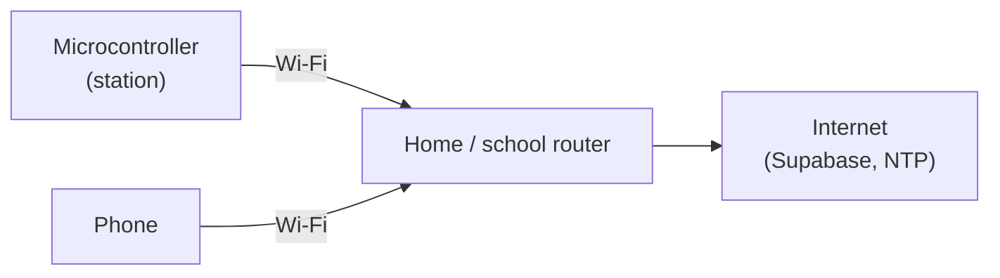
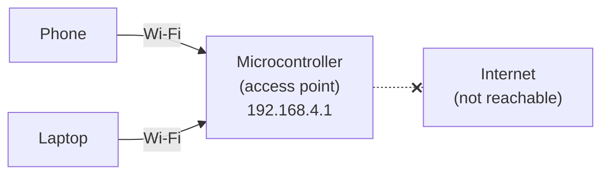
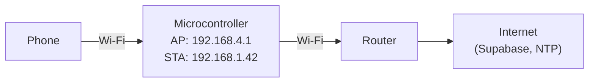
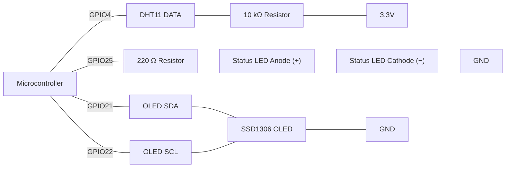
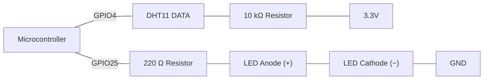

# Week 8: Networking and Database Connection

## Introduction
Every log built so far in this course has stayed inside the microcontroller itself — a struct array living only in RAM , or at best a binary record on the board's own onboard flash (Week 7's LittleFS). None of it has ever left the device. This week connects the microcontroller to a Wi-Fi network and sends sensor readings out to a real cloud platform over the internet, where they can be viewed from anywhere, charted over time, and kept even if the device itself is reset or replaced. Along the way, the device also fetches the real current time from an internet time server, and learns to survive a dropped connection without freezing everything else it's doing.


## Key Concepts

### Key Concept 1 - Why Connect an IoT Device to a Network
Every device built so far has been a **standalone** device: it senses, decides and reacts entirely on its own, and its data lives only on the board. That's enough for a dice roller or a nightlight, but it runs into hard limits as soon as the data matters to someone who isn't standing next to the device:

- **The data is trapped.** A struct array in RAM can only be read through the Serial Monitor, which means a USB cable plugged into a laptop sitting right beside the board. Nobody can check a greenhouse sensor from home that way.
- **The data is fragile.** RAM is wiped on every reset or power cut. LittleFS survives a reset, but not a dead, stolen or replaced board, and the flash only has a few megabytes to hold it all.
- **The time is wrong.** `millis()` only counts milliseconds since the board last powered on. A record stamped `millis() = 3600000` means "one hour after boot", not "2:15 pm on Tuesday", and after a power cut the count starts again from zero.
- **The device is alone.** It can't tell any other device what it measured, and it can only raise an alarm with whatever is wired to it, like an LED or a buzzer that only works if someone is in the room.

Connecting the device to a network deals with each of those limits:

- **Send readings to a cloud dashboard visible from anywhere**, not just from the Serial Monitor. A phone browser on the other side of the world sees the same live chart as the person beside the board.
- **Keep the data safe off the device.** Once a reading reaches the cloud it stays there even if the microcontroller is reset, reflashed, unplugged or destroyed. Cloud storage also has no realistic size limit compared with a few MB of onboard flash, so months of history can be kept.
- **Log data with accurate, real-world timestamps** from an internet time server (NTP, Key Concept 5), instead of `millis()`. Readings from different days, or from different devices, can then be lined up and compared.
- **Share the same data with other devices or a central server.** A cold-room sensor can report to a central server that also collects data from twenty other rooms, or a soil sensor in one place can tell a pump controller somewhere else that it's time to water.
- **Trigger an alert that isn't limited to a local LED or buzzer.** A cloud platform can send an email or push notification when a reading crosses a threshold, so someone hears about it even when nobody is near the device.
- **Control and update the device remotely.** Settings like thresholds and sample rates, and even the firmware itself ("over-the-air" updates), can be changed without physically visiting the device. The examples here only send data *out*, but the same connection works in both directions.

**Standalone vs network-connected, side by side:**
| | Standalone | Network-connected |
|---|---|---|
| Where the data can be viewed | Serial Monitor / local display, on-site only | Any browser or app, anywhere |
| Survives a reset | RAM: no. LittleFS: yes | Yes, it's stored off the device |
| Survives losing the board | No | Yes |
| Storage capacity | KB (RAM) to a few MB (flash) | Effectively unlimited |
| Timestamps | `millis()`, time since boot | Real date and time via NTP |
| Alerts | Local LED / buzzer / OLED | Email, push notification, dashboard alarm, plus local alerts |
| Works with no network | Always | Must handle a dropped connection (Key Concept 6) |
| Power use | Low | Higher, because the Wi-Fi radio is power-hungry |
| Security concerns | Mostly physical access | Credentials, API keys, data in transit |

The last three rows matter just as much as the first six. Networking is **not free**:
- **Dependency.** If the router, the internet connection or the cloud platform goes down, the device has to keep doing its main job anyway, like keeping the alarm working and the display updating. That's why Key Concepts 6 and 7 exist, and why every example here is written so a failed send never freezes `loop()`.
- **Power.** The Wi-Fi radio uses far more current than reading a sensor does. A mains-powered device doesn't care, but a battery-powered one usually connects, sends, and then switches Wi-Fi off again.
- **Security.** A device on a network can be reached by others on that network. Passwords and API keys have to be protected (see the credentials note in Key Concept 2), and anything sent over plain `http://` can be read along the way.
- **Limits and cost.** Free cloud plans limit how much you can store and send. Supabase's free plan gives one small database, so a device sending a row every 100 ms would fill it fast. Sending every 15 seconds is plenty for room temperature (5,760 rows a day), which is why Key Concept 7 throttles sends.

In practice, most real IoT devices **do both**: they log locally (e.g. to LittleFS) as a fallback and send to the cloud whenever the network is available. Local storage gives reliability, and the network gives reach.

#### Types of IoT networks
Wi-Fi is only one way to connect a device. IoT networks are usually grouped by **how far they reach**, and every type trades off range, speed and power use. You can't have all three, so choosing a network means choosing which one matters least for the job.

| Network type | Range | Examples | Typical IoT use |
|---|---|---|---|
| **PAN** (Personal Area Network) | Up to ~10 m | Bluetooth, Bluetooth Low Energy (BLE) | Fitness trackers, smartwatches, a phone app configuring a device |
| **LAN** (Local Area Network) | A building, ~50-100 m | Wi-Fi, Ethernet | Home and office devices: smart plugs, cameras, the examples below |
| **Mesh / home-automation** | A building, extended hop by hop | Zigbee, Thread, Z-Wave | Smart lights and sensors that relay messages to each other |
| **LPWAN** (Low-Power Wide Area Network) | 2-15+ km | LoRaWAN, Sigfox, NB-IoT, LTE-M | Farm soil sensors, water meters, asset tracking on battery for years |
| **Cellular WAN** (Wide Area Network) | Anywhere with mobile coverage | 4G LTE, 5G | Vehicle tracking, remote cameras, anything that moves or needs lots of data |

**The common technologies compared:**
| Technology | Range | Data rate | Power use | Microcontroller support |
|---|---|---|---|---|
| Wi-Fi (2.4 GHz) | ~50 m indoors | High (Mbps) | High | ✓ Built in, used in these examples |
| Bluetooth / BLE | ~10 m | Medium (BLE: low) | Low (BLE: very low) | ✓ Built in |
| Ethernet | 100 m per cable | Very high | Medium (but needs a cable) | Needs an external Ethernet module |
| Zigbee / Thread | ~10-100 m per hop | Low | Very low | ✗ Needs a different chip (e.g. ESP32-C6/H2) or a module |
| LoRa / LoRaWAN | 2-15 km | Very low (bytes per message) | Very low | Needs an external LoRa module (e.g. SX1276) |
| NB-IoT / LTE-M / 4G | Mobile coverage | Low to high | Medium to high | Needs a cellular modem and a SIM card |

**How to choose:** ask three questions.
1. **How far is the device from the internet connection?** In the same building, Wi-Fi or Bluetooth works. In a paddock 5 km away, you need LoRaWAN or cellular.
2. **Is it running on mains power or a battery?** Wi-Fi drains a battery in days, while LoRaWAN or BLE can run for months or years.
3. **How much data does it send, and how often?** A temperature every 15 minutes is tiny and suits any network. A video stream needs Wi-Fi, Ethernet or 4G/5G.

Networks also differ in their **topology**, meaning how devices are linked together:
- **Star:** every device talks directly to one central hub, like a Wi-Fi router or a LoRaWAN gateway. It's simple, but if the hub goes down, everything is offline.
- **Mesh:** devices pass messages along to each other, as in Zigbee or Thread. Coverage grows with every device added, and the network can route around a failed node.
- **Point-to-point:** two devices talk directly, like a phone and a fitness band over Bluetooth.

The examples here use **Wi-Fi in a star topology**: the microcontroller connects to a router, and the router connects to the internet. It's built into the board, it's fast enough for any sensor data, and every home and classroom already has it.

**Common IoT cloud platforms:**
| Platform | Free tier | Best for |
|---|---|---|
| Supabase | Yes | A full cloud database (PostgreSQL): readings stored as table rows you can query, filter and export. **Used in the examples below** |
| ThingSpeak | Yes | Quick sensor charts with numbered fields, but no real database tables |
| MQTT broker (e.g. HiveMQ) | Yes | Real-time messaging between many devices |
| A custom HTTP server | Depends | Full control over storage/processing, but you have to build and host it yourself |

**Discussion question:** What advantages does cloud-connected data logging have over LittleFS logging? What are the disadvantages?

### Key Concept 2 - Connecting to Wi-Fi (`WiFi.h`)
```cpp
#include <WiFi.h>

const char* SSID     = "YOUR_WIFI_NAME";      // your 2.4 GHz network name (case-sensitive)
const char* PASSWORD = "YOUR_WIFI_PASSWORD";

// Joins the Wi-Fi network as a station, trying for up to 10 seconds (20 x 500 ms). Called once from setup().
bool connectWiFi() {
  Serial.print("Connecting to WiFi");
  WiFi.begin(SSID, PASSWORD);

  int attempts = 0;
  while (WiFi.status() != WL_CONNECTED && attempts < 20) {
    delay(500);
    Serial.print(".");
    attempts++;
  }

  if (WiFi.status() == WL_CONNECTED) {
    Serial.println("\nConnected! IP: " + WiFi.localIP().toString());
    return true;
  }
  Serial.println("\nConnection failed - continuing offline.");
  return false;
}

// Runs once at start-up: starts Serial, then joins Wi-Fi before loop() begins.
void setup() {
  Serial.begin(115200);
  connectWiFi();
}

// Runs over and over forever. Empty for now: the Key Concepts below add the work that goes here.
void loop() {
}
```

**Code Walkthrough**
| Section | Explanation |
|---|---|
| `#include <WiFi.h>` | Brings in the microcontroller's built-in Wi-Fi library: `WiFi.begin()`, `WiFi.status()`, `WiFi.localIP()` and the rest |
| `SSID`, `PASSWORD` | Your own 2.4 GHz network name and password, stored at the top so they're easy to find and replace |
| `WiFi.begin(SSID, PASSWORD)` | Starts the connection attempt and returns before it has finished |
| `while (WiFi.status() != WL_CONNECTED && attempts < 20)` | Waits for the result, checking every 500 ms. `attempts < 20` caps the wait at 10 seconds so the board can never hang forever |
| `return true` / `return false` | Tells `setup()` whether Wi-Fi came up, so the rest of the sketch can carry on offline if it didn't |
| `setup()` | Starts Serial at 115200 baud, then calls `connectWiFi()` exactly once |
| `loop()` | Empty for now. Key Concepts 3-7 show what goes here |

`WiFi.begin(ssid, password)` starts the connection attempt; it does not wait for it to finish. `WiFi.status()` is checked repeatedly until it reports `WL_CONNECTED` or a bounded number of attempts runs out — this bounded `while`/`delay()` loop is only acceptable because it runs **once, from `setup()`**, exactly like the blocking sensor/display initialisation this course has always done in `setup()` (e.g. `dht.begin()`, `display.begin()`). It must never be called again from inside `loop()`.

> **Connecting a Real Microcontroller:** every example uses `YOUR_WIFI_NAME` / `YOUR_WIFI_PASSWORD` as placeholders. Replace them with your own network's details before uploading. If the Serial Monitor keeps printing dots and then says "Connection failed", check these first:
> - **The network must be 2.4 GHz.** The microcontroller's radio can't see 5 GHz networks at all. If your router broadcasts one name for both bands, it usually works. If it only has a 5 GHz name, use a phone hotspot set to 2.4 GHz (on iPhone, turn on "Maximise Compatibility").
> - **The SSID and password are case-sensitive.** They must match exactly, spaces included.
> - **Avoid captive-portal and enterprise networks.** Hotel, café and campus networks that need a sign-in web page, or a username *and* password (such as eduroam / WPA2-Enterprise), won't work with plain `WiFi.begin(ssid, password)`. A home network or a phone hotspot is the easiest option.
> - **Stay in range, with enough power.** Wi-Fi draws current spikes of a few hundred mA. A weak USB port or a long, thin cable can cause brownout resets (`Brownout detector was triggered` in the Serial Monitor) the moment Wi-Fi starts.
>
> **Pin choices on the microcontroller:** the examples use GPIO 25 for the LED, GPIO 34 for the potentiometer, GPIO 4 for the DHT11 and GPIO 21/22 for the OLED's I²C. Keep these limits in mind if you rewire:
> - Analog inputs must use **ADC1** pins (GPIO 32-39), because ADC2 pins return nothing useful while Wi-Fi is on.
> - Don't use GPIO 6-11, 16 or 17 (they're wired to the microcontroller's internal flash) or GPIO 1/3 (Serial TX/RX).
> - GPIO 34-39 are input-only.
> - Avoid the boot-mode (strapping) pins GPIO 0, 2, 5, 12 and 15. Something connected to them can stop the board from booting or uploading.

> **Using a DHT11:** the examples use a DHT11 temperature and humidity sensor (`#define DHTTYPE DHT11`). A few things to know about it:
> - **3-pin board or 4-pin sensor?** Most DHT11s come on a small blue board with 3 pins (`+`/VCC, `OUT`/DATA, `-`/GND) that already has the 10 kΩ pull-up resistor on it, so you can leave the resistor out. A bare 4-pin sensor still needs the 10 kΩ resistor between DATA and 3.3V. Leave its third pin unconnected.
> - **Range and accuracy:** 0-50 °C to within about ±2 °C, and 20-90 % humidity to within about ±5 %, shown in whole percent. That's fine for a room, but not for freezing or very hot places.
> - **Read it no more than once a second.** The examples read it every 2 seconds, which is safely inside that limit. Reading faster returns `NaN`, which the `isnan()` checks catch.

> **A note on real credentials:** every `SSID`/`PASSWORD`/`SUPABASE_KEY` in these examples is hardcoded at the top of the `.ino` for clarity. On a real board those are **real secrets**: your actual Wi-Fi password and Supabase key. Delete them before sharing the sketch, posting it for help, or committing it anywhere. They should never sit in a file that other people can see. A safer habit is to move them into a separate `secrets.h` file next to the sketch (`#include "secrets.h"`) and never share or commit that one file.

#### Wi-Fi modes: Station, Access Point, AP + Station and Off
The `connectWiFi()` code above runs the microcontroller in **Station mode**, where it joins someone else's network the same way a phone or laptop does. That isn't the only option. The microcontroller's Wi-Fi radio has four modes, chosen with `WiFi.mode()`:

| Mode | Constant | What the microcontroller does | Internet access? | Typical use |
|---|---|---|---|---|
| **Station (STA)** | `WIFI_STA` | Joins an existing Wi-Fi network (a router or hotspot) | ✓ Through the router | Sending data to the cloud, getting NTP time (Examples 1-4) |
| **Access Point (AP)** | `WIFI_AP` | Creates its **own** Wi-Fi network that phones and laptops join | ✗ No router, so no internet | Local control panel, field devices, Wi-Fi setup pages (Example 5) |
| **AP + Station** | `WIFI_AP_STA` | Does both at once: runs its own network *and* joins a router | ✓ Through the station side | A local web page that also logs to the cloud |
| **Off** | `WIFI_OFF` | Radio fully switched off | ✗ | Saving power between sends on a battery device |

Calling `WiFi.begin()` switches the microcontroller into Station mode automatically, which is why Examples 1-4 never call `WiFi.mode()`. It's still good practice to set the mode explicitly at the top of `setup()`, so whoever reads the code knows straight away which mode the device runs in.

##### 1. Station mode (`WIFI_STA`): the microcontroller joins a network
**What it is:** the microcontroller acts as a *client* on an existing Wi-Fi network, just like a phone or laptop. In Wi-Fi terms, any device that connects to a network is called a "station".

**How it works:** the microcontroller searches for the network name (SSID) you give it and joins using the password. The router then gives it an IP address on that network, such as `192.168.1.42`. From then on, everything the microcontroller sends to the internet goes through the router: HTTP requests, Supabase inserts, NTP time requests.



**Real-world examples:**
- A smart plug that you switch on and off from an app while you're away from home
- A weather station on a roof that uploads readings to a website every few minutes
- A smart doorbell that sends a notification to your phone when someone presses it
- Examples 1-4 on this page, which send readings to a server or Supabase and get the time from NTP

```cpp
#include <WiFi.h>

const char* SSID     = "YOUR_WIFI_NAME";
const char* PASSWORD = "YOUR_WIFI_PASSWORD";

bool ipShown = false;

// Runs once at start-up: puts the radio in Station mode and starts joining the router.
void setup() {
  Serial.begin(115200);
  WiFi.mode(WIFI_STA);
  WiFi.begin(SSID, PASSWORD);              // join the router
}

// Runs over and over forever. Prints the ESP32's IP address once, as soon as it has joined.
void loop() {
  if (!ipShown && WiFi.status() == WL_CONNECTED) {
    Serial.print("Joined the router. IP: ");
    Serial.println(WiFi.localIP());        // the address the ROUTER gave the ESP32, e.g. 192.168.1.42
    ipShown = true;
  }
}
```

**Code Walkthrough**
| Section | Explanation |
|---|---|
| `WiFi.mode(WIFI_STA)` | Sets Station mode explicitly so anyone reading the code knows the microcontroller joins a network |
| `WiFi.begin(SSID, PASSWORD)` in `setup()` | Starts joining the router. `setup()` finishes immediately without waiting |
| `WiFi.status() == WL_CONNECTED` in `loop()` | Checked on every pass, so the sketch notices the moment the router accepts the microcontroller |
| `ipShown` | A flag that stops the IP address being printed thousands of times a second. It's set to `true` after the first print |
| `WiFi.localIP()` | The address the router gave the microcontroller, e.g. `192.168.1.42` |


**Good for:** anything that needs the internet. **Watch out for:** the microcontroller depends on the router. If the router is switched off or out of range, the connection drops, and the code has to reconnect (Key Concept 6).

##### 2. Access Point mode (`WIFI_AP`): the microcontroller *is* the network
**What it is:** the microcontroller creates its **own** Wi-Fi network, with its own name and password, and other devices join it. It plays the role a router normally plays. The "soft" in `softAP()` means the access point is created in software by the microcontroller rather than by a dedicated router.

**How it works:** `WiFi.softAP()` starts broadcasting the network immediately. The microcontroller always takes the address `192.168.4.1` and hands out addresses to the devices that join (192.168.4.2, .3, ...). Phones and laptops on that network can talk to the microcontroller, usually through a web page it serves. There's **no router**, so there's **no internet**.



**Real-world examples:**
- **Wi-Fi setup for new smart devices:** a new smart light or camera is switched on for the first time, creates a network like "SmartLight-Setup", and your phone joins it so you can type in your home Wi-Fi password
- **Action cameras and drones** that create their own network so a phone app can preview video and download photos
- **A data logger in a paddock, shed or tunnel** with no Wi-Fi. A technician walks up, joins its network and downloads the readings
- **A local control panel** for lights or a pump that works even if the building's internet is down
- Example 5 on this page, which shows live DHT11 readings and an LED button on a phone

```cpp
#include <WiFi.h>

const char* AP_SSID     = "ESP32-PICO";
const char* AP_PASSWORD = "iot12345";    // at least 8 characters, or "" for an open network

const unsigned long REPORT_INTERVAL = 5000;
unsigned long lastReport = 0;

// Runs once at start-up: starts the ESP32's own Wi-Fi network.
void setup() {
  Serial.begin(115200);
  WiFi.mode(WIFI_AP);
  if (WiFi.softAP(AP_SSID, AP_PASSWORD)) {
    Serial.print("Access point started at ");
    Serial.println(WiFi.softAPIP());     // 192.168.4.1 by default
  } else {
    Serial.println("Access point failed - is the password at least 8 characters?");
  }
}

// Runs over and over forever. Every 5 seconds, prints how many devices have joined the network.
void loop() {
  if (millis() - lastReport >= REPORT_INTERVAL) {
    lastReport = millis();
    Serial.print("Devices connected: ");
    Serial.println(WiFi.softAPgetStationNum());
  }
}
```

**Code Walkthrough**
| Section | Explanation |
|---|---|
| `WiFi.mode(WIFI_AP)` | Makes the microcontroller create its own network instead of joining one |
| `if (WiFi.softAP(AP_SSID, AP_PASSWORD))` | Starts the network and returns `true` or `false` immediately. `false` usually means the password is shorter than 8 characters |
| `WiFi.softAPIP()` | The microcontroller's own address on its network, `192.168.4.1` by default |
| `REPORT_INTERVAL` / `lastReport` | The `millis()` interval pattern: the count is printed every 5 s without `delay()` |
| `WiFi.softAPgetStationNum()` | How many phones or laptops are joined to the microcontroller right now. Join from your phone and watch it go up |

`WiFi.softAP()` returns `true` or `false` straight away. There's no connection to wait for, so unlike Station mode it never needs a `while` loop.

**Good for:** working anywhere, with no router needed. **Watch out for:** there's no internet, only about 4 devices can join by default, and the range is short.

##### 3. AP + Station mode (`WIFI_AP_STA`): both at the same time
**What it is:** the microcontroller runs its own access point **and** joins a router as a station, at the same time, using one radio.

**How it works:** the microcontroller now has **two IP addresses**. `WiFi.softAPIP()` (192.168.4.1) is used by phones joined directly to the microcontroller, and `WiFi.localIP()` (e.g. 192.168.1.42) is used on the router's network. Phones nearby can always reach the microcontroller directly, while the station side sends data to the internet.



**Real-world examples:**
- **A greenhouse controller:** staff check readings on their phones by joining the controller's network, while the same readings are logged to the cloud for the manager at head office
- **A smart device's setup screen** that keeps its setup network running while it tests the home Wi-Fi password you entered, then tells you on the same page whether it worked
- **A device you can always reach locally,** even if the router's name or password changes and the station side can no longer connect
- Example 5 changed to `WIFI_AP_STA`, with Example 4's `sendToSupabase()` added

```cpp
#include <WiFi.h>

const char* SSID     = "YOUR_WIFI_NAME";
const char* PASSWORD = "YOUR_WIFI_PASSWORD";

bool ipShown = false;

// Runs once at start-up: starts the ESP32's own network and starts joining the router.
void setup() {
  Serial.begin(115200);
  WiFi.mode(WIFI_AP_STA);
  WiFi.softAP("ESP32-PICO", "iot12345");   // local network for phones: 192.168.4.1
  WiFi.begin(SSID, PASSWORD);              // and join the router for internet access
}

// Runs over and over forever. Prints both IP addresses once, as soon as the station side has joined.
void loop() {
  if (!ipShown && WiFi.status() == WL_CONNECTED) {
    Serial.print("AP address (phones):  ");
    Serial.println(WiFi.softAPIP());
    Serial.print("STA address (router): ");
    Serial.println(WiFi.localIP());
    ipShown = true;
  }
}
```

**Code Walkthrough**
| Section | Explanation |
|---|---|
| `WiFi.mode(WIFI_AP_STA)` | Runs the access point and the station side at the same time |
| `WiFi.softAP(...)` | Starts the local network for phones right away, before the router is even joined |
| `WiFi.begin(SSID, PASSWORD)` | Starts joining the router for internet access |
| `WiFi.status() == WL_CONNECTED` | Only reports on the station side. The access point started in `setup()` and keeps running even while this is `false` |
| `WiFi.softAPIP()` / `WiFi.localIP()` | The microcontroller's two addresses: one for phones joined to it, one on the router's network |


**Good for:** local access and cloud logging in one device. **Watch out for:** both networks share one radio channel. When the station side joins the router, the access point moves to the router's channel, so phones on the AP may drop for a moment and reconnect. It also uses the most power of the four modes.

##### 4. Off (`WIFI_OFF`): the radio is switched off
**What it is:** the Wi-Fi radio is fully powered down. The rest of the microcontroller keeps running, so sensors, LEDs, the OLED and `loop()` all still work, just without Wi-Fi.

**How it works:** the code turns Wi-Fi on only when it needs to send something, then turns it off again. The Wi-Fi radio is by far the most power-hungry part of the microcontroller, using well over 100 mA while connected, so switching it off greatly extends battery life.

**Real-world examples:**
- **A battery-powered soil moisture sensor** that wakes up, connects, sends one reading, turns Wi-Fi off and waits 10 minutes, running for months instead of days
- **A device in a place where radios must be off,** such as some hospital areas or on board aircraft, that still logs to onboard flash locally
- **A sketch that needs ADC2 pins.** ADC2 analog readings don't work while Wi-Fi is on, so some projects turn Wi-Fi off, read the sensor, then turn it back on
- **A standalone gadget** like a dice game or nightlight that never uses Wi-Fi at all

```cpp
#include <WiFi.h>

const char* SSID     = "YOUR_WIFI_NAME";
const char* PASSWORD = "YOUR_WIFI_PASSWORD";

const unsigned long SEND_INTERVAL   = 60000;   // turn the radio on once a minute
const unsigned long CONNECT_TIMEOUT = 15000;   // give up if the router can't be joined in 15 s
unsigned long lastSendTime = 0;
bool radioOn = false;

// Runs once at start-up: starts Serial with the Wi-Fi radio switched off.
void setup() {
  Serial.begin(115200);
  WiFi.mode(WIFI_OFF);
}

// Switches the radio off to save power.
void radioOff() {
  WiFi.disconnect(true);                 // leave the network; true = also turn the radio off
  WiFi.mode(WIFI_OFF);
  radioOn = false;
}

// Runs over and over forever. Turns the radio on when a send is due, sends once connected, then turns it off.
void loop() {
  // the next send is due, so turn the radio back on
  if (!radioOn && millis() - lastSendTime >= SEND_INTERVAL) {
    lastSendTime = millis();
    WiFi.mode(WIFI_STA);
    WiFi.begin(SSID, PASSWORD);
    radioOn = true;
  }

  if (radioOn && WiFi.status() == WL_CONNECTED) {
    Serial.println("Connected - sending reading");   // a real sketch calls sendToSupabase() here
    radioOff();
  } else if (radioOn && millis() - lastSendTime >= CONNECT_TIMEOUT) {
    Serial.println("Couldn't connect - trying again next interval");
    radioOff();
  }
}
```

**Code Walkthrough**
| Section | Explanation |
|---|---|
| `setup()` with `WiFi.mode(WIFI_OFF)` | The board starts with the radio off. The first send happens once `SEND_INTERVAL` has passed |
| `radioOn` | Remembers whether the radio is currently on, so `loop()` knows which step it's up to |
| First `if` in `loop()` | When a send is due and the radio is off, it turns Station mode on and calls `WiFi.begin()`, then moves on without waiting |
| `radioOn && WiFi.status() == WL_CONNECTED` | Checked on every pass. Once connected, the reading is sent and the radio is switched off again |
| `CONNECT_TIMEOUT` | If the router can't be joined within 15 s, the sketch gives up until the next interval instead of leaving the radio on and draining the battery |
| `radioOff()` | `WiFi.disconnect(true)` leaves the network and powers the radio down; `WiFi.mode(WIFI_OFF)` makes sure it stays off |


**Good for:** saving power on a battery device. **Watch out for:** reconnecting takes a few seconds each time, so the code must wait for `WL_CONNECTED` (without blocking `loop()`) before sending.

**The four modes side by side:**
| | Station | Access Point | AP + Station | Off |
|---|---|---|---|---|
| Who creates the network? | The router | The microcontroller | Both | Nobody |
| Internet access | ✓ | ✗ | ✓ | ✗ |
| Phones can connect straight to the microcontroller | ✗ (only through the router) | ✓ | ✓ | ✗ |
| Microcontroller's IP address | Given by the router, e.g. 192.168.1.42 | 192.168.4.1 | Both | None |
| Needs a router nearby | ✓ | ✗ | ✓ (for the internet side) | ✗ |
| Power use | High | High | Highest | Lowest |
| Main function | `WiFi.begin()` | `WiFi.softAP()` | Both | `WiFi.mode(WIFI_OFF)` |

**More things to watch for:**
- **AP passwords must be 8-63 characters.** A shorter password makes `softAP()` return `false`, and the network never appears. An empty string `""` gives an open network that anyone nearby can join.
- **Only a few devices can join.** The default limit is 4 at once. You can raise it to about 10 with `WiFi.softAP(ssid, pass, channel, hidden, maxConnections)`, but the microcontroller is not built to be a busy router.
- **Range is short,** typically 20-50 m, because the antenna is small.
- **Serving pages must stay non-blocking.** A web server only answers requests when `server.handleClient()` runs, so a `delay()` in `loop()` makes the page slow or time out. The same `millis()` rule applies.

**Which mode should I use?**
| Scenario | Mode |
|---|---|
| Log temperature to Supabase every 15 s | Station |
| Control an LED from a phone in a shed with no Wi-Fi | Access Point |
| Let a customer type their home Wi-Fi password into the device the first time it's switched on | Access Point (then switch to Station) |
| Show live readings on a phone nearby *and* log them to the cloud | AP + Station |
| Battery sensor that sends once every 10 minutes | Station while sending, then Off between sends |

### Key Concept 3 - Sending Data via HTTP POST (`HTTPClient.h`)
You don't need a server of your own to practise this. The examples send to **httpbin.org**, a free public test server. It needs no account or key: anything you POST to `http://httpbin.org/post` gets a `200 OK` reply, with a copy of what you sent, so you know it arrived. It doesn't store anything, so use it only for testing. Example 3 shows how to save readings permanently in a real database.

```cpp
#include <WiFi.h>
#include <HTTPClient.h>

const char* SSID       = "YOUR_WIFI_NAME";
const char* PASSWORD   = "YOUR_WIFI_PASSWORD";
const char* SERVER_URL = "http://httpbin.org/post";   // free test server: accepts any POST and replies 200

const int POT_PIN = 34;
const unsigned long SEND_INTERVAL = 15000;
unsigned long lastSendTime = 0;

// Sends the reading to the server as JSON in an HTTP POST. Returns true if the server replied.
bool sendReading(String sensor, float value) {
  if (WiFi.status() != WL_CONNECTED) {
    Serial.println("[ERROR] Not connected to WiFi.");
    return false;
  }

  HTTPClient http;
  http.begin(SERVER_URL);
  http.addHeader("Content-Type", "application/json");

  String json = "{\"sensor\":\"" + sensor + "\",\"value\":" + String(value, 1) + "}";
  int responseCode = http.POST(json);
  http.end();   // always release the connection, whether the send succeeded or not

  Serial.print("[HTTP] Response: ");
  Serial.println(responseCode);
  return responseCode > 0;
}

// Runs once at start-up: starts Serial and starts joining Wi-Fi (connectWiFi() from Key Concept 2 also works here).
void setup() {
  Serial.begin(115200);
  WiFi.begin(SSID, PASSWORD);
}

// Runs over and over forever. Sends the potentiometer reading every 15 seconds.
void loop() {
  if (millis() - lastSendTime >= SEND_INTERVAL) {
    lastSendTime = millis();
    sendReading("potentiometer", analogRead(POT_PIN));
  }
}
```

**Code Walkthrough**
| Section | Explanation |
|---|---|
| `#include <HTTPClient.h>` | The library that builds and sends HTTP requests |
| `SERVER_URL` | Where the reading is sent. httpbin.org accepts any POST, so it's safe to test with. It works over plain `http://`, so no `WiFiClientSecure` is needed |
| `WiFi.status() != WL_CONNECTED` inside `sendReading()` | Checked before every send, not assumed from `setup()` |
| `http.addHeader("Content-Type", "application/json")` | Tells the server the POST body is JSON |
| `String json = ...` | Builds text like `{"sensor":"potentiometer","value":2048.0}`. The `\"` are quote marks inside the string |
| `http.end()` | Called unconditionally, straight after `http.POST()` |
| `responseCode > 0` | A positive code means the server answered (httpbin always replies `200`). A negative code means the request never reached it |
| `setup()` | Calls `WiFi.begin()` and moves on. Until Wi-Fi connects, `sendReading()` just reports "Not connected" and returns `false` |
| `loop()` | Reads GPIO 34 (an ADC1 pin, so it works with Wi-Fi on) and sends it every 15 s using `millis()` |

Two things are easy to get wrong here and both matter: `WiFi.status()` must be checked **before every single send**, not just once at startup — the connection can drop at any point after `setup()` finishes. And `http.end()` must be called after every `http.begin()`, regardless of whether the request succeeded, or the connection resource is never released.

#### Reading data via HTTP GET
POST *sends* data to a server. **GET** does the opposite: it asks a server for data and reads the reply. Your web browser sends a GET every time it opens a page. To try it without building your own server, this sketch uses the free **Fake E-Commerce API** at `https://fakeapi.net`. It needs no account or key and always returns the same made-up shop data, so it's safe to test against.

| Request | What it returns |
|---|---|
| `GET /products/1` | One product: title, price, stock, rating and so on |
| `GET /products?limit=5` | The first 5 products, inside a `data` list |
| `GET /products/categories` | The list of category names |
| `GET /users/1/orders` | Orders placed by user 1 |

Full list of endpoints: [fakeapi.net/docs/fake-e-commerce-api](https://fakeapi.net/docs/fake-e-commerce-api)

```cpp
#include <WiFi.h>
#include <HTTPClient.h>
#include <WiFiClientSecure.h>

const char* SSID     = "YOUR_WIFI_NAME";
const char* PASSWORD = "YOUR_WIFI_PASSWORD";
const char* API_URL  = "https://fakeapi.net/products/1";

const unsigned long FETCH_INTERVAL = 10000;   // the API allows 100 requests a minute; once every 10 s is plenty
unsigned long lastFetchTime = 0;

// Asks the API for one product with an HTTPS GET and prints the reply. Returns true if the server replied 200 (OK).
bool fetchProduct() {
  if (WiFi.status() != WL_CONNECTED) {
    Serial.println("[ERROR] Not connected to WiFi.");
    return false;
  }

  WiFiClientSecure client;
  client.setInsecure();          // fakeapi.net is HTTPS-only

  HTTPClient http;
  http.begin(client, API_URL);
  int code = http.GET();

  if (code == 200) {
    String body = http.getString();   // the reply, as JSON text
    Serial.println("[HTTP] 200 OK:");
    Serial.println(body);
  } else {
    Serial.print("[HTTP] Request failed, code: ");
    Serial.println(code);
  }
  http.end();

  return code == 200;
}

// Runs once at start-up: starts Serial and starts joining Wi-Fi.
void setup() {
  Serial.begin(115200);
  WiFi.begin(SSID, PASSWORD);
}

// Runs over and over forever. Fetches the product every 10 seconds.
void loop() {
  if (millis() - lastFetchTime >= FETCH_INTERVAL) {
    lastFetchTime = millis();
    fetchProduct();
  }
}
```

**Expected Serial output** once Wi-Fi connects:
```
[HTTP] 200 OK:
{"id":1,"title":"Smartphone X","price":799.99,"description":"Latest smartphone with advanced features","category":"electronics","brand":"TechCo","stock":50,...}
```

**Code Walkthrough**
| Section | Explanation |
|---|---|
| `API_URL` | The address of the data you want. Change `/products/1` to `/products/2` or `/products/categories` to get something else |
| `WiFiClientSecure` + `setInsecure()` | The API only answers over HTTPS, the same as Supabase in Key Concept 4 |
| `http.GET()` | Sends the request and waits for the reply. There's no body to send and no `Content-Type` header, because a GET only asks for data |
| `code == 200` | `200 OK` means the server found what you asked for. `404` means the address is wrong, and a negative code means the request never reached the server |
| `http.getString()` | Reads the server's reply into a `String`. Only call it after a `200`, because an error reply holds an error message rather than the data |
| `http.end()` | Called on every path, after the reply has been read, the same as after a POST |
| `FETCH_INTERVAL` | Keeps well under the API's limit of 100 requests a minute. Replies are cached for an hour, so fetching more often just gets the same answer again |
| `setup()` / `loop()` | Same layout as the POST sketch: connect in `setup()`, then fetch on a `millis()` timer with no `delay()` |

**POST vs GET:**
| | POST | GET |
|---|---|---|
| Direction | Microcontroller sends data **to** the server | Microcontroller asks for data **from** the server |
| Request body | Yes (the JSON reading) | No |
| `HTTPClient` call | `http.POST(json)` | `http.GET()` |
| Success code | Usually `200` or `201` | `200` |
| Example | Logging a temperature reading | Getting the price of a product, a weather forecast or a setting |

### Key Concept 4 - Sending Data to a Cloud Database (Supabase)
Supabase is a free cloud database (PostgreSQL) — no server of your own required. Every table you create automatically gets a REST address, so the microcontroller saves a reading by sending an **HTTPS POST** with a JSON body, exactly like Key Concept 3, plus two headers carrying your project key. Each POST becomes one **row** in the table.
```cpp
#include <WiFi.h>
#include <HTTPClient.h>
#include <WiFiClientSecure.h>

const char* SSID         = "YOUR_WIFI_NAME";
const char* PASSWORD     = "YOUR_WIFI_PASSWORD";
const char* SUPABASE_URL = "https://YOUR_PROJECT_ID.supabase.co";
const char* SUPABASE_KEY = "YOUR_SUPABASE_PUBLISHABLE_KEY";

const unsigned long SEND_INTERVAL = 15000;
unsigned long lastSendTime = 0;

// Saves the reading as a new row in the Supabase table over HTTPS. Returns true only if Supabase replies 201 (Created).
bool sendToSupabase(float temp) {
  if (WiFi.status() != WL_CONNECTED) return false;

  String url  = String(SUPABASE_URL) + "/rest/v1/readings";
  String json = "{\"temperature\":" + String(temp, 1) + "}";

  WiFiClientSecure client;
  client.setInsecure();          // Supabase is HTTPS-only

  HTTPClient http;
  http.begin(client, url);
  http.addHeader("Content-Type", "application/json");
  http.addHeader("apikey", SUPABASE_KEY);
  http.addHeader("Authorization", String("Bearer ") + SUPABASE_KEY);
  http.addHeader("Prefer", "return=minimal");

  int code = http.POST(json);
  http.end();

  return code == 201;            // 201 Created = row saved
}

// Runs once at start-up: starts Serial and starts joining Wi-Fi.
void setup() {
  Serial.begin(115200);
  WiFi.begin(SSID, PASSWORD);
}

// Runs over and over forever. Saves a reading to Supabase every 15 seconds.
void loop() {
  if (millis() - lastSendTime >= SEND_INTERVAL) {
    lastSendTime = millis();
    float temp = 22.5;           // fixed test value; swap in a real sensor reading
    if (sendToSupabase(temp)) {
      Serial.println("[OK] Row saved");
    } else {
      Serial.println("[ERROR] Send failed");
    }
  }
}
```

**Code Walkthrough**
| Section | Explanation |
|---|---|
| `#include <WiFiClientSecure.h>` | Adds HTTPS support. Supabase won't accept plain HTTP |
| `SUPABASE_URL` / `SUPABASE_KEY` | Your project's address and publishable key, from the Supabase dashboard |
| `url = SUPABASE_URL + "/rest/v1/readings"` | The REST address of the `readings` table. A POST here inserts a row |
| `client.setInsecure()` | Encrypts the data but skips checking the server's certificate, which keeps the example short |
| `apikey` and `Authorization` headers | Identify your project. Without them Supabase replies `401` |
| `Prefer: return=minimal` | Asks Supabase not to send the new row back, which saves memory on the microcontroller |
| `code == 201` | `201 Created` is the only reply that means the row was saved |
| `loop()` | Sends a fixed test value every 15 s and prints whether it worked. Replace `22.5` with a real sensor reading |

The `readings` table has to exist first, with an insert policy that allows the device to add rows. Example 3 walks through the one-time setup. Supabase has no strict per-second limit, but sending far more often than the data actually changes wastes storage on the free plan, which is a throttling problem. Key Concept 7 below covers the non-blocking way to solve it.

### Key Concept 5 - Getting Real Time From the Internet (NTP)
`millis()` only counts milliseconds since the device last powered on — it has no idea what the actual date or time is. NTP (Network Time Protocol) fetches the real time from an internet time server once Wi-Fi is connected.
```cpp
#include <WiFi.h>
#include <time.h>

const char* SSID     = "YOUR_WIFI_NAME";
const char* PASSWORD = "YOUR_WIFI_PASSWORD";

const unsigned long PRINT_INTERVAL = 5000;
unsigned long lastPrint = 0;

// Gets the real date and time from an internet (NTP) time server, waiting up to 10 seconds for the first sync.
void syncTime() {
  configTime(0, 0, "pool.ntp.org", "time.nist.gov");   // start the NTP sync (main + backup server)
  setenv("TZ", "AEST-10", 1);                          // local time zone: UTC+10 (AEST), no daylight saving
  tzset();
  Serial.print("Syncing NTP time");
  int attempts = 0;
  while (time(nullptr) < 1000000 && attempts < 20) {   // a valid Unix time is a huge number; a synced clock is never this small
    delay(500);
    Serial.print(".");
    attempts++;
  }
  Serial.println(" done.");
}

// Returns the current local date and time as text, e.g. "2026-10-27 14:05:09".
String getTimestamp() {
  time_t now = time(nullptr);
  struct tm* t = localtime(&now);
  char buf[25];
  sprintf(buf, "%04d-%02d-%02d %02d:%02d:%02d",
          t->tm_year + 1900, t->tm_mon + 1, t->tm_mday,
          t->tm_hour, t->tm_min, t->tm_sec);
  return String(buf);
}

// Runs once at start-up: joins Wi-Fi (waiting up to 10 seconds), then syncs the clock.
void setup() {
  Serial.begin(115200);
  WiFi.begin(SSID, PASSWORD);
  int attempts = 0;
  while (WiFi.status() != WL_CONNECTED && attempts < 20) {   // once, in setup() only, same as connectWiFi()
    delay(500);
    attempts++;
  }
  if (WiFi.status() == WL_CONNECTED) {
    syncTime();
  }
}

// Runs over and over forever. Prints the real date and time every 5 seconds.
void loop() {
  if (millis() - lastPrint >= PRINT_INTERVAL) {
    lastPrint = millis();
    Serial.println(getTimestamp());
  }
}
```

**Code Walkthrough**
| Section | Explanation |
|---|---|
| `#include <time.h>` | Gives access to `configTime()`, `time()` and `localtime()` |
| `configTime(0, 0, "pool.ntp.org", "time.nist.gov")` | Starts the NTP sync with a main and a backup time server. The two `0`s are the time-zone offsets, left at zero because `TZ` sets the time zone instead. Written this way, the same line also compiles on a Raspberry Pi Pico W |
| `setenv("TZ", "AEST-10", 1)` + `tzset()` | Sets the local time zone to Australian Eastern Standard Time (UTC+10, no daylight saving). For daylight saving in NSW, VIC or TAS use `"AEST-10AEDT,M10.1.0,M4.1.0/3"` |
| `time(nullptr) < 1000000` | Before syncing, the clock counts up from 1970, so the value is tiny. Once synced it jumps to billions |
| `localtime(&now)` | Splits the raw seconds into year, month, day, hour, minute and second |
| `tm_year + 1900`, `tm_mon + 1` | `tm_year` counts from 1900 and `tm_mon` from 0, so both need adding to |
| `sprintf(buf, "%04d-%02d-...")` | Formats the parts with leading zeros, e.g. `2026-10-27 09:05:03` |
| `setup()` | Waits up to 10 s for Wi-Fi (once only), then calls `syncTime()` only if Wi-Fi actually connected |
| `loop()` | Prints the timestamp every 5 s using `millis()` |

`syncTime()` must run **after** Wi-Fi is confirmed connected, and — like `connectWiFi()` — it is only called once, from `setup()`. Calling `getTimestamp()` before `configTime()` has finished syncing returns a timestamp near 1970-01-01, since the clock hasn't actually been set yet (see Task 4 and Spot-the-Bug Round 6).

### Key Concept 6 - Handling a Dropped Connection Without Blocking `loop()`
A naive fix for a dropped connection is to call `connectWiFi()`'s blocking `while` loop again from inside `loop()` whenever `WiFi.status() != WL_CONNECTED`. That freezes sensor reads and button response for however long the reconnect attempt takes — exactly the blocking mistake `millis()` was introduced in Week 4 to eliminate.

The fix: poll the connection state on its own non-blocking interval, and if it's down, call `WiFi.begin()` again **without waiting for the result**:
```cpp
#include <WiFi.h>

const char* SSID     = "YOUR_WIFI_NAME";
const char* PASSWORD = "YOUR_WIFI_PASSWORD";

const unsigned long RECONNECT_CHECK_INTERVAL = 5000;
unsigned long lastReconnectCheck = 0;

// Checks the Wi-Fi on its own timer and restarts the connection if it has dropped. Never waits for the result.
void maybe_reconnect() {
  if (millis() - lastReconnectCheck < RECONNECT_CHECK_INTERVAL) return;
  lastReconnectCheck = millis();

  if (WiFi.status() != WL_CONNECTED) {
    Serial.println("[WARN] WiFi disconnected - reconnecting (non-blocking)...");
    WiFi.begin(SSID, PASSWORD);   // fires the attempt; loop() continues immediately
  }
}

// Runs once at start-up: starts Serial and starts joining Wi-Fi.
void setup() {
  Serial.begin(115200);
  WiFi.begin(SSID, PASSWORD);
}

// Runs over and over forever. Each pass checks what is due and returns quickly (no delay()).
void loop() {
  maybe_reconnect();
  // sensor reads, button checks and cloud sends carry on here, even while Wi-Fi is down
}
```

**Code Walkthrough**
| Section | Explanation |
|---|---|
| `RECONNECT_CHECK_INTERVAL` / `lastReconnectCheck` | Checks the connection every 5 s instead of on every pass of `loop()` |
| `return` at the top of `maybe_reconnect()` | If it isn't time to check yet, the function leaves immediately. Calling it on every pass of `loop()` takes almost no time |
| `WiFi.begin(SSID, PASSWORD)` with no `while` | Starts a new attempt and returns without waiting. The microcontroller reconnects in the background |
| `setup()` | Starts the first connection attempt |
| `loop()` | Calls `maybe_reconnect()` on every pass. Other work keeps running even while Wi-Fi is down |

`WiFi.begin()` itself was never the blocking part — it only *starts* a connection attempt and returns right away. The blocking behaviour in `connectWiFi()` came entirely from the surrounding `while (WiFi.status() != WL_CONNECTED) { delay(500); ... }` loop that waited for the result. Calling `WiFi.begin()` alone from `maybe_reconnect()`, with no such loop wrapped around it, keeps `loop()` fully responsive while a reconnect happens quietly in the background over the following seconds.

### Key Concept 7 - Throttling Cloud Sends Without `delay()`
`delay(15000)` to space out cloud sends blocks everything else in `loop()` for a full 15 seconds every time it runs. The fix is the same non-blocking interval pattern used for every sensor poll since Week 4:
```cpp
const unsigned long SEND_INTERVAL = 15000;
unsigned long lastSendTime = 0;

// Runs once at start-up: starts Serial (Wi-Fi setup from Key Concept 2 goes here too).
void setup() {
  Serial.begin(115200);
}

// Runs over and over forever. Each pass checks what is due and returns quickly (no delay()).
void loop() {
  if (millis() - lastSendTime >= SEND_INTERVAL) {
    lastSendTime = millis();
    // read sensor, send to Supabase
  }
}
```

**Code Walkthrough**
| Section | Explanation |
|---|---|
| `SEND_INTERVAL = 15000` | 15 seconds between sends, in milliseconds |
| `millis() - lastSendTime >= SEND_INTERVAL` | True once 15 s have passed since the last send. Subtracting like this still works when `millis()` wraps around after about 49 days |
| `lastSendTime = millis()` | Restarts the 15 s countdown |
| `setup()` | Only starts Serial here. A full sketch adds the Wi-Fi setup from Key Concept 2 |
| `loop()` | Returns straight away on every pass where a send isn't due, so buttons and sensors stay responsive |


## Code Examples

### Example 1 - Non-Blocking Wi-Fi Connection With a Status LED

**Components:** Microcontroller, 1x LED (Wi-Fi status indicator), 1x 220 Ω resistor.

**Wiring:**


```cpp
#include <WiFi.h>

const char* SSID     = "YOUR_WIFI_NAME";      // your 2.4 GHz network name (case-sensitive)
const char* PASSWORD = "YOUR_WIFI_PASSWORD";

const int STATUS_LED = 25;

// Joins the Wi-Fi network as a station, trying for up to 10 seconds (20 x 500 ms). Called once from setup().
void connectWiFi() {
  Serial.print("Connecting to WiFi");
  WiFi.begin(SSID, PASSWORD);

  int attempts = 0;
  while (WiFi.status() != WL_CONNECTED && attempts < 20) {
    delay(500);
    Serial.print(".");
    attempts++;
  }

  if (WiFi.status() == WL_CONNECTED) {
    Serial.println("\nConnected! IP: " + WiFi.localIP().toString());
  } else {
    Serial.println("\nConnection failed - continuing offline.");
  }
}

// Runs once at start-up: sets up Serial, the pins and parts, and Wi-Fi before loop() begins.
void setup() {
  Serial.begin(115200);
  pinMode(STATUS_LED, OUTPUT);
  connectWiFi();
}

// Runs over and over forever. Each pass checks what is due and returns quickly (no delay()).
void loop() {
  bool connected = (WiFi.status() == WL_CONNECTED);
  digitalWrite(STATUS_LED, connected ? HIGH : LOW);
}
```

**How it works**
1. `setup()` starts Serial, sets GPIO 25 as an output for the LED, then calls `connectWiFi()`.
2. `connectWiFi()` calls `WiFi.begin()` to start joining your network, then checks `WiFi.status()` every 500 ms and prints a dot each time. It stops as soon as the board connects, or after 20 tries (10 seconds).
3. It then prints either the IP address the router gave the board or `Connection failed - continuing offline.` Either way, `setup()` finishes and `loop()` starts, so a missing network can't leave the board stuck.
4. `loop()` asks `WiFi.status()` on every pass and turns the LED on when connected and off when not. `loop()` runs thousands of times a second, so the LED changes almost the moment the connection does.
5. This sketch has no reconnect code of its own. It only *shows* the connection state. Example 4 adds a proper reconnect.

**What you should see:** `Connecting to WiFi.....` followed by `Connected! IP: 192.168.1.42` (your address will be different), and the LED lights up. Switch off your hotspot or router and the LED goes out.

**Code Walkthrough**
| Section | Explanation |
|---|---|
| `connectWiFi()` | Blocking, bounded retry — called exactly once, from `setup()` |
| `SSID`, `PASSWORD` | Your own 2.4 GHz network name and password - the SSID must match exactly, including capitals and spaces |
| `WiFi.status() == WL_CONNECTED` | Checked fresh on every pass of `loop()` — the connection can drop at any time |
| `loop()` | Contains no `delay()` at all — the LED simply reflects current status every pass |

### Example 2 - HTTP POST of a Potentiometer Reading, on a Non-Blocking Interval

**Components:** Microcontroller, potentiometer.

**Wiring:**


```cpp
#include <WiFi.h>
#include <HTTPClient.h>

const char* SSID       = "YOUR_WIFI_NAME";      // your 2.4 GHz network name (case-sensitive)
const char* PASSWORD   = "YOUR_WIFI_PASSWORD";
const char* SERVER_URL = "http://httpbin.org/post";     // free test server: accepts any POST and replies 200

const int POT_PIN = 34;   // ADC1 pin - ADC2 pins stop working while Wi-Fi is on
const unsigned long SEND_INTERVAL = 5000;
unsigned long lastSendTime = 0;

// Sends the reading to the server as JSON in an HTTP POST. Returns true if the server replied.
bool sendReading(float value) {
  if (WiFi.status() != WL_CONNECTED) {
    Serial.println("[ERROR] Not connected to WiFi.");
    return false;
  }

  HTTPClient http;
  http.begin(SERVER_URL);
  http.addHeader("Content-Type", "application/json");

  String json = "{\"sensor\":\"potentiometer\",\"value\":" + String(value, 1) + "}";
  int responseCode = http.POST(json);
  http.end();

  Serial.print("[HTTP] Response: ");
  Serial.println(responseCode);
  return responseCode > 0;
}

// Runs once at start-up: sets up Serial, the pins and parts, and Wi-Fi before loop() begins.
void setup() {
  Serial.begin(115200);
  WiFi.begin(SSID, PASSWORD);
  Serial.print("Connecting");
  while (WiFi.status() != WL_CONNECTED) {
    delay(500);
    Serial.print(".");
  }
  Serial.println("\nConnected: " + WiFi.localIP().toString());
}

// Runs over and over forever. Each pass checks what is due and returns quickly (no delay()).
void loop() {
  if (millis() - lastSendTime >= SEND_INTERVAL) {
    lastSendTime = millis();
    float value = analogRead(POT_PIN);
    sendReading(value);
  }
}
```

**How it works**
1. `setup()` starts Serial and calls `WiFi.begin()`, then waits, printing dots, until the board is connected. Unlike Example 1, this wait has no limit: with a wrong password the board waits here forever. Example 1's bounded `connectWiFi()` is the safer choice for your own projects.
2. `loop()` checks whether 5000 ms have passed since `lastSendTime`. On almost every pass the answer is no, so `loop()` ends straight away and starts again.
3. When 5 seconds have passed, it resets the timer, reads the potentiometer on GPIO 34 (a number from 0 to 4095) and passes it to `sendReading()`.
4. `sendReading()` first checks that Wi-Fi is still connected. If it isn't, it prints an error and returns `false` without trying to send.
5. If Wi-Fi is up, it builds a JSON message such as `{"sensor":"potentiometer","value":2048.0}`, sends it with `http.POST()`, releases the connection with `http.end()` and prints the server's response code.

**What you should see:** `Connected: 192.168.1.42`, then `[HTTP] Response: 200` every 5 seconds, which means httpbin.org received the reading. A negative number such as `-1` means the request never reached the server: check that Wi-Fi is connected and that the URL is typed exactly.

**Code Walkthrough**
| Section | Explanation |
|---|---|
| `SEND_INTERVAL` / `lastSendTime` | Non-blocking `millis()`-gated interval, exactly like every sensor poll since Week 4 |
| `WiFi.status() != WL_CONNECTED` inside `sendReading()` | Checked on every call, not assumed from `setup()` |
| `http.addHeader("Content-Type", "application/json")` | Tells the server the POST body is JSON |
| `http.end()` | Called unconditionally, right after `http.POST()` |

### Example 3 - DHT11 → Supabase Cloud Database Logger, With NTP Timestamps

**Components:** Microcontroller, DHT11 sensor, 10 kΩ resistor.

**Wiring:**


[Supabase](https://supabase.com) is a free cloud **database** (PostgreSQL). Instead of a chart with numbered fields, each reading becomes a **row in a table** with named columns, which you can view, filter, sort and export, and which other apps can query later. The microcontroller talks to it with an ordinary **HTTPS POST** carrying a JSON body, the same pattern as Key Concept 3.

**Set up Supabase first (one time):**
1. Sign up at [supabase.com](https://supabase.com) and create a new project (free plan). Wait for it to finish setting up.
2. Open **SQL Editor**, paste the SQL below and click **Run**. It creates a `readings` table and allows the microcontroller to **insert** rows (and nothing else):
   ```sql
   create table readings (
     id          bigint generated always as identity primary key,
     created_at  timestamptz not null default now(),
     temperature real,
     humidity    real
   );

   alter table readings enable row level security;

   create policy "ESP32 can insert readings"
     on readings for insert
     to anon
     with check (true);
   ```
3. Open **Project Settings → API Keys** (or the **Connect** button) and copy your **Project URL** and your **publishable** key (called the **anon** key on older projects). Paste them into `SUPABASE_URL` and `SUPABASE_KEY` below.
4. After uploading, open **Table Editor → readings**. A new row should appear about every 15 seconds.

```cpp
#include <WiFi.h>
#include <WiFiClientSecure.h>
#include <HTTPClient.h>
#include <time.h>
#include <DHT.h>

const char* SSID     = "YOUR_WIFI_NAME";      // your 2.4 GHz network name (case-sensitive)
const char* PASSWORD = "YOUR_WIFI_PASSWORD";

// From Supabase: Project Settings → API Keys
const char* SUPABASE_URL = "https://YOUR_PROJECT_ID.supabase.co";
const char* SUPABASE_KEY = "YOUR_SUPABASE_PUBLISHABLE_KEY";   // publishable/anon key - NEVER the secret/service_role key
const char* TABLE_NAME   = "readings";

#define DHTPIN 4
#define DHTTYPE DHT11
DHT dht(DHTPIN, DHTTYPE);

const unsigned long SEND_INTERVAL = 15000;
unsigned long lastSendTime = 0;

// Joins the Wi-Fi network as a station, trying for up to 10 seconds (20 x 500 ms). Called once from setup().
void connectWiFi() {
  WiFi.begin(SSID, PASSWORD);
  Serial.print("Connecting");
  int attempts = 0;
  while (WiFi.status() != WL_CONNECTED && attempts < 20) {
    delay(500); Serial.print("."); attempts++;
  }
  Serial.println(WiFi.status() == WL_CONNECTED ? "\nConnected." : "\nFailed.");
}

// Gets the real date and time from an internet (NTP) time server, waiting up to 10 seconds for the first sync.
void syncTime() {
  configTime(0, 0, "pool.ntp.org", "time.nist.gov");   // start the NTP sync (main + backup server)
  setenv("TZ", "AEST-10", 1);                          // local time zone: UTC+10 (AEST), no daylight saving
  tzset();
  Serial.print("Syncing NTP time");
  int attempts = 0;
  while (time(nullptr) < 1000000 && attempts < 20) {
    delay(500); Serial.print("."); attempts++;
  }
  Serial.println(" done.");
}

// Returns the current local date and time as text, e.g. "2026-10-27 14:05:09".
String getTimestamp() {
  time_t now = time(nullptr);
  struct tm* t = localtime(&now);
  char buf[25];
  sprintf(buf, "%04d-%02d-%02d %02d:%02d:%02d",
          t->tm_year + 1900, t->tm_mon + 1, t->tm_mday,
          t->tm_hour, t->tm_min, t->tm_sec);
  return String(buf);
}

// Saves the reading as a new row in the Supabase table over HTTPS. Returns true only if Supabase replies 201 (Created).
bool sendToSupabase(float temp, float humidity) {
  if (WiFi.status() != WL_CONNECTED) return false;

  String url  = String(SUPABASE_URL) + "/rest/v1/" + TABLE_NAME;
  String json = "{\"temperature\":" + String(temp, 1) +
                ",\"humidity\":" + String(humidity, 1) + "}";

  WiFiClientSecure client;
  client.setInsecure();   // encrypted, but skips checking Supabase's certificate - fine for class, not for a product

  HTTPClient http;
  http.begin(client, url);
  http.addHeader("Content-Type", "application/json");
  http.addHeader("apikey", SUPABASE_KEY);
  http.addHeader("Authorization", String("Bearer ") + SUPABASE_KEY);
  http.addHeader("Prefer", "return=minimal");   // don't send the new row back

  int code = http.POST(json);
  http.end();   // always release the connection

  if (code != 201) {
    Serial.print("[HTTP] Response: ");
    Serial.println(code);
  }
  return code == 201;   // 201 Created = the row was inserted
}

// Runs once at start-up: sets up Serial, the pins and parts, and Wi-Fi before loop() begins.
void setup() {
  Serial.begin(115200);
  dht.begin();
  connectWiFi();
  if (WiFi.status() == WL_CONNECTED) syncTime();
}

// Runs over and over forever. Each pass checks what is due and returns quickly (no delay()).
void loop() {
  if (millis() - lastSendTime >= SEND_INTERVAL) {
    lastSendTime = millis();

    float temp = dht.readTemperature();
    float humidity = dht.readHumidity();
    if (isnan(temp) || isnan(humidity)) {
      Serial.println("[SKIP] Invalid DHT11 reading.");
      return;
    }

    Serial.print(getTimestamp());
    Serial.print(" | Temp: "); Serial.print(temp, 1);
    Serial.print(" C | Humidity: "); Serial.print(humidity, 1);
    Serial.println(" %");

    bool sent = sendToSupabase(temp, humidity);
    Serial.println(sent ? "[OK] Row saved to Supabase" : "[FAIL] Send failed");
  }
}
```

**How it works**
1. `setup()` starts Serial and the DHT11, then calls `connectWiFi()`, which tries for up to 10 seconds.
2. If Wi-Fi connected, `syncTime()` asks `pool.ntp.org` for the real time (UTC+10) and waits up to 10 seconds for the clock to be set. If Wi-Fi didn't connect, it skips this, since there's no network to ask.
3. Every 15 seconds, `loop()` reads the temperature and humidity. If either reading failed (`NaN`), it prints `[SKIP]` and `return` ends this pass early. The timer has already been reset, so the next try is 15 seconds later.
4. For a good reading, it prints the real timestamp and both values to Serial.
5. `sendToSupabase()` builds the table's address (`.../rest/v1/readings`) and a JSON body such as `{"temperature":23.4,"humidity":55.1}`, then sends an HTTPS POST with the two key headers. It prints the response code only when something went wrong.
6. Supabase checks the key and the insert policy, adds a new row, and fills in `created_at` with its own clock. A `201` reply means the row was saved.

**What you should see:** a line like `2026-10-27 14:05:09 | Temp: 23.4 C | Humidity: 55.1 %` followed by `[OK] Row saved to Supabase` every 15 seconds, and a new row in **Table Editor → readings** each time. If you get `[FAIL] Send failed`, the `[HTTP] Response:` code printed just before it tells you why (see the table of response codes below).

**Code Walkthrough**
| Section | Explanation |
|---|---|
| `SUPABASE_URL + "/rest/v1/" + TABLE_NAME` | Supabase automatically gives every table a REST address. POSTing JSON to it inserts a row |
| JSON keys `temperature` / `humidity` | Must match the table's column names exactly. A misspelt key gets a `400` error |
| `WiFiClientSecure` + `setInsecure()` | Supabase only accepts **HTTPS**. `setInsecure()` still encrypts the data but skips checking the server's certificate, which keeps the example short |
| `apikey` and `Authorization` headers | Identify your project. Without them Supabase replies `401 Unauthorized` |
| `Prefer: return=minimal` | Tells Supabase not to send the inserted row back, which saves memory on the microcontroller |
| `code == 201` | `201 Created` means the row was saved. Many other web APIs return `200`, so check for the right code |
| `created_at` column | Filled in by Supabase's own clock (`default now()`), so the microcontroller doesn't have to send a time. `getTimestamp()` is still used for the Serial log |
| `syncTime()` called only if `WiFi.status() == WL_CONNECTED` | No point syncing time with no network to sync it from |
| `isnan(temp) \|\| isnan(humidity)` | Same failed-read guard used for the DHT sensor every week since it was introduced |

**Common Supabase response codes:**
| Code | Meaning | Usual fix |
|---|---|---|
| `201` | Row inserted | Nothing to fix |
| `400` | Bad request | A JSON key doesn't match a column name, or the JSON is malformed |
| `401` | Unauthorized, or blocked by row level security | Re-copy the publishable/anon key. If the key is right, the insert policy from step 2 is missing |
| `404` | Not found | Wrong project URL or table name |
| negative (e.g. `-1`) | No connection at all | Wi-Fi is down or the URL doesn't start with `https://` |

> **Keys and security:** the publishable/anon key is designed to sit in a device or web page, but it's only safe because the row level security policy above lets it **insert** and nothing else. Never put the **secret** (`service_role`) key on the microcontroller, because it bypasses every policy and gives full control of the database. Treat both keys like your Wi-Fi password and replace them with placeholders before sharing your code.

### Example 4 - Robust Reconnect With an OLED Status Display

**Components:** Microcontroller, DHT11 sensor, 10 kΩ resistor, 1x LED (status indicator), 1x 220 Ω resistor, SSD1306 OLED display (128×64, I²C).

**Wiring:**


```cpp
#include <WiFi.h>
#include <WiFiClientSecure.h>
#include <HTTPClient.h>
#include <Wire.h>
#include <Adafruit_GFX.h>
#include <Adafruit_SSD1306.h>
#include <DHT.h>

const char* SSID         = "YOUR_WIFI_NAME";      // your 2.4 GHz network name (case-sensitive)
const char* PASSWORD     = "YOUR_WIFI_PASSWORD";
const char* SUPABASE_URL = "https://YOUR_PROJECT_ID.supabase.co";
const char* SUPABASE_KEY = "YOUR_SUPABASE_PUBLISHABLE_KEY";

#define DHTPIN 4
#define DHTTYPE DHT11
DHT dht(DHTPIN, DHTTYPE);

const int STATUS_LED = 25;
Adafruit_SSD1306 display(128, 64, &Wire, -1);

const unsigned long SEND_INTERVAL = 15000;
const unsigned long RECONNECT_CHECK_INTERVAL = 5000;
unsigned long lastSendTime = 0;
unsigned long lastReconnectCheck = 0;

// Clears the OLED and redraws the Wi-Fi status and latest temperature.
void update_display(String status, float temp) {
  display.clearDisplay();
  display.setCursor(0, 0);
  display.println(status);
  display.print("Temp: "); display.print(temp, 1); display.println(" C");
  display.display();
}

// Checks the Wi-Fi on its own timer and restarts the connection if it has dropped. Never waits for the result.
void maybe_reconnect() {
  if (millis() - lastReconnectCheck < RECONNECT_CHECK_INTERVAL) return;
  lastReconnectCheck = millis();

  if (WiFi.status() != WL_CONNECTED) {
    Serial.println("[WARN] WiFi disconnected - reconnecting (non-blocking)...");
    WiFi.begin(SSID, PASSWORD);
  }
}

// Saves the reading as a new row in the Supabase table over HTTPS. Returns true only if Supabase replies 201 (Created).
bool sendToSupabase(float temp) {
  if (WiFi.status() != WL_CONNECTED) return false;

  String url  = String(SUPABASE_URL) + "/rest/v1/readings";
  String json = "{\"temperature\":" + String(temp, 1) + "}";

  WiFiClientSecure client;
  client.setInsecure();

  HTTPClient http;
  http.begin(client, url);
  http.addHeader("Content-Type", "application/json");
  http.addHeader("apikey", SUPABASE_KEY);
  http.addHeader("Authorization", String("Bearer ") + SUPABASE_KEY);
  http.addHeader("Prefer", "return=minimal");
  int code = http.POST(json);
  http.end();
  return code == 201;
}

// Runs once at start-up: sets up Serial, the pins and parts, and Wi-Fi before loop() begins.
void setup() {
  Serial.begin(115200);
  pinMode(STATUS_LED, OUTPUT);
  dht.begin();

  Wire.begin(21, 22);   // SDA, SCL - the ESP32 default I2C pins
  display.begin(SSD1306_SWITCHCAPVCC, 0x3C);

  WiFi.begin(SSID, PASSWORD);
}

// Runs over and over forever. Each pass checks what is due and returns quickly (no delay()).
void loop() {
  maybe_reconnect();

  bool connected = (WiFi.status() == WL_CONNECTED);
  digitalWrite(STATUS_LED, connected ? HIGH : LOW);

  if (millis() - lastSendTime >= SEND_INTERVAL) {
    lastSendTime = millis();

    float temp = dht.readTemperature();
    if (isnan(temp)) return;

    bool sent = connected && sendToSupabase(temp);
    update_display(connected ? (sent ? "Sent OK" : "Send failed") : "Offline", temp);
  }
}
```

**How it works**
1. `setup()` starts Serial, the status LED, the DHT11 and the OLED, then calls `WiFi.begin()` and moves on without waiting. `setup()` is done in a fraction of a second.
2. Every pass of `loop()` calls `maybe_reconnect()` first. Most of the time it returns immediately. Every 5 seconds it checks the connection, and if it's down it calls `WiFi.begin()` again and returns without waiting for the result.
3. The status LED is updated on every pass, so it always matches the current connection state.
4. Every 15 seconds, the sketch reads the temperature (skipping the pass if the read failed). `connected && sendToSupabase(temp)` only calls `sendToSupabase()` when `connected` is `true`. If it's `false`, `&&` stops there and no HTTPS request is attempted.
5. The OLED then shows one of three messages with the temperature: `Sent OK`, `Send failed` or `Offline`. Nothing is drawn until the first 15 seconds have passed, so the screen starts blank.

**What you should see:** after a few seconds the LED lights up as the board connects, and from the 15-second mark the OLED shows `Sent OK` with the temperature. Now switch off your hotspot or router. The LED goes out straight away, Serial prints `[WARN] WiFi disconnected - reconnecting (non-blocking)...` every 5 seconds, and the OLED shows `Offline` at the next send. The temperature keeps updating the whole time. Switch the network back on and the LED returns, then the next send shows `Sent OK` again.

**Code Walkthrough**
| Section | Explanation |
|---|---|
| `WiFi.begin(SSID, PASSWORD)` in `setup()`, with no surrounding `while` loop | The connection is started but not waited for — `loop()` runs immediately, showing "Offline" on the OLED until it connects |
| `maybe_reconnect()` | Polled on its own `RECONNECT_CHECK_INTERVAL`, entirely independent of `SEND_INTERVAL` |
| `connected && sendToSupabase(temp)` | Never even attempts the HTTPS call while disconnected |
| Same `readings` table as Example 3 | Only `temperature` is sent; `humidity` is left empty (`NULL`) for these rows |
| `update_display()` always ends with `display.display()` | Same OLED convention used since it was introduced |

### Example 5 - Microcontroller as an Access Point: Live Readings and LED Control From a Phone

**Scenario:** a sensor in a shed with no Wi-Fi. The microcontroller creates its own network. You join it from your phone and open a web page that shows the live temperature and humidity and has a button to switch an LED on and off. No router or internet is needed.

**Components:** Microcontroller, DHT11 sensor, 10 kΩ resistor, 1x LED, 1x 220 Ω resistor.

**Wiring:**


```cpp
#include <WiFi.h>
#include <WebServer.h>
#include <DHT.h>

const char* AP_SSID     = "ESP32-PICO-Sensor";
const char* AP_PASSWORD = "iot12345";   // 8+ characters, or "" for an open network

#define DHTPIN 4
#define DHTTYPE DHT11
DHT dht(DHTPIN, DHTTYPE);

const int STATUS_LED = 25;
bool ledOn = false;

WebServer server(80);                   // port 80 = normal http://

const unsigned long READ_INTERVAL = 2000;
unsigned long lastReadTime = 0;
float lastTemp = NAN;
float lastHumidity = NAN;

// Builds the HTML web page the phone sees: the latest readings and the control button(s).
String build_page() {
  String html = "<!DOCTYPE html><html><head>";
  html += "<meta name='viewport' content='width=device-width, initial-scale=1'>";
  html += "<meta http-equiv='refresh' content='5'>";   // browser reloads every 5 s
  html += "<title>ESP32 Sensor</title></head><body>";
  html += "<h1>ESP32-PICO Sensor</h1>";

  if (isnan(lastTemp)) {
    html += "<p>Waiting for first reading...</p>";
  } else {
    html += "<p>Temperature: " + String(lastTemp, 1) + " &deg;C</p>";
    html += "<p>Humidity: " + String(lastHumidity, 1) + " %</p>";
  }

  html += "<p>LED is " + String(ledOn ? "ON" : "OFF") + "</p>";
  html += "<p><a href='/toggle'>Toggle LED</a></p>";
  html += "<p>Devices connected: " + String(WiFi.softAPgetStationNum()) + "</p>";
  html += "</body></html>";
  return html;
}

// Runs when a phone opens the main page ("/"): sends it the web page.
void handle_root() {
  server.send(200, "text/html", build_page());
}

// Runs when the toggle button is pressed: flips the LED, then sends the phone back to the main page.
void handle_toggle() {
  ledOn = !ledOn;
  digitalWrite(STATUS_LED, ledOn ? HIGH : LOW);
  server.sendHeader("Location", "/");   // send the browser back to the main page
  server.send(303);
}

// Runs for any address the server doesn't know: replies 404 Not Found.
void handle_not_found() {
  server.send(404, "text/plain", "Not found");
}

// Runs once at start-up: sets up Serial, the pins and parts, and Wi-Fi before loop() begins.
void setup() {
  Serial.begin(115200);
  pinMode(STATUS_LED, OUTPUT);
  dht.begin();

  WiFi.mode(WIFI_AP);
  if (!WiFi.softAP(AP_SSID, AP_PASSWORD)) {
    Serial.println("[ERROR] Access point failed to start");
    return;
  }
  Serial.print("Join Wi-Fi \"");
  Serial.print(AP_SSID);
  Serial.print("\" then browse to http://");
  Serial.println(WiFi.softAPIP());

  server.on("/", handle_root);
  server.on("/toggle", handle_toggle);
  server.onNotFound(handle_not_found);
  server.begin();
}

// Runs over and over forever. Each pass checks what is due and returns quickly (no delay()).
void loop() {
  server.handleClient();                // answer any waiting browser request

  if (millis() - lastReadTime >= READ_INTERVAL) {
    lastReadTime = millis();

    float temp = dht.readTemperature();
    float humidity = dht.readHumidity();
    if (isnan(temp) || isnan(humidity)) return;

    lastTemp = temp;
    lastHumidity = humidity;
  }
}
```

**How it works**
1. `setup()` starts Serial, the LED and the DHT11, then switches to Access Point mode and starts the `ESP32-PICO-Sensor` network. If that fails (usually because the password is under 8 characters), it prints an error and `return` ends `setup()` early, so the web server never starts.
2. It prints the network name and the address to browse to (`http://192.168.4.1`), then tells the web server which function handles each address: `/` runs `handle_root()`, `/toggle` runs `handle_toggle()`, and anything else runs `handle_not_found()`. `server.begin()` starts listening.
3. Every pass of `loop()` calls `server.handleClient()` first. If a browser has asked for a page, this runs the matching handler. If not, it returns immediately.
4. Every 2 seconds, `loop()` reads the DHT11 and saves good readings in `lastTemp` and `lastHumidity`.
5. When your phone opens `http://192.168.4.1`, `handle_root()` calls `build_page()`, which writes an HTML page with the latest saved readings, the LED state, a **Toggle LED** link and the number of connected devices, and sends it with code `200`.
6. The page includes `<meta http-equiv='refresh' content='5'>`, so the phone's browser asks for it again every 5 seconds and the readings stay up to date without you touching anything.
7. Tapping **Toggle LED** opens `/toggle`. `handle_toggle()` flips `ledOn`, switches the LED and replies `303` with `Location: /`, which sends the browser straight back to the main page, now showing the new LED state.

**Code Walkthrough**
| Section | Explanation |
|---|---|
| `WiFi.mode(WIFI_AP)` + `WiFi.softAP()` | Creates the "ESP32-PICO-Sensor" network. There's nothing to wait for, so there's no retry loop like the one in `connectWiFi()` |
| `WiFi.softAPIP()` | The board's address on its own network, `192.168.4.1` by default. This is what you type into the phone's browser |
| `WebServer server(80)` + `server.on()` | Maps each web address (`/`, `/toggle`) to the function that handles it. Anything else goes to `handle_not_found()` |
| `server.handleClient()` at the top of `loop()` | Checks whether a browser has asked for a page and, if so, runs its handler. It only works if `loop()` runs often, so there's no `delay()` anywhere |
| `lastTemp` / `lastHumidity` read on their own 2 s interval | The page shows the most recent saved reading instead of reading the DHT11 inside the handler. A slow sensor read never holds up the web page, and the sensor is never read faster than it supports |
| `isnan(lastTemp)` check in `build_page()` | Shows "Waiting for first reading..." until the first DHT11 read succeeds, instead of displaying `nan` |
| `handle_toggle()` redirects with `303` and `Location: /` | After toggling, the browser goes back to `/`. Without this, the 5-second auto-refresh would reload `/toggle` and flip the LED every 5 seconds |
| `WiFi.softAPgetStationNum()` | How many devices are currently joined to the microcontroller's network. The default maximum is 4 |
| No Supabase or NTP | Access Point mode has no internet connection. To also log to the cloud, change to `WIFI_AP_STA` and add the `WiFi.begin()` + `sendToSupabase()` code from Example 4 |

**Try it:** upload the sketch, open the Serial Monitor, join **ESP32-PICO-Sensor** from your phone (password `iot12345`), and browse to `http://192.168.4.1`. Your phone may warn that the network has "No internet connection". That's expected, so choose to stay connected.

## Vocabulary
| Term | Definition |
|---|---|
| `WiFi.h` | Arduino library for Wi-Fi connectivity |
| `HTTPClient.h` | Library for making HTTP requests from the microcontroller |
| `WiFi.begin()` | Starts a Wi-Fi connection attempt; does not wait for the result |
| `WL_CONNECTED` | Wi-Fi status constant indicating a successful connection |
| SSID | The name of a Wi-Fi network; case-sensitive, so `"HomeWiFi"` and `"homewifi"` are different networks |
| 2.4 GHz | The only Wi-Fi band the microcontroller's radio supports - it cannot see or join a 5 GHz-only network |
| JSON | A text format (`{"key":"value"}`) commonly used to structure data sent over HTTP |
| HTTP POST / GET | HTTP request methods — POST sends a body of data (used to insert rows into Supabase); GET requests/retrieves data |
| Supabase | A cloud database service built on PostgreSQL; every table gets a REST address the microcontroller can POST rows to |
| HTTPS | HTTP sent over an encrypted connection; on the microcontroller it needs `WiFiClientSecure` |
| Row level security (RLS) | Supabase rules that decide what each key may do to a table, e.g. insert only |
| NTP | Network Time Protocol — synchronises a device's clock from an internet time server |
| `configTime()` | Starts an NTP time sync; the clock isn't valid until the sync completes |
| Non-blocking reconnect | Polling `WiFi.status()` on its own `millis()` interval and calling `WiFi.begin()` again without waiting, so `loop()` is never frozen while reconnecting |
| `WiFi.mode()` | Sets the Wi-Fi mode: `WIFI_STA`, `WIFI_AP`, `WIFI_AP_STA` or `WIFI_OFF` |
| Station mode (STA) | The microcontroller joins an existing Wi-Fi network as a client, like a phone joining a router |
| Access Point mode (AP) | The microcontroller creates its own Wi-Fi network for other devices to join; it has no internet access by itself |
| AP + Station mode | The microcontroller runs its own network and joins a router at the same time, so it has two IP addresses |
| `WiFi.softAP()` | Starts the microcontroller's own access point; returns `false` if it fails (e.g. a password shorter than 8 characters) |
| `WiFi.softAPIP()` | The microcontroller's IP address on its own access point, `192.168.4.1` by default |
| `WebServer.h` | Microcontroller library for serving web pages; `server.on()` maps a path to a handler, and `server.handleClient()` must run every pass of `loop()` |
