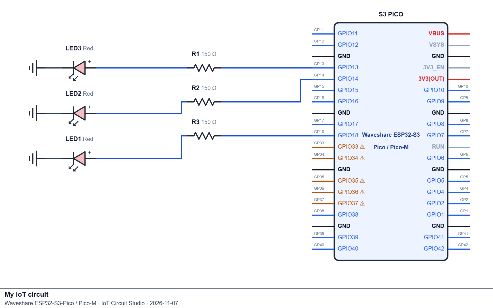
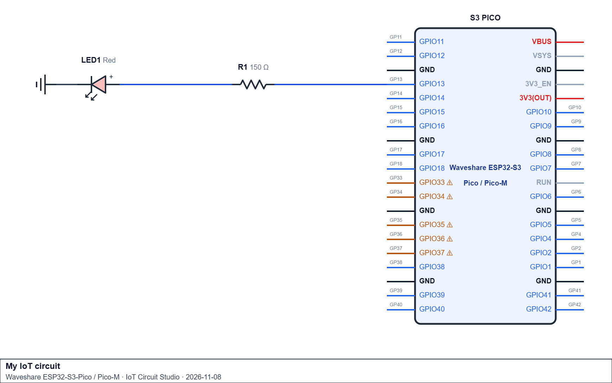
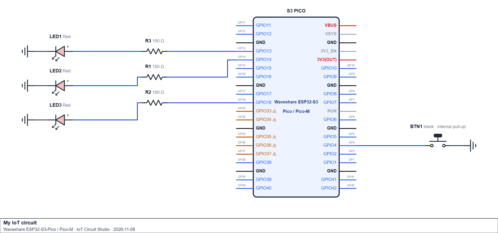

# Activity 9 (Station Mode) - Wi-Fi Station Mode 

Work through these tasks after reading [Wi-Fi Modes - Station Mode (STA) in Depth](../Resource/Week-10-WiFi-Station-Mode.md). Every task runs the ESP32-PICO in **Station mode** on your own 2.4 GHz network (a phone hotspot works well).

> **Schematics:** for every task that has a circuit (Tasks 2, 3, 5 and 6), draw the schematic **before** you build it on the breadboard, using [Circuit Studio](https://circuit-studio.pages.dev/).
> - Include **every component** in that task's Components list.
> - **You choose the GPIO pins.** Fill in the task's **Your pin choices** table, draw those pins on your schematic, and use the same numbers as named constants in your code (e.g. `const int STATUS_LED = 27;`). All three must match.
> - Show the resistors, and connect every ground to GND.
> - When it's finished, use **Export → Schematic image** to save a picture and **Export → Share link** to get a link, and paste both into the Schematic box near the top of each task.

> **Pin rules for the ESP32-PICO** (a pin that breaks one of these rules can stop the sketch working, or stop the board booting):
> - **Outputs** (LEDs) can't use GPIO 34, 35, 36 or 39, because those are input-only.
> - **Never use** GPIO 6-11, 16 or 17 (wired to the ESP32-PICO's internal flash) or GPIO 1 and 3 (Serial TX/RX, which the Serial Monitor needs).
> - **Avoid the boot-mode (strapping) pins** GPIO 0, 2, 5, 12 and 15. Something connected to them can stop the board from booting or uploading.
> - **Safe choices** for LEDs and buttons: GPIO 4, 13, 14, 18, 19, 21, 22, 23, 25, 26, 27, 32, 33.
> - **Buttons** in this Activity are wired between the GPIO and GND and use `INPUT_PULLUP`, so a press reads `LOW`.
> - **Check your board's pinout.** Not every GPIO is broken out to a header pin on every ESP32-PICO board.
> - **Within one task, every connection needs its own pin.**

> **Credentials:** replace your real Wi-Fi name and password with `"YOUR_WIFI_NAME"` / `"YOUR_WIFI_PASSWORD"` before you submit any code. Blank out your real IP addresses and MAC addresses in screenshots if you'd rather not share them.

## Task 1 - Wi-Fi Network Scanner

**Scenario:**

A technician is about to install a sensor in a storeroom and wants to know which 2.4 GHz networks reach that spot, and how strong each one is, before choosing where to mount it.

**Components:**

- ESP32-PICO development board (no circuit)

Write a sketch that puts the radio in Station mode (`WiFi.mode(WIFI_STA)`) and calls `WiFi.disconnect()` without joining any network, then scans once from `setup()` using `WiFi.scanNetworks()`. Print the number of networks found, then one line per network showing: its number, RSSI in dBm, a quality word (`excellent`, `good`, `fair`, `weak` or `unusable`, using the RSSI table in the Resource), the channel, the security type and the SSID. Write two helper functions, `const char* rssiQuality(int rssi)` and `const char* securityText(wifi_auth_mode_t type)` (handle at least `open`, `WPA2`, `WPA/WPA2`, `WPA2/WPA3` and `other`). Show hidden networks as `(hidden)`. Print `"No networks found."` if the count is 0 and an error message if it's negative. Call `WiFi.scanDelete()` when you've finished printing.

>
> Evidence: _(screenshot of the Serial Monitor showing the scan table; your own network should be in the list)_
>
>A copy of my code Activity 1: https://wokwi.com/projects/480013702329256961

**Check yourself:**
- [ ] Radio set to Station mode before scanning, and no `WiFi.begin()` call
- [ ] Each line shows number, RSSI, quality word, channel, security and SSID
- [ ] `rssiQuality()` and `securityText()` are separate functions, each with a one-line comment above it
- [ ] Hidden networks are shown as `(hidden)`, and the 0 and negative counts are handled
- [ ] `WiFi.scanDelete()` is called after the results are printed
- [ ] Your own 5 GHz network (if you have one) is missing from the list, and you can explain why

---

## Task 2 - Connection Diagnosis With a Blinking Status LED

**Scenario:**

Students keep reporting that their devices "won't connect", but the only clue the Serial Monitor gives them is a row of dots. Build a connection routine that says *why* it failed, with an LED that blinks while connecting and stays on once connected.

**Components:**

- ESP32-PICO development board
- 1x LED
- 1x 220 Ω resistor
- Jumper wires

> **Schematic:**
>
>
>[Finished Schematic](https://circuit-studio.pages.dev/#p=zfZLdb9owFMX_FXSenSp2wkL9VnVThfZRtHUvmxDKhwFvSWzZDjQg_vfKGW0SVPZon-Pzu_f6HrFWpkodOKRyQS5N3kgXWNcUUoFgJ4yVqganBHVaCXB8bSdz9TQ5W0GQG5E6UYCDhexDQGkQJk9hwhnlU3YTh_EvEDS6eN-U8Ci-YTHzpkylpph7k7A6YoGNAi1zX0euKq1qUTsL_vsI6T0_KQhcq31R3UsQPIPHIUELTkMCoxx4SFCmmSjB8SOaLOb3jyDQRmkLfjxdh57ImZOvNm3VTsO2x5XiDAvi8B8uecXR2QD45dNHOqAhV6Uy4DCiwIlgXUoNvk5LKwY0XTQzVkc9zQgrrVPmjOwILfjsXeT3EVBtKwtOp-FV2n53u9mK5562qd96Sy56ux1wHr6NWrvIXxLspRGD39qvDqaJVL0HQdrN4qJZ7XfDTyXr1X7wXr3z6iu__5_96nAo2XbHxsnjt58vkvu2vbq4lqyreBaxv_-rmY6Su6X01w-L-SONxrlLgryxTlX3qhDgdVOWXq434EhN0cja73opM5Ma2Q1vSZB12To17jznP02lhekOp9ML)
>
>Activity 2: Connection-Diagnosis-Schematic:
>
>
> <details><summary>Schematic link</summary>
>
> [Open the example schematic in Circuit Studio]()
>
> </details>
>
> **Your pin choices** (choose any suitable GPIO, following the pin rules, and use the same numbers in your schematic and your code):
>
> | Connection | Pin type needed | Your GPIO |
> |---|---|---|
> | Status LED (through the 220 Ω resistor; LED cathode → GND) | Digital output | GPIO 13 |

Write `const char* statusText(wl_status_t status)` that returns a helpful message for each of `WL_IDLE_STATUS`, `WL_NO_SSID_AVAIL`, `WL_CONNECTED`, `WL_CONNECT_FAILED`, `WL_CONNECTION_LOST` and `WL_DISCONNECTED` (plus a `default`). In `setup()`, set Station mode and call `WiFi.begin()` **once**, with no waiting loop. In `loop()`, with no `delay()`:
- check `WiFi.status()` on every pass, and print `"Status: "` + `statusText()` **only when the status changes** (keep a `lastStatus` variable)
- while not connected, blink the LED every 250 ms using `millis()`
- once connected, keep the LED on and print `"Connected! IP: "` with `WiFi.localIP()` once
- if still not connected after `CONNECT_TIMEOUT = 15000` ms from start-up, print `"Gave up - "` + `statusText()` once and turn the LED off

Then test three cases and screenshot each: (a) correct details, (b) an SSID that doesn't exist, (c) the right SSID with a wrong password.

>
> Evidence: _(photo or short video of the LED blinking then staying on, plus three Serial Monitor screenshots: correct details, wrong SSID, wrong password)_
>
>A copy of my code Activity 2: https://wokwi.com/projects/480021042724052993

**Check yourself:**
- [ ] Pin table filled in with pins that follow the pin rules, and the same pins used in both the schematic and the code constants
- [ ] Schematic drawn in Circuit Studio using every component listed above, pasted into the Schematic box with its share link
- [ ] `WiFi.begin()` is called once from `setup()`, with no blocking wait loop anywhere
- [ ] Status printed only when it changes, not on every pass
- [ ] LED blinks at 250 ms while connecting and stays on once connected, all with `millis()`
- [ ] The 15-second timeout message appears once only
- [ ] The wrong-SSID test shows the "network not found" message
- [ ] `loop()` contains no `delay()`

---

## Task 3 - Connection Report and RSSI Signal Meter

**Scenario:**

The technician from Task 1 now wants a handheld meter: after joining the network it shows signal strength as 0-3 bars on LEDs, so they can walk around the storeroom and find the best spot to mount the sensor.

**Components:**

- ESP32-PICO development board
- 3x LED
- 3x 220 Ω resistor
- Jumper wires

> **Schematic:**
>
>
>[Finished Schematic](https://circuit-studio.pages.dev/#p=zlZVdb5swFIb_SnWuzQQ4JMF3UzdV0T5abd3NpiriwzAnYLu2Sciq_PfJLJUDCnS5BB-_z_vi48MLFELViQECTBgvYyprmPG0aXImAMGOKs0EBxIg4ElNgcCXw81KPN6cSgFBpmhiaA4EQj-ce0Hg-YtHPyZBRCL8LpotfgKCRuaXi5a2yMdzW5SKROUrW0S1xKGnsSdZZn1kopaCU240kF8vwGzNjwAQmIO0prqdgKAFEvg-ggOQuY9ACQPER1AlKa2AwHd887C6vQcEUgmpgbwcx6lHdAJla1_ttG4jx6voiebh2T9cuHzlBcsz4uePH4IzHGSiEgoIKJrDEUFRMQmkSCpNz3B4z2LcLiZx_hguvBpndk3cpJPpgnAMh6_G1WXJ04I7nKKaaSPUidmxLBNfZH7rfU_xu9ZAgsgfxaUyWzxvDw5X8td0s2CYLj4D3X3tHd0ogNV-0XL9dp74cp7wujysyNsy01N5XHMM8oT_k6eswlLPmjfzhNHlPPi6PM3mj2gO7WSe5UgePJ7nCcGeKXo2L_brbYEXebkFBEnXrYN2lHY62b5N3aq7G3b1vV195bsBsV_PRM2YYn3l_t5PA2XXl3b1YUx5a-p45-d9Zddylzy78THpOVnomIeyr9zfO_Tsem_Scys2cle3fWXXVpc8uwk76blIeKHTwQn29w49u_6a9FzwvTLbaKo3gp5y9_uxr-8eVvcBHtMtxTbKlmrq_KZ0Z2O6Sj8_b1I99Y2ndJd93ScEWaONqG9FToHwpqrsMi-BQKLyhnH7F65YqhLFukv1hCDttGWizOn-bZpaUtU9HI9_AQ)
>
>Activity 3: RSSI Signal Meter Schematic:
>
>
> <details><summary>Schematic link</summary>
>
> [Open the example schematic in Circuit Studio]()
>
> </details>
>
> **Your pin choices** (choose any suitable GPIO, following the pin rules, and use the same numbers in your schematic and your code):
>
> | Connection | Pin type needed | Your GPIO |
> |---|---|---|
> | Bar LED 1 (through a 220 Ω resistor; LED cathode → GND) | Digital output | GPIO 13 |
> | Bar LED 2 (through a 220 Ω resistor; LED cathode → GND) | Digital output | GPIO 14 |
> | Bar LED 3 (through a 220 Ω resistor; LED cathode → GND) | Digital output | GPIO 18 |

Connect in Station mode from `setup()` with a bounded blocking retry (max 20 attempts × 500 ms, called once only). If connected, call `printConnectionInfo()`, which prints the SSID, router MAC (`WiFi.BSSIDstr()`), channel, RSSI, IP address, subnet mask, gateway, DNS server and the ESP32-PICO's own MAC address, one per line with labels. Write `int rssiToBars(int rssi)` (3 bars at -60 dBm or stronger, 2 bars at -70 or stronger, 1 bar at -80 or stronger, otherwise 0) and `void showBars(int bars)`. In `loop()`, every `METER_INTERVAL = 1000` ms (`millis()`, no `delay()`), read `WiFi.RSSI()`, update the LEDs and print `RSSI <value> dBm -> <bars> bar(s)`. If not connected, show 0 bars and print `Not connected -> 0 bars`.

Test it by walking away from the router (power the board from a power bank or long cable) and record the RSSI at three distances.

>
> Evidence: _(photo or video of the LED bars, a Serial Monitor screenshot of the connection report, and a small table of the RSSI and bars you measured at three distances)_
>
>A copy of my code Activity 3: https://wokwi.com/projects/480028056565487617

**Check yourself:**
- [ ] Pin table filled in with pins that follow the pin rules, and the same pins used in both the schematic and the code constants
- [ ] Schematic drawn in Circuit Studio using every component listed above, pasted into the Schematic box with its share link
- [ ] `printConnectionInfo()` prints all nine details, labelled
- [ ] `rssiToBars()` uses exactly the thresholds given
- [ ] Meter updates once a second using `millis()`; `loop()` has no `delay()`
- [ ] Shows 0 bars when the connection drops (switch off the hotspot to test)
- [ ] Three-distance RSSI table included

---

## Task 4 - Static IP and Hostname

**Scenario:**

A classroom has a display board that needs to send commands to an ESP32-PICO, so the ESP32-PICO must always be at the same address. The network admin also wants it to appear in the router's device list with a clear name.

**Components:**

- ESP32-PICO development board (no circuit)
- A laptop connected to the same network

**Step 1:** connect once **without** a static IP, and print `WiFi.localIP()`, `WiFi.gatewayIP()`, `WiFi.subnetMask()` and `WiFi.dnsIP()`. Write these down: they tell you your network's range.

**Step 2:** choose a static IP in the same range, with a last number that no other device uses (e.g. `.200`). Write `bool connectWithStaticIP()` that:
- calls `WiFi.setHostname("classroom-<your initials>")` **before** `WiFi.mode(WIFI_STA)`
- calls `WiFi.config(staticIP, gateway, subnet, dns)` before `WiFi.begin()`, checking its return value and printing an error if it's `false`
- waits with a bounded retry (max 20 attempts × 500 ms), printing the status with your `statusText()` from Task 2 only when it changes
- returns whether it connected

Call it once from `setup()`, then print the IP address, gateway and `WiFi.getHostname()`. Restart the board three times and confirm the IP is the same each time. From your laptop, run `ping <your static IP>` and screenshot the replies.

>
> Evidence: _(screenshots of: Step 1 output, the Serial Monitor showing the static IP and hostname, and the laptop terminal showing successful ping replies; optionally the router's device list showing your hostname)_
>
>A copy of my code Activity 4: https://wokwi.com/projects/480102486408070145

**Check yourself:**
- [ ] Static IP, gateway and subnet match the values found in Step 1 (same first three numbers, real router address as the gateway)
- [ ] `WiFi.setHostname()` comes before `WiFi.mode()` and `WiFi.begin()`
- [ ] `WiFi.config()` comes before `WiFi.begin()` and its return value is checked
- [ ] Same IP after three restarts
- [ ] `ping` from the laptop gets replies

---

## Task 5 - Event-Driven Connection Monitor

**Scenario:**

A cool-room temperature sensor keeps going offline for short periods, and the facilities team wants to know how often and why. Build a monitor that reacts to Wi-Fi events the moment they happen, counts real drops and logs the reason for each one.

**Components:**

- ESP32-PICO development board
- 1x LED
- 1x 220 Ω resistor
- Jumper wires

> **Schematic:**
>
>
>[Finished Schematic](https://circuit-studio.pages.dev/#p=zfZJfb9owFMW_CjrPTmUnIaV-q7qpQvtTtHUvmxByEkPdJbFnO2QI8d0rZ6AQVPZo3-Pzu-f67rHWthYeHEr7qFC2aJWPnG9LpUGwldYp3YAzgkbUEhxfdpO5fp4cpSAorBReluCIaZxFjEV09kwzPo15TG_uKPsJgtaU10RTepPM0iDKtbDlPIikM0kcuSQyqgh9FLo2upGNd-C_9lBB84OBwO9MaKp_CYK_4IxSgh14Rgms9uCUoBK5rMDxPZks5g9PIDBWGwe-P1ynHsgRVKzWwsfbNBt4lTzSoiT9h2PxicdmZ8TPHz-wMxwKXWkLDitLHAjWlTLga1E5eYZ7-V3T1-zPgLPSKee1PTJ7VmAm7zK_jYj6pXbgbEqv4rptufEyHXCb5pQuZZfp7s5Aj19H4S4AS4JOWXn2Y91KdlWubkMy0U_jIq4J-xHmkg_VYfaheh-qJ_7wRd2qyNJpkpix8_jtpwvnIXeoLq453yZx1nXufz2zkXO_mOH6cTF_YsnYd0lQtM7r-kGXErxpqyqUmw04hC1b1YR9r1RuhVX98JYEee9thPXHOb-2tZG2PxwObw)
>
>Activity 5: Event-Driven Connection Monitor Schematic:
>
>
> <details><summary>Schematic link</summary>
>
> [Open the example schematic in Circuit Studio]()
>
> </details>
>
> **Your pin choices** (choose any suitable GPIO, following the pin rules, and use the same numbers in your schematic and your code):
>
> | Connection | Pin type needed | Your GPIO |
> |---|---|---|
> | Status LED (through the 220 Ω resistor; LED cathode → GND) | Digital output | GPIO 13 |

Write `onWiFiEvent(WiFiEvent_t event, WiFiEventInfo_t info)` that handles `ARDUINO_EVENT_WIFI_STA_GOT_IP` and `ARDUINO_EVENT_WIFI_STA_DISCONNECTED` by **only** setting `volatile` flags and saving `info.wifi_sta_disconnected.reason` (no printing, no `delay()` inside it). Register it with `WiFi.onEvent()` in `setup()` **before** `WiFi.begin()`, and don't use a blocking wait loop. Write `const char* reasonText(uint8_t reason)` covering at least reasons 15, 200, 201, 202 and 204. In `loop()`, with no `delay()`:
- handle the flags: on "got IP" print `[EVENT] Online. IP: ...` with the RSSI; on "disconnected" print `[EVENT] Disconnected - reason <code>: <text> (drops so far: <n>)`
- count a drop **only** when the device was online and then disconnected, not on every failed retry
- keep the LED on while online and blink it every 250 ms while offline
- keep a non-blocking `maybe_reconnect()` safety net that calls `WiFi.begin()` every 10 s while offline, with no wait loop around it

Test it by switching your hotspot off and on three times. Then upload once with a wrong password and capture the reason code.

>
> Evidence: _(video of the LED going solid → blinking → solid as you switch the hotspot off and on, plus Serial Monitor screenshots showing three drops with their reasons and the wrong-password reason)_
>
>A copy of my code Activity 5: https://wokwi.com/projects/480109075489836033

**Check yourself:**
- [ ] Pin table filled in with pins that follow the pin rules, and the same pins used in both the schematic and the code constants
- [ ] Schematic drawn in Circuit Studio using every component listed above, pasted into the Schematic box with its share link
- [ ] Event function only sets `volatile` flags and the reason; all printing happens in `loop()`
- [ ] `WiFi.onEvent()` registered before `WiFi.begin()`
- [ ] Drop counter shows 3 after three hotspot off/on cycles, not a bigger number
- [ ] `reasonText()` decodes the reasons; the wrong-password test shows 15, 202 or 204
- [ ] `maybe_reconnect()` has no `while`/`delay()` around `WiFi.begin()`
- [ ] `loop()` contains no `delay()`

---

## Task 6 - Capstone: Wi-Fi Site Survey Tool

**Scenario:**

An installer wants a single handheld tool for checking Wi-Fi before installing IoT devices on a farm shed. It stays connected to the shed's network, shows live signal bars, logs every drop with its reason, and scans for other networks on demand, without ever freezing.

**Components:**

- ESP32-PICO development board
- 3x LED
- 3x 220 Ω resistor
- 1x push button
- Jumper wires

> **Schematic:**
>
>
>[Finished Schematic](https://circuit-studio.pages.dev/#p=zlVVbb5swFP4r1Xk2FcZAiN-2bqqibW21dS-bqoqLkzgxmBhTclH--0SahsDAbR6Tc_xdfD4fdjCVKg01UOBSWzFXccm1Vegy4RIQvDBVcJkBxQiyMGVA4cfmaiIfr46tgCBWLNQsAQqO7fgWxpYdPNoBJQH1vOuR7f8BBGWe9Da5mLrk2nbduimSoUomdRMrcuJYBbFyHtc6YpnmMmOZLoD-3QGve35jQKA3eS3qcBIQrIFiYiPYAPVtBEpqoDYCEUZMAIVf5OphcnMPCHIl8wLobj_MukdHovg5mWerrVYNn2BHNovgVzrsvPHh4Izx-9cv-IwOYimkAgqKJbBHMBU8BzoNRcHO6FYYe9FoYaJz7CE652K6dT5bapIa6YIhOnIxHXHUyBfJ2fBKrWX2yuiNXgkJ6Rnf58e73suMRBgv60Ip6jaeaavMhwVMl5uFuw4aAYoVvNBSHU2PjxMd93r-2ZIg52kBFHv2INt4q0pbeQ3bLDvdbtAd5viM6PauFZ3htMzFHLvv2nG8fjvOZXa0E6QzbRvtBAN2nI_YIXMdhYHz7nRIvx1y4XTmVRnkW5Od5mV37JCP2ClFuZKbsIfA949Rd9_wnVGbwB0meEJQccXO1mH1XOAALxIBCMLD6-iEPa-Xb_0qoqbabJq6-qmuvvE3-696jtVSVQq3kdtnv3WQm9jX1Ych5NUmHRUi6iCfEt2nuVlXRs1ZKd2lL9vI7bNdzU22jZp5tZhxN20jN7Ht09x8QIya83jkurqD3D773z2fAmzWXKx4uq06mk-buE9zk1wjcmB7S17FJmTcQj58t-u_bx8m9-7g-JgfLpOt6ZINsJgM4Vbegq342vRITLiDeovQDtIXY5BNuEEb9wlBXBZapjcyYUCzUoi6nM2AQqiSkmd1sAWPVKj4YQs8IYgO2Hmo9HFhLMo0Z-rwY7__Bw)
>
>Activity 6: Wi-Fi Site Survey Tool Schematic:
>
>
> <details><summary>Schematic link</summary>
>
> [Open the example schematic in Circuit Studio]()
>
> </details>
>
> **Your pin choices** (choose any suitable GPIO, following the pin rules, and use the same numbers in your schematic and your code):
>
> | Connection | Pin type needed | Your GPIO |
> |---|---|---|
> | Bar LED 1 (through a 220 Ω resistor; LED cathode → GND) | Digital output | GPIO 13 |
> | Bar LED 2 (through a 220 Ω resistor; LED cathode → GND) | Digital output | GPIO 14 |
> | Bar LED 3 (through a 220 Ω resistor; LED cathode → GND) | Digital output | GPIO 18 |
> | Push button (other leg → GND, `INPUT_PULLUP`) | Digital input | GPIO 4 |

Combine Tasks 3 and 5 and add an on-demand scan:
- **Connect:** Station mode, `WiFi.onEvent()` registered before `WiFi.begin()`, no blocking wait loop.
- **Events:** reuse your Task 5 event function, flag handling, `reasonText()` and drop counter. When the device comes online, also call your `printConnectionInfo()` from Task 3.
- **Signal bars:** reuse `rssiToBars()` and `showBars()` from Task 3, updated every 1000 ms. While offline, show 0 bars.
- **Scan button:** a debounced press (50 ms, `millis()`) starts an **asynchronous** scan with `WiFi.scanNetworks(true)`. Check `WiFi.scanComplete()` each pass: while it's `WIFI_SCAN_RUNNING`, do nothing; on `WIFI_SCAN_FAILED`, print an error; otherwise print each network's RSSI, channel and SSID, then call `WiFi.scanDelete()`. Ignore presses while a scan is already running.
- **Safety net:** `maybe_reconnect()` every 10 s while offline, and not while a scan is running.
- `loop()` calls short functions only and contains no `delay()`.

>
> Evidence: _(video showing the bars changing as you move, a scan being triggered by the button while the bars keep updating, and a hotspot off/on cycle; plus Serial Monitor screenshots of the connection report, a scan result and a logged drop)_
>
>A copy of my code Activity 5: https://wokwi.com/projects/480116371122050049

**Check yourself:**
- [ ] Pin table filled in with pins that follow the pin rules, and the same pins used in both the schematic and the code constants
- [ ] Schematic drawn in Circuit Studio using every component listed above, pasted into the Schematic box with its share link
- [ ] Event-driven connect with no blocking loop; connection report printed each time the device comes online
- [ ] Bars update every second, and show 0 while offline
- [ ] Scan is asynchronous: the bars and event handling keep working during it
- [ ] Presses during a running scan are ignored; `WiFi.scanDelete()` called after printing
- [ ] `maybe_reconnect()` doesn't run during a scan
- [ ] `loop()` contains no `delay()`

---

## Task 7 - Spot-the-Bug Worksheet

**Format:** For each round, read the snippet and write down what's wrong **before** revealing the answer.

**Round 1:**
```cpp
void setup() {
  Serial.begin(115200);
  WiFi.mode(WIFI_STA);
  WiFi.begin(SSID, PASSWORD);
  WiFi.setHostname("pump-controller");
}
```
<details><summary>Answer</summary>`WiFi.setHostname()` is called **after** `WiFi.mode()` and `WiFi.begin()`. By then Station mode has already started and sent its default name to the router, so the new hostname is ignored and the router still lists the device as `esp32-XXXXXX`. Move `WiFi.setHostname()` to before `WiFi.mode(WIFI_STA)`.</details>

**Round 2:**
```cpp
IPAddress staticIP(192, 168, 1, 200);
IPAddress gateway(192, 168, 1, 1);
IPAddress subnet(255, 255, 255, 0);

void setup() {
  WiFi.mode(WIFI_STA);
  WiFi.begin(SSID, PASSWORD);
  WiFi.config(staticIP, gateway, subnet);
}
```
<details><summary>Answer</summary>`WiFi.config()` is called after `WiFi.begin()`. The connection (and the DHCP request) has already started, so the static settings arrive too late: depending on timing they can be ignored or overwritten by DHCP, and the device may get a different address from one boot to the next instead of always `192.168.1.200`. `WiFi.config()` must come before `WiFi.begin()`.</details>

**Round 3:**
```cpp
int rssiToBars(int rssi) {
  if (rssi <= -60) return 3;
  if (rssi <= -70) return 2;
  if (rssi <= -80) return 1;
  return 0;
}
```
<details><summary>Answer</summary>The comparisons are the wrong way round. RSSI is negative, and a **weaker** signal is a **more negative** number, so `rssi <= -60` is true for every weak signal (-75, -90...) and they all show 3 bars, while a strong signal such as -45 shows 0 bars. It should be `rssi >= -60` → 3, `rssi >= -70` → 2, `rssi >= -80` → 1.</details>

**Round 4:**
```cpp
void onWiFiEvent(WiFiEvent_t event, WiFiEventInfo_t info) {
  if (event == ARDUINO_EVENT_WIFI_STA_DISCONNECTED) {
    Serial.println("Lost Wi-Fi, retrying...");
    while (WiFi.status() != WL_CONNECTED) {
      WiFi.begin(SSID, PASSWORD);
      delay(1000);
    }
  }
}
```
<details><summary>Answer</summary>The event function blocks: it waits in a `while`/`delay()` loop until the connection is back. Event functions run on the Wi-Fi system's own task, and that task has to keep running to deliver the very connection it's waiting for, so this can stall reconnection or trigger a watchdog reset. Event functions must only set flags (and save the reason); the printing and the non-blocking reconnect belong in `loop()`.</details>

**Round 5:**
```cpp
void updateScan() {
  if (scanButtonPressed()) {
    WiFi.scanNetworks(true);
    int count = WiFi.scanComplete();
    for (int i = 0; i < count; i++) {
      Serial.println(WiFi.SSID(i));
    }
  }
}
```
<details><summary>Answer</summary>`WiFi.scanNetworks(true)` starts a **background** scan and returns straight away, so `WiFi.scanComplete()` is checked immediately and returns `WIFI_SCAN_RUNNING` (-1). The `for` loop never runs and nothing is printed. The result must be checked on later passes of `loop()` (using a `scanning` flag) until it stops returning `WIFI_SCAN_RUNNING`. `WiFi.scanDelete()` is also missing.</details>

**Round 6:**
```cpp
volatile bool disconnectedFlag = false;
int dropCount = 0;

void loop() {
  if (disconnectedFlag) {
    disconnectedFlag = false;
    dropCount++;
    Serial.print("Drops: ");
    Serial.println(dropCount);
  }
}
```
<details><summary>Answer</summary>`ARDUINO_EVENT_WIFI_STA_DISCONNECTED` fires on **every failed retry**, not just when a working connection drops. With the router off for a minute, the counter climbs by dozens for what was really one drop. Keep an `online` variable and only count a drop when `online` was `true` (then set it to `false`).</details>

---

## Questions

Answer these in your own words before moving on:

1. Describe the four stages a station goes through to join a router. If `WiFi.status()` returns `WL_NO_SSID_AVAIL`, which stage failed, and what three things would you check?
   ```
   The four stages are scanning (searching for Wi-Fi networks), authentication (checking the password and security), association (the router accepts the ESP32), and the four-way handshake (establishing an encrypted connection).
   ```

2. An ESP32-PICO shows `WL_CONNECTED` but every Supabase send fails. Give two possible causes, and explain why `WL_CONNECTED` doesn't prove the device can reach the internet.
   ```
   two possible causes are incorrect Supabase details, such as the URL or publishable key, and an internet DNS connection problem. WL_CONNECTED only confirms that the ESP32 is connected to the router. It doesn't guarantee internet access or that it can reach Supabase.

   ```

3. One device reads `-48 dBm` and another reads `-78 dBm`. Which has the stronger signal, roughly how many times stronger is it, and what would you expect from each connection?
   ```
   -48 dBm is stronger than -78 dBm because the closer the value is to zero, the stronger the signal. The 30 dB difference means the stronger signal has 1,000 times more received power. The -48 dBm connection should be faster and more stable, while the -78 dBm connection may be slower and experience dropouts.

   ```

4. When would you give an IoT device a static IP, and when is DHCP fine? Why is a DHCP reservation on the router often a better choice than `WiFi.config()` in the sketch?
   ```
   A static IP is useful when an IoT device needs to always be reachable at the same IP address and DHCP is fine for devices that only need to connect to Wi-Fi and send data. A DHCP reservation is usually better because the router's DHCP server always assigns the same IP to that device, reducing the chance of IP conflicts and avoiding manual configuration in the code.

   ```

5. Compare polling `WiFi.status()` in `loop()` with using `WiFi.onEvent()`. What can events tell you that polling can't, and why must an event function only set flags instead of printing, waiting or reconnecting?
   ```
   Polling makes the ESP32 repeatedly check whether Wi-Fi is connected or disconnected. Events notify the ESP32 when something happens, such as connecting or disconnecting, and can provide the reason. The event function should only set flags because it needs to finish quickly, while the main loop handles the printing and reconnecting.

   ```
