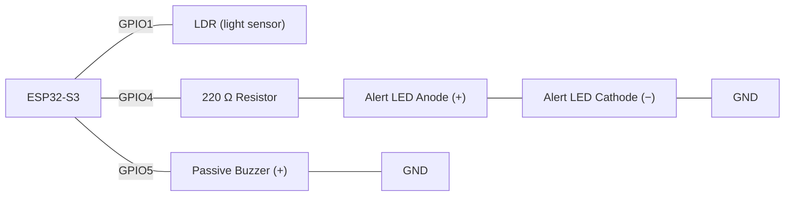
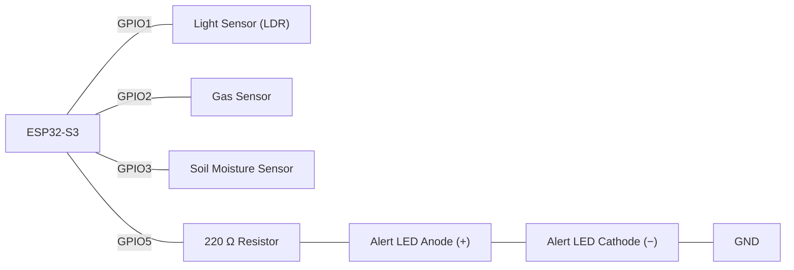

# Week 7: Sensor Threshold (Reading, Converting, and Reacting to Sensor Values)

## What is a Threshold?
A **threshold** is a value that marks the boundary between two states, such as normal and alert. When a reading crosses the threshold, the program responds. A threshold system typically needs a **low** limit, a **high** limit, or both, depending on the sensor:

| Sensor | Low threshold | High threshold |
|--------|--------------|---------------|
| Temperature (DHT11) | 15 °C | 35 °C |
| Light (LDR) | 800 (dark) | 3200 (bright) |
| Gas/smoke | None | 2400 |
| Soil moisture | 800 (dry) | None |

### Real-world use in industry
- A fridge or cold room alarms if temperature rises above a safe limit; 
- a smoke detector alarms once smoke density crosses a fixed level;
-  a phone throttles its CPU once internal temperature gets too high; 
-  a greenhouse controller opens vents once humidity exceeds a set point. 
  
In every case the sensor only reports a number. The threshold comparison in software is what turns that number into a decision.

---

## What is an ADC?
An **ADC (Analogue-to-Digital Converter)** is the circuit inside the microcontroller that turns a voltage into a number the program can work with. Sensors such as an LDR or a soil moisture probe output a voltage that changes smoothly (for example 1.27 V), but code can only work with numbers, so the ADC measures that voltage and turns it into a whole number.

The ESP32-S3 has a **12-bit** ADC, which gives 2¹² = 4096 possible values, from **0 to 4095**. 0 V reads as 0, 3.3 V reads as 4095, and everything in between scales proportionally:

| Voltage on pin | `analogRead()` returns |
|---|---|
| 0 V | 0 |
| 1.65 V (half) | ~2047 |
| 3.3 V | 4095 |

A digital sensor such as the DHT11 has its own converter built into the module. It does the conversion itself and sends a finished value over its data wire, which is why it needs no `analogRead()` or conversion formula.

> **ESP32-S3 pin note:** only some GPIO pins are connected to the ADC. GPIO1–10 belong to **ADC1**. **ADC2** pins stop working while Wi-Fi is on, so analogue sensors are safest on ADC1 pins. That's why the examples in this lesson use GPIO1–3.

### Common Analogue Sensors
Every sensor below outputs a voltage that changes with what it measures, so each one is read with `analogRead()` and needs converting into a meaningful unit:

| Sensor | Measures | How the output changes | Typical use |
|---|---|---|---|
| LDR (photoresistor) | Light level | Resistance drops as light increases (used in a voltage divider) | Automatic night lights, daylight detection |
| Potentiometer | Knob/slider position | Voltage rises as the knob is turned | Volume or brightness control, setting a threshold by hand |
| Soil moisture sensor | Water content of soil | Reading changes as soil gets wetter or drier | Plant watering systems |
| Gas sensor (MQ-2 / MQ-135) | Smoke or gas concentration | Voltage rises as gas concentration increases | Smoke and gas leak alarms |
| NTC thermistor | Temperature | Resistance drops as temperature rises (used in a voltage divider) | Simple temperature monitoring |
| TMP36 / LM35 | Temperature | Voltage rises steadily with temperature (10 mV per °C) | Temperature monitoring without a library |
| Water level sensor | Depth of water | Voltage rises as more of the sensor is submerged | Tank and flood level alerts |
| Sound sensor (analogue output) | Loudness | Voltage rises with louder sound | Noise level meters, clap detection |
| Flame sensor (analogue output) | Infrared light from a flame | Reading changes as a flame gets closer | Fire detection |
| Force-sensitive resistor (FSR) | Pressure or squeeze | Resistance drops as more force is applied | Pressure pads, seat occupancy |
| Flex sensor | Bending | Resistance rises as it bends | Gesture gloves, bend detection |
| Joystick module | X/Y position | Two potentiometers, one analogue output per axis | Game controllers, robot steering |

> **Voltage warning:** the ESP32-S3's ADC pins accept a maximum of **3.3 V**. Some sensor modules (such as the MQ gas sensors and the LM35) are designed for 5 V. Check that the sensor's *output* never goes above 3.3 V, or use a voltage divider to scale it down, before connecting it to a GPIO pin.

---

### Reading an Analogue Sensor (LDR)
`analogRead(pin)` reads the voltage on an ``ADC-capable`` GPIO pin and returns a value from **0 to 4095** (12-bit ADC, 0 V to 3.3 V). This lesson uses an **LDR (photoresistor)** as the example analogue sensor.

#### Wiring the LDR as a Voltage Divider
An LDR doesn't output a voltage on its own. It is a resistor whose resistance changes with light, roughly from 1 MΩ in darkness down to a few hundred ohms in bright light. To turn that change into a voltage `analogRead()` can measure, you pair the LDR with a fixed 10 kΩ resistor to make a **voltage divider**.


The ESP32 measures the voltage at the middle point, where the LDR and resistor meet:

`Vout = 3.3 × R_fixed / (R_LDR + R_fixed)`

| Light | LDR resistance | Voltage at GPIO1 | `analogRead()` (approx.) |
|---|---|---|---|
| Dark | ~100 kΩ | ~0.30 V | ~370 |
| Room light | ~10 kΩ | ~1.65 V | ~2047 |
| Bright | ~1 kΩ | ~3.00 V | ~3720 |

With the LDR on the 3.3 V side, **more light gives a higher reading**. Swap the LDR and the resistor and the behaviour flips, so that more light gives a lower reading.

**Wiring:** LDR between **3V3** and **GPIO1**, 10 kΩ resistor between **GPIO1** and **GND**.

<p align="center"></p>

#### Reading the Raw Value
```cpp
const int LDR_PIN = 1;   // GPIO1 (ADC1), middle point of the voltage divider

void setup() {
  Serial.begin(115200);
}

void loop() {
  int raw = analogRead(LDR_PIN);   // 0 (dark) to 4095 (bright)
  Serial.println("LDR raw: " + String(raw));
  delay(500);
}
```

Cover the LDR with your hand and the reading drops. Shine a phone torch on it and the reading rises towards 4095.

**Code Walkthrough**
| Section | What it does |
|---|---|
| `const int LDR_PIN = 1` | Names the ADC pin connected to the middle point of the voltage divider |
| `Serial.begin(115200)` | Opens the serial connection so readings can be viewed in the Serial Monitor |
| `analogRead(LDR_PIN)` | Measures the pin voltage and returns a whole number from 0 (0 V) to 4095 (3.3 V) |
| `Serial.println(...)` | Prints the raw reading, with no conversion yet |
| `delay(500)` | Waits half a second between readings |

---

## What is a Digital Sensor?
A **digital sensor** sends the microcontroller **digital data** (HIGH/LOW signals, 1s and 0s) instead of a smoothly changing voltage. You don't read it with `analogRead()` or the ADC, and you don't need a conversion formula.

| | Analogue sensor | Digital sensor |
|---|---|---|
| Output | A voltage that changes smoothly (e.g. 1.27 V) | Digital signals: HIGH/LOW, or a stream of bits |
| Read with | `analogRead()` → 0–4095 | `digitalRead()` or a library function |
| Conversion | You write the formula (`raw / 4095.0 * ...`) | Done inside the sensor; you get the final value |
| Example | LDR, soil moisture, MQ-2 gas | DHT11, push button, PIR motion |

Digital sensors come in two kinds:

**1. On/off sensors.** The output is only HIGH or LOW, read with `digitalRead(pin)`.

| Sensor | HIGH / LOW means |
|---|---|
| Push button | Pressed / not pressed |
| PIR motion sensor | Motion / no motion |
| IR obstacle sensor | Object detected / no object |
| Reed switch | Magnet near / not near |

**2. Data sensors.** The sensor measures, converts and calibrates internally, then sends the finished number as a stream of bits. A library decodes it for you.

| Sensor | Measures | How it communicates |
|---|---|---|
| DHT11 / DHT22 | Temperature and humidity | Single data wire, read with `dht.readTemperature()` |
| HC-SR04 ultrasonic | Distance | Calculated from the length of an echo pulse |
| AHT20 / BMP280 | Temperature, humidity, pressure | I²C bus (two wires: SDA and SCL) |
| DS18B20 | Temperature | Single data wire (1-Wire protocol) |

The DHT11 returns a finished value like **24.0 °C**, while an LDR returns a raw number like **2606** that you convert yourself. Once you have the value, the threshold `if / else` logic is the same for both.

---

### Reading a Digital Sensor (DHT11)
Not every sensor needs the raw-value conversion above. The **DHT11** is a low-cost temperature and humidity sensor that does its own analogue sensing and calibration inside the module. It sends the result to the microcontroller as digital data on a **single data wire**, using its own timing-based protocol. The protocol isn't I²C, and it isn't `analogRead()` either. The `DHT sensor library` (by Adafruit) handles that protocol for you and gives you a finished `°C` value, so you don't write any conversion formula.

**Wiring:** DHT11 **VCC → 3V3**, **DATA → GPIO7**, **GND → GND**.

<p align="center"></p>

```cpp
#include <DHT.h>   // DHT sensor library by Adafruit

DHT dht(7, DHT11);   // data pin GPIO7, sensor type DHT11

void setup() {
  Serial.begin(115200);
  dht.begin();
}

void loop() {
  float temperature = dht.readTemperature();  // already a calibrated °C value
  float humidity    = dht.readHumidity();     // relative humidity in %

  if (isnan(temperature) || isnan(humidity)) {
    Serial.println("Failed to read from DHT11");
  } else {
    Serial.println("Temp: " + String(temperature, 1) + " C  Humidity: " + String(humidity, 1) + "%");
  }
  delay(2000);   // the DHT11 needs at least 1 s between reads
}
```

**Code Walkthrough**
| Section | What it does |
|---|---|
| `#include <DHT.h>` | Loads the Adafruit DHT library, which handles the DHT11's single-wire protocol |
| `DHT dht(7, DHT11)` | Creates the sensor object for a DHT11 with its data wire on GPIO7 |
| `dht.begin()` | Starts the sensor; called once in `setup()` |
| `dht.readTemperature()` / `dht.readHumidity()` | Return finished values in °C and % with no `analogRead()` or conversion formula |
| `isnan(temperature) \|\| isnan(humidity)` | Catches a failed read (the library returns NaN) before the values are printed |
| `delay(2000)` | Waits 2 seconds between reads, because the DHT11 can't be read more than about once a second |


### Common Digital Sensors
A wider range of on/off and data sensors you'll meet in IoT projects:

| Sensor | Measures | Kind | How it communicates | Typical use |
|---|---|---|---|---|
| Push button | Press | On/off | `digitalRead()` | User input, reset buttons |
| Limit switch | Physical contact | On/off | `digitalRead()` | 3D printer end stops, door closed detection |
| PIR motion sensor (HC-SR501) | Movement of warm bodies | On/off | `digitalRead()` | Security lights, room occupancy |
| IR obstacle sensor | Object in front of it | On/off | `digitalRead()` | Line-following and obstacle-avoiding robots |
| Reed switch | Magnetic field | On/off | `digitalRead()` | Door and window alarms |
| Hall effect sensor (A3144) | Magnetic field | On/off | `digitalRead()` | Wheel speed counting, lid detection |
| Tilt switch | Tilt past an angle | On/off | `digitalRead()` | Tip-over alarms, orientation detection |
| Touch sensor (TTP223) | Finger touch | On/off | `digitalRead()` | Touch buttons with no moving parts |
| Rotary encoder | Rotation and direction | On/off pulses | Two `digitalRead()` pins counted in code | Menu knobs, motor position |
| HC-SR04 ultrasonic | Distance | Data (pulse timing) | `pulseIn()` measures the echo pulse length | Parking sensors, tank levels |
| DHT11 / DHT22 | Temperature and humidity | Data | Single data wire, DHT library | Weather stations, room monitoring |
| DS18B20 | Temperature | Data | Single data wire (1-Wire protocol) | Waterproof probes for liquids and soil |
| AHT20 / SHT31 | Temperature and humidity | Data | I²C (SDA/SCL) | Accurate climate monitoring |
| BMP280 / BME280 | Pressure, temperature (BME280 adds humidity) | Data | I²C or SPI | Weather stations, altitude |
| BH1750 | Light level in lux | Data | I²C | Smart lighting, plant grow lights |
| VL53L0X | Distance (laser time-of-flight) | Data | I²C | Precise short-range distance |
| MPU6050 | Acceleration and rotation | Data | I²C | Step counters, drones, tilt detection |
| RC522 RFID reader | RFID card/tag ID | Data | SPI | Door access, attendance systems |

> **Modules with both outputs:** some sensor boards, including many sound, flame, rain and soil moisture modules, have two output pins. **AO** (analogue output) gives a varying voltage for `analogRead()`. **DO** (digital output) gives HIGH/LOW for `digitalRead()`, switching when the reading passes a level you set with the small potentiometer on the board.

---

### Threshold Logic with `if / else if / else`
**Wiring:** DHT11 **VCC → 3V3**, **DATA → GPIO7**, **GND → GND** (same circuit as above).

<p align="center"></p>

```cpp
#include <DHT.h>   // DHT sensor library by Adafruit

DHT dht(7, DHT11);

const float HIGH_THRESHOLD = 35.0;
const float LOW_THRESHOLD  = 15.0;

void setup() {
  Serial.begin(115200);
  dht.begin();
}

void loop() {
  float temperature = dht.readTemperature();

  if (isnan(temperature)) {
    Serial.println("Failed to read from DHT11");
  } else if (temperature > HIGH_THRESHOLD) {
    Serial.println("ALERT: High temperature!");
    // activate red LED and buzzer
  } else if (temperature < LOW_THRESHOLD) {
    Serial.println("ALERT: Low temperature!");
    // activate blue LED
  } else {
    Serial.println("Temperature normal.");
    // activate green LED
  }
  delay(2000);
}
```
**Code Walkthrough**
| Section | What it does |
|---|---|
| `HIGH_THRESHOLD` / `LOW_THRESHOLD` | Named constants for the upper and lower temperature limits |
| `if (isnan(temperature))` | Checked first, so a failed read is never compared against the thresholds |
| `else if (temperature > HIGH_THRESHOLD)` | High alert zone: the reading is above the upper limit |
| `else if (temperature < LOW_THRESHOLD)` | Low alert zone: the reading is below the lower limit |
| `else` | Normal zone: runs only when neither limit is crossed |
| `delay(2000)` | Waits 2 seconds before the next read |

Only one branch of an `if / else if / else` chain ever runs, so each reading falls into exactly one zone.

Storing `HIGH_THRESHOLD`/`LOW_THRESHOLD` as named constants, rather than typing `35.0` and `15.0` straight into the `if` condition, means you change the limits in one place, and anyone reading the code can see what each number is for.

---

### Hysteresis: Preventing Output Flicker
Without hysteresis, a reading that sits right at the threshold (e.g., 35.0 °C) makes the alert switch on and off rapidly. Use two slightly different values to create a dead band.

**Wiring:** DHT11 **DATA → GPIO7**, alert LED on **GPIO4** through a 150 Ω resistor to **GND**.

<p align="center"></p>

```cpp
#include <DHT.h>   // DHT sensor library by Adafruit

DHT dht(7, DHT11);

const int ALERT_LED = 4;

const float ALERT_ON  = 35.0;    // Alert triggers ABOVE this
const float ALERT_OFF = 33.0;    // Alert clears BELOW this

bool alertActive = false;

void setup() {
  pinMode(ALERT_LED, OUTPUT);
  Serial.begin(115200);
  dht.begin();
}

void loop() {
  float temperature = dht.readTemperature();

  if (!isnan(temperature)) {
    if (temperature > ALERT_ON) {
      alertActive = true;
    } else if (temperature < ALERT_OFF) {
      alertActive = false;
    }
    // between 33.0 and 35.0 alertActive keeps its previous value (the dead band)

    digitalWrite(ALERT_LED, alertActive ? HIGH : LOW);
    Serial.println(String(temperature, 1) + " C  Alert: " + (alertActive ? "ON" : "OFF"));
  }
  delay(2000);
}
```

**Code Walkthrough**
| Section | What it does |
|---|---|
| `ALERT_ON` / `ALERT_OFF` | Two separate limits: the alert turns on above 35.0 °C and only turns off below 33.0 °C |
| `bool alertActive` | Remembers whether the alert is currently on. It is declared outside `loop()` so it keeps its value between readings |
| `if (!isnan(temperature))` | Only updates the alert when the read succeeded |
| `if (temperature > ALERT_ON)` | Turns the alert on |
| `else if (temperature < ALERT_OFF)` | Turns the alert off |
| *(no `else`)* | Between 33.0 and 35.0 °C nothing changes, so the alert keeps its previous state (the dead band) |
| `alertActive ? HIGH : LOW` | Drives the LED from the remembered state rather than straight from the latest reading |

#### Real-world use in industry
A household thermostat doesn't switch heating off the instant it reaches the target temperature and back on the instant it drops one degree below. It uses a dead band of a degree or two either side, like `ALERT_ON`/`ALERT_OFF` above, so the heating element and its relay aren't switched on and off dozens of times an hour.

---


### Example 1 - Temperature Alert System (DHT11)

**Components:** ESP32-S3, DHT11 temperature/humidity sensor, 10 kΩ pull-up resistor (not needed if your DHT11 is on a 3-pin module board, which already has one), red LED, green LED, passive buzzer, 220 Ω resistors for LEDs.

**Library:** DHT sensor library by Adafruit (install it from the Library Manager).

> **Passive vs active buzzer:** an *active* buzzer has its own oscillator and beeps at one fixed pitch when you `digitalWrite()` it HIGH. A **passive** buzzer has no oscillator, so it needs a changing signal to make sound. `digitalWrite(HIGH)` only gives a click. Drive it with `tone(pin, frequency)` to play a note and `noTone(pin)` to stop. Because you choose the frequency, different alerts can have different pitches.


<p align="center"></p>

```cpp
#include <DHT.h>   // DHT sensor library by Adafruit

const int DHT_PIN   = 7;
DHT dht(DHT_PIN, DHT11);

const int LED_RED   = 4;
const int LED_GREEN = 5;
const int BUZZER    = 6;   // passive buzzer

const float HIGH_TEMP = 35.0;
const float LOW_TEMP  = 18.0;

const unsigned long READ_INTERVAL = 2000;   // DHT11 shouldn't be polled faster than about once a second
unsigned long previousReadMillis = 0;

void setup() {
  pinMode(LED_RED,   OUTPUT);
  pinMode(LED_GREEN, OUTPUT);
  Serial.begin(115200);   // no pinMode() for the buzzer, since tone() sets the pin up itself

  dht.begin();
  Serial.println("Temperature monitor started.");
}

float readTemperature() {
  return dht.readTemperature();   // already a calibrated °C value, so no ADC conversion is needed
}

void setStatusLeds(bool redOn, bool greenOn) {
  digitalWrite(LED_RED,   redOn   ? HIGH : LOW);
  digitalWrite(LED_GREEN, greenOn ? HIGH : LOW);
}

void triggerAlert(int frequency, int durationMs) {
  tone(BUZZER, frequency, durationMs);   // plays the note, then stops by itself
}

void checkThreshold(float temp) {
  if (temp > HIGH_TEMP) {
    setStatusLeds(true, false);
    triggerAlert(2000, 500);   // high pitch, long beep
    Serial.println("HIGH ALERT: " + String(temp, 1) + " C exceeds " + String(HIGH_TEMP, 1) + " C");
  } else if (temp < LOW_TEMP) {
    setStatusLeds(true, false);
    triggerAlert(500, 200);    // low pitch, short beep
    Serial.println("LOW ALERT:  " + String(temp, 1) + " C below " + String(LOW_TEMP, 1) + " C");
  } else {
    setStatusLeds(false, true);
    Serial.println("Normal:     " + String(temp, 1) + " C");
  }
}

void loop() {
  unsigned long currentMillis = millis();
  if (currentMillis - previousReadMillis >= READ_INTERVAL) {
    previousReadMillis = currentMillis;
    float temp = readTemperature();
    if (isnan(temp)) {
      Serial.println("Failed to read from DHT11. Check the wiring.");
      return;   // skip this cycle and try again next interval
    }
    checkThreshold(temp);
  }
}
```
The main read/check cycle is non-blocking (`millis()`-timed, which keeps reads comfortably slower than the DHT11's 1-second minimum poll interval), and so is the beep. `tone(BUZZER, frequency, durationMs)` starts the note and the ESP32 stops it automatically after `durationMs`, so `triggerAlert()` needs no `delay()`. A high temperature gives a high-pitched 2000 Hz beep and a low temperature gives a lower 500 Hz beep, so you can tell the two alerts apart by ear.

**Code Walkthrough**
| Section | What it does |
|---|---|
| `DHT dht(DHT_PIN, DHT11)` | Creates the sensor object, telling the library which pin the data wire is on and which sensor model is attached |
| `dht.begin()` | Prepares the data pin to talk to the DHT11 |
| `dht.readTemperature()` | Returns the finished, calibrated °C reading. A digital sensor needs no raw ADC conversion |
| `isnan(temp)` | Detects a failed read (the library returns NaN) so a bad value never reaches the threshold check |
| `checkThreshold(temp)` | Keeps all the threshold logic in one function |
| `tone(BUZZER, frequency, durationMs)` | Plays a note on the passive buzzer at the given pitch (Hz) for the given time, without blocking |
| `loop()` | Every 2000 ms (non-blocking), reads the sensor once and checks it against both thresholds |


---

### Example 2 - Light Level Alert (LDR)

**Components:** 
- ESP32-S3
- Light-dependent resistor (LDR) 
-  Alert LED
-  Passive buzzer
  
**Wiring:**


```cpp
const int LDR_PIN   = 1;    // light sensor, analogue
const int ALERT_LED = 4;    // lights when it's too dark
const int BUZZER    = 5;    // passive buzzer, sounds when it's too bright

const int LOW_LIGHT  = 800;    // raw ADC value; below this counts as "too dark"
const int HIGH_LIGHT = 3200;   // raw ADC value; above this counts as "too bright"

const int ALARM_FREQ = 1500;   // buzzer pitch in Hz

const unsigned long READ_INTERVAL = 1000;
unsigned long previousReadMillis = 0;

void setup() {
  pinMode(ALERT_LED, OUTPUT);
  Serial.begin(115200);   // no pinMode() for the buzzer, since tone() sets the pin up itself
}

void loop() {
  unsigned long currentMillis = millis();
  if (currentMillis - previousReadMillis >= READ_INTERVAL) {
    previousReadMillis = currentMillis;

    int raw = analogRead(LDR_PIN);
    float percent = (raw / 4095.0) * 100.0;

    if (raw < LOW_LIGHT) {
      digitalWrite(ALERT_LED, HIGH);
      noTone(BUZZER);
      Serial.println("Light: " + String(percent, 1) + "%, too dark");
    } else if (raw > HIGH_LIGHT) {
      digitalWrite(ALERT_LED, LOW);
      tone(BUZZER, ALARM_FREQ);   // keeps sounding until noTone() is called
      Serial.println("Light: " + String(percent, 1) + "%, too bright");
    } else {
      digitalWrite(ALERT_LED, LOW);
      noTone(BUZZER);
      Serial.println("Light: " + String(percent, 1) + "%, normal");
    }
  }
}
```
This is the analogue version of Example 1. The code compares the raw ADC value directly against the raw limits from the threshold table at the start of this lesson (800 and 3200) instead of converting to a percentage first. Either approach works, because `raw < LOW_LIGHT` and `percent < (LOW_LIGHT/4095.0)*100.0` describe the same boundary.

**Code Walkthrough**
| Section | What it does |
|---|---|
| `analogRead(LDR_PIN)` | Reads the raw ADC value (0–4095) from the light sensor |
| `LOW_LIGHT` / `HIGH_LIGHT` | Raw-value thresholds, compared directly against `raw` |
| `tone(BUZZER, ALARM_FREQ)` / `noTone(BUZZER)` | Starts a continuous 1500 Hz note on the passive buzzer when it's too bright, and stops it in the other two zones |
| `percent` | Only used for the Serial output. The comparison itself uses the raw value |
| `loop()` | Every 1000 ms (non-blocking), reads the sensor and drives the LED/buzzer from whichever zone it falls in |


---

### Example 3 - Multi-Sensor Threshold Monitor With Alert Log

**Components:** 
- ESP32-S3, three analogue sensors (light, gas, soil moisture), alert LED, 220 Ω resistor for the LED.

**Wiring:**


A single `SensorThreshold` struct groups everything one sensor needs (its name, pin, and limits), so `scanAllSensors()` can loop through the whole array instead of repeating the same read-and-check logic three separate times. Every out-of-range reading is also appended to a small in-memory alert log, printed in full once it fills up.

```cpp
struct SensorThreshold {
  char  name[12];
  int   pin;
  float lowLimit;
  float highLimit;
};

SensorThreshold sensors[] = {
  {"Light", 1,  20.0,  80.0},
  {"Gas",   2,   0.0,  60.0},
  {"Soil",  3,  20.0, 100.0},
};
const int SENSOR_COUNT = sizeof(sensors) / sizeof(sensors[0]);

const int ALERT_LED = 5;

String alertLog[10];
int alertCount = 0;

const unsigned long SCAN_INTERVAL = 1000;
unsigned long previousScanMillis = 0;

void scanAllSensors() {
  bool anyAlert = false;

  for (int i = 0; i < SENSOR_COUNT; i++) {
    int raw = analogRead(sensors[i].pin);
    float percent = (raw / 4095.0) * 100.0;

    Serial.print(sensors[i].name);
    Serial.print(": ");
    Serial.print(percent, 1);
    Serial.print("%");

    if (percent < sensors[i].lowLimit || percent > sensors[i].highLimit) {
      Serial.println(", ALERT");
      anyAlert = true;

      if (alertCount < 10) {
        alertLog[alertCount] = String(sensors[i].name) + ": " + String(percent, 1) + "% out of range";
        alertCount++;
      }
    } else {
      Serial.println(", normal");
    }
  }

  digitalWrite(ALERT_LED, anyAlert ? HIGH : LOW);

  if (alertCount >= 10) {
    Serial.println("--- Alert Log (last 10) ---");
    for (int i = 0; i < alertCount; i++) {
      Serial.println(alertLog[i]);
    }
    alertCount = 0;   // reset the log after printing it
  }
}

void setup() {
  pinMode(ALERT_LED, OUTPUT);
  Serial.begin(115200);
}

void loop() {
  unsigned long currentMillis = millis();
  if (currentMillis - previousScanMillis >= SCAN_INTERVAL) {
    previousScanMillis = currentMillis;
    scanAllSensors();
  }
}
```

**Code Walkthrough**
| Section | What it does |
|---|---|
| `struct SensorThreshold` | Groups one sensor's name, pin, and both limits into a single record |
| `sensors[]` / `SENSOR_COUNT` | The array of sensors to check, and its length calculated with `sizeof` |
| `scanAllSensors()` | Loops through every sensor once, printing its status and flagging any out-of-range reading |
| `alertLog[]` / `alertCount` | A small fixed-size array capturing up to 10 alert messages before printing and resetting |
| `loop()` | Every 1000 ms (non-blocking), scans every sensor in the array |


---

## Vocabulary
| Term | Definition |
|------|-----------|
| Threshold | A boundary value that triggers a change in behaviour when crossed |
| `analogRead()` | ESP32-S3 function that reads a 12-bit ADC value (0–4095) |
| ADC | Analogue-to-Digital Converter, the circuit that turns a varying voltage into a number |
| DHT11 | A low-cost digital temperature and humidity sensor that sends a finished, calibrated reading over a single data wire, with no manual ADC conversion |
| NaN | "Not a Number", the value `dht.readTemperature()` returns when a read fails; tested with `isnan()` |
| Pull-up resistor | A resistor (10 kΩ for the DHT11) between a data line and VCC that holds the line HIGH when nothing is driving it |
| LDR | Light Dependent Resistor, whose resistance drops as light increases |
| Voltage divider | A circuit that scales down a voltage using two resistors |
| Hysteresis | Using separate on/off thresholds to prevent output flickering near the boundary |
| `const float` | A floating-point constant; its value can't change after it is declared |
| `4095.0` | Using `.0` forces floating-point division instead of integer division |
